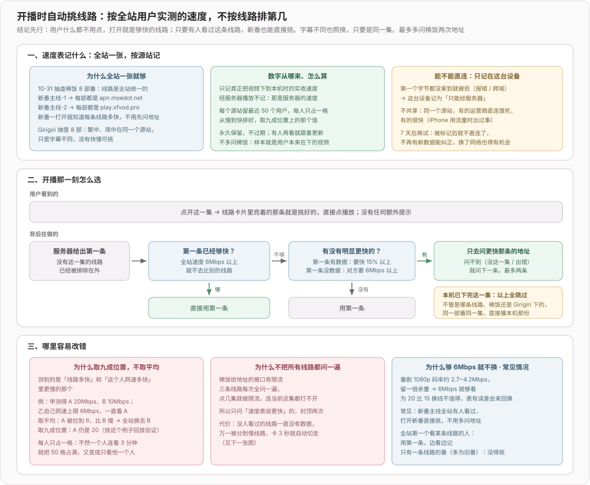
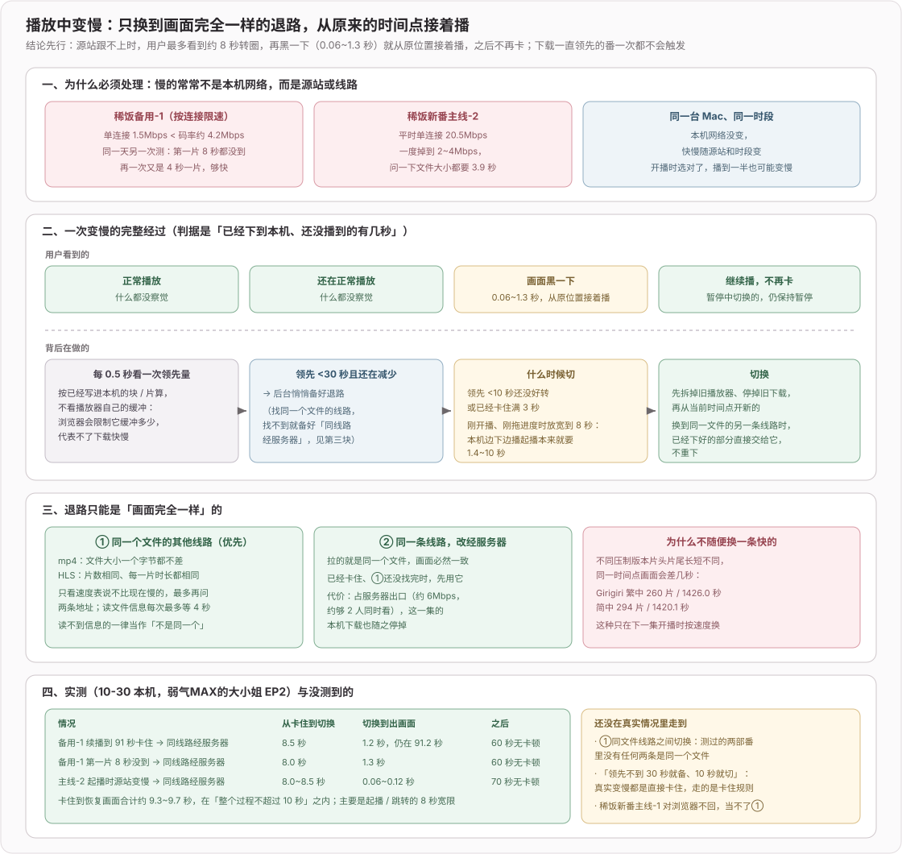
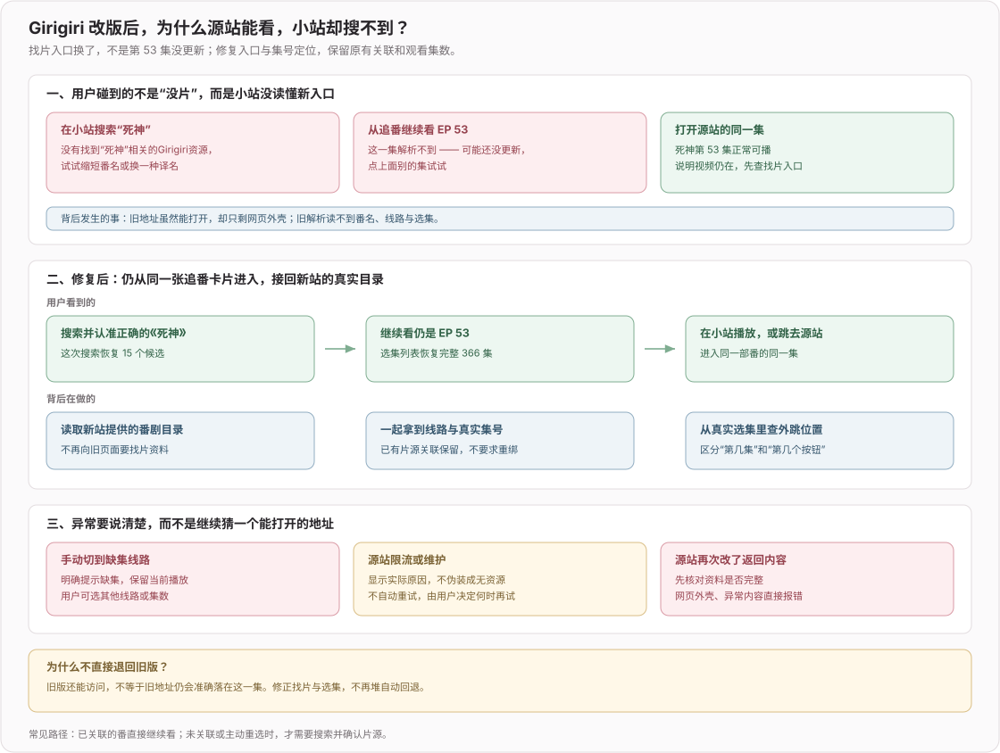
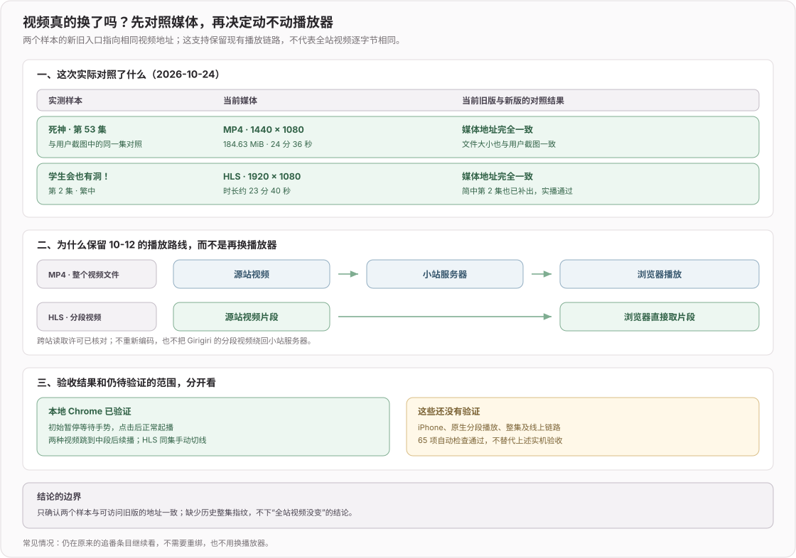
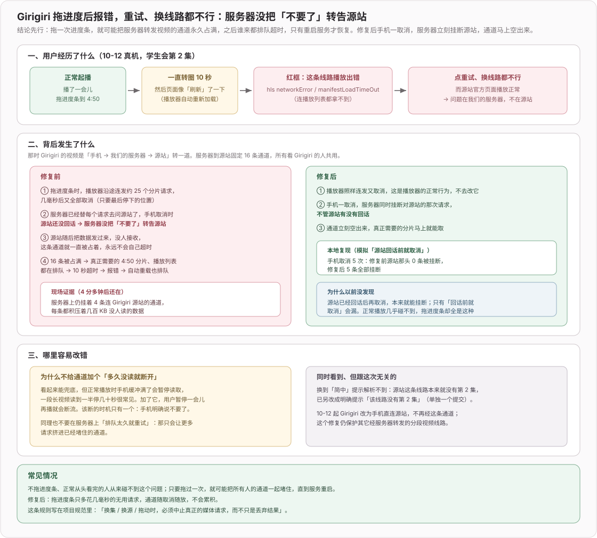
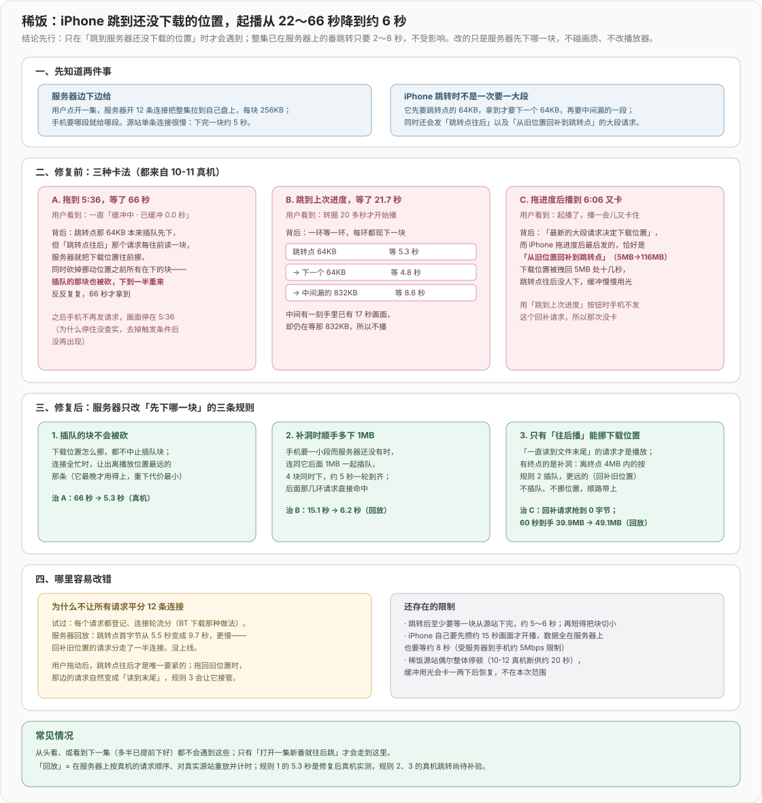
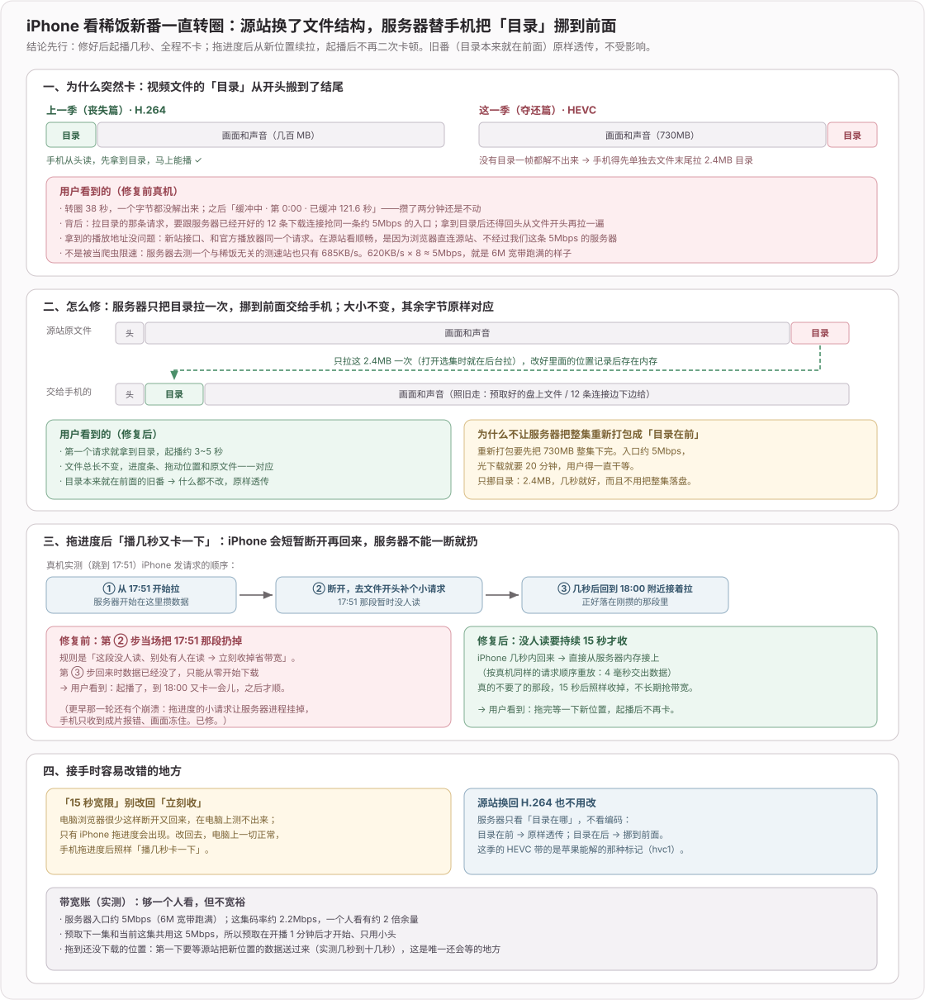

# 在线观看（2026）

> 当前实现与接手顺序见 [011 - 网页版在线观看](../ideas/011-在线观看.md)。这里仅保留近期修复记录与历史入口，新提交仍按 [DEVLOG](../../DEVLOG.md) 规则追加。

## 历史入口

- [截至 09-23 的原专题记录](archive/2026-在线观看-截至09-23.md)：桌面播放器、旧网页直连/救援/预转、09-16 重写、09-17 清理、09-21～23 修复。
- [从网页版专题迁出的早期记录](archive/2026-网页版在线观看-早期记录.md)：07-21 原型、追番绑定、Girigiri、源切换和源站跳转。
- 09-28 新稀饭协议适配见 [原 011 记录](../ideas/archive/011-在线观看-历史记录.md) 开头；并非本次新增的验收结果。

## 2026-10-30 feat(web): 新增本地缓存播放器

**效果**：

1. 在线播放时，浏览器用本机网速直连源站把整集下到本机，播放器读的就是这份正在写入的本地数据，播放和下载只拉一份流；这一集下完立刻接着下下一集，下载不受暂停影响。稀饭新番主线-2、备用-1 和 Girigiri 的 mp4 / HLS 线路都覆盖；稀饭新番主线-1 浏览器读不到，照旧经本站
2. 开播先看本机有没有下完这一集：不管是哪条线路、稀饭还是 Girigiri 下的，同一部番（同站同番，或同一个 Bangumi 条目）同一集就直接播本机那份。整集下完后起播和跳转都在 0.1 秒内
3. 本机没有时自动挑线路：按全站用户实测的源站速度，第一条已够 6Mbps 就直接用，不够才换明显更快的（字幕不同也换，只要是同一集）
4. 播放中下载跟不上时，切到画面完全一致的退路（同一个文件的其他线路，或同一条线路改走服务端），从当前时间点、保持播放 / 暂停接着播
5. 看过的集默认保留 30 天（从最后一次播放算），标了「鉴赏神回」的不清。设置 →「本地缓存」按标题 + 集数列出已缓存的集，显示大小、剩余天数和已用空间，可直接播放、手动删除
6. 断网或本站连不上时，下完的集照样能打开、播放、跳转，并在已下完的集之间切换





**各源站能不能直连**（10-30 本机经代理实测，速度只作相对参考；现在由页面自动判断）：

| 线路 | 源站 | 格式 | 浏览器能否直连读 | 下载方式 |
|---|---|---|---|---|
| 稀饭新番主线-2 / 旧番主线-1 | play.xfvod.pro | mp4 | 能（单连接 20.5Mbps） | 单连接顺序拉 4MB 块 |
| Girigiri | akua.girigirilove.com | HLS | 能（单连接 9.8Mbps） | 同时拉 4 片：一片 0.2~2MB、首字节 1.5~4 秒，一片一片拉只有约 2Mbps |
| 稀饭备用-1 | dl.playxf.top | HLS | 能（单连接 1.5Mbps，6 连接 23.6Mbps） | 一片按 Range 拆 6 段并发 |
| 稀饭新番主线-1 | apn.moedot.net → 联通网盘 | mp4 | **不能** | 网盘见到 Origin 头就 403，浏览器跨域读一定带 Origin |

**数据流**：

```
播放页 ──job(当前集)──▶ 下载 Worker ──直连源站──▶ 源站
                            │ mp4：每满 4MB 写一块 <序号>.bin；HLS：整片到手写 r<序号>，播放表改写成 index.m3u8
                            │ 写完、flush、close（HLS 先写临时名再改名）之后才广播「到了」
                            ▼
                     OPFS media-cache/<sha1(host+路径)>/
                            ▲
播放器 ──/media-cache/<hash>（mp4，按 Range）或 /media-cache/<hash>/index.m3u8（HLS）──▶ Service Worker
                     缺的块 / 片先发 need 让下载器插队，再等广播

下载器每 5 秒的实收速度 ──POST /api/player/line-speed──▶ 服务端 data/line-speed.json（全站一张）
服务端解析出的「稀饭线路 N → 源站」也记进同一张表；播放列表顺带返回各线路的全站速度
```

- 切块 / 按片存，而不是一个大文件：同步写句柄独占文件，SW 在它打开期间读不到；按块写完关闭再广播，读取端只会看到已落盘的字节
- mp4 先下第 0 块和最后一块（moov 在尾部的不用等整集），其余顺序拉；跳进度离当前下载位置超过 3 块就断开重开到目标位置。HLS 从播放器要的那一片往后接着拉，到尾再回头补
- 身份按 host + 路径（不含签名），签名换了也认得出同一集；mp4 总长 / HLS 片数和本地记录不一致就整集重下，防串片
- 重试预算只有一份：HTTP 错误直接失败不重试；只有传输中断（含 20 秒没收到数据）才续传，全集共用最多 3 次，间隔 2/6/15 秒加抖动。失败时同线路退回原来的方式，本页不再用本地缓存
- 换线路时先销毁播放器，再让下载器中止旧任务、开新任务；换集是整页跳转，Worker 随页面结束，进新页从盘上已有的块 / 片续下
- 速度表按源站记，每个源站留最近 50 个用户、每人一格（自己的值按新样本 3 成滚动），取九成位置的值，永久保留；只收服务端自己解析出过的源站，每人 4 秒最多收一个样本。只记稀饭：Girigiri 所有线路在同一个源站
- 「这台设备不能直连某源站」只记在本机 localStorage，7 天后再试
- 离线：SW 把播放页和它的脚本、样式、字体按「先网络、失败才用副本」存一份（最多 60 个播放页）。没开过的集借最近一次的播放页，只换页面参数（和服务端同样校验 src / id / ep）
- 下载日志、测速被拒、本机命中等经播放页的 client-log 回服务端终端

**边界**：

- 页面关掉下载就停，下次打开续下；iOS 切到后台会挂起；Safari 7 天没打开的网站数据可能被系统清掉，iPhone 上 30 天保留只能尽量做到。iPhone 真机尚未验证 Safari 的 <video> 和原生 HLS 请求是否经过 SW，不经过时会出错并退回原方式
- SW 还没接管播放页（第一次打开网站、隐私模式）或没有 OPFS 时完全走原方式；剩余空间不够时不下（mp4 按整集 + 64MB，HLS 按第一片估算）
- 本机到源站带宽低于码率时只能部分缓解；网络抖动连续中断 3 次后这一集不再下
- 没人看过的线路一直没有速度数据；全站速度和某个运营商下的实际速度可能不一致，分错时靠播放中切换兜底
- 同一文件线路之间切换、「领先不到 30 秒就备、不到 10 秒就切」都还没在真实环境触发过：测试用的番里没有两条线路是同一个文件，几次真实变慢都是直接卡住
- 不同压制版本（Girigiri 繁中 260 片 / 1426.0 秒、简中 294 片 / 1420.1 秒）同一时间点画面差几秒，一集中途不切过去
- 本机已下完的那份坏了：先等最多 45 秒（SW 等缺的块），再回到正常挑线路
- 切换会重建播放器，画面黑一下；退到服务端吃服务器出口（约 6Mbps，约够 2 人同时看），这一集的本地下载会停掉；一次页面里每条线路只会被切走一次
- 离线只覆盖播放页：追番、设置等主页面断网打不开；离线壳里存着最近一次播放页的监控配置（含当前账号），换账号后断网打开会带着旧账号上报，联网后即刷新

## 2026-10-24 fix(web): 适配 Girigiri 新版搜索与播放入口



**效果**：Girigiri 新站改版后，网页版搜索、线路、选集和“跳去源站”恢复可用。搜索《死神》返回 15 个候选，从追番继续看仍进入第 53 集，选集列表恢复 366 集；已有片源关联和观看集数保留，不要求重新绑定

**原因与关键决策**：

- 源站从 MacCMS 页面换成独立前端，旧地址虽返回 HTTP 200，内容却只有网页外壳。继续按旧 HTML 解析，会把“没读到资料”误报成“没有资源 / 可能没更新”。改读新站公开的搜索、详情和周表接口，异常内容明确报错，不再吞成空结果
- 保留原 `GV…` 绑定，只在请求新站时取数字编号。选集按标签认真实集号，再查新站外跳所需的零基线路 / 选集位置：死神第 53 集对应 `sourceIndex=0&episodeIndex=52`，不拿“第几个按钮”代替集号。手动切到缺集线路时保留当前播放；外跳缺集明确报错，不猜第 1 集，也不自动退回旧版
- 同一部番的线路与选集一次取全，详情缓存 30 秒、并发请求合并；周表一次取七天，缓存 6 小时。搜索按实际分页取齐并去重。限流、维护和业务错误保留各自原因与 code，不自动重试、不周期探测



**视频对照**：当前可访问旧版与新版给出的死神第 53 集 MP4、学生会第 2 集繁中 HLS 地址分别完全一致；死神文件仍为 184.63 MiB，与用户截图一致。学生会简中第 2 集现已补出并实播通过，不把 10-12 的缺集记录固定成今天的结果。此次只修找片入口与选集定位，保留 10-12 的 Girigiri HLS 浏览器直连，MP4 仍经本站；不换播放器、不重新编码

**边界**：尚未部署；iPhone 真机、原生 HLS、整集及全站目录仍待验证，桌面源与下载器未改。本次媒体对照限两个样本与当前可访问旧版，缺少 10-12 历史整集哈希，不据此断言“全站视频没有变化”

## 2026-10-12 chore(web): 拖进度时不再把播放器取消的分片请求记成失败

**效果**：经本站转发的分段视频，播放器自己取消的请求（拖进度时成批发出又取消）不再在错误日志里留下「[player] seg 失败: Error: aborted」，只有真正的源站失败才记。此前拖一次就可能连着二十几行，像是源站出错。

## 2026-10-12 perf(web): Girigiri 改为直连播放

**效果**：Girigiri 的播放表和分片由手机直接从源站取，不再经本站转发。真机同一时刻、同 3 片（1.6MB）对比：直连 6.2Mbps / 首字节 191ms，经本站 4.0Mbps / 332ms。本站出口约 5Mbps，追不上片中 7～9Mbps 的高码率段（10-12 学生会 2 集 11:04 卡 38 秒）。

**边界**：只走直连这一条，不探测、不回退到经本站（避免回到 09-17 前「多路径 × 多回退」）；直连失败显示原因 +「重试」。依赖源站允许本站跨域（`Access-Control-Allow-Origin` 回本站域名），源站改这条就会整源不可播。稀饭仍经本站（部分源站见 Origin 头就 403）。

## 2026-10-12 fix(web): girigiri换到没有这一集的线路时明确提示

**效果**：点到没有当前集的线路（如 Girigiri「简中」没有第 2 集），不再显示「线路 2 解析失败：此线路解析不到…」和无用的「重试」，改成「「简中」没有第 2 集，请选其他线路，当前继续播放「繁中」」；该线路卡片右侧标「没有第 2 集」，再点直接给同一提示、不再请求。

## 2026-10-12 fix(web): 修复 Girigiri 拖进度后报错、无法重试和换线路



**效果**：Girigiri（HLS）拖进度条后不再报 `fragLoadTimeOut`，之后重载也不会一直 `manifestLoadTimeOut`。

**原因**：拖进度条时 hls.js 会一口气发出又取消几十个分片请求。服务器转发分片时没把「播放器断开」传给源站请求，源站还没回头就被取消的那些，响应回来后没人读，连接一直挂在转发用的连接池里（不设读取超时）。16 条占满后，新分片和 m3u8 都排队到 10 秒超时；之后重试同样排队，只有重启服务才恢复。真机现场：拖到 4:50 后报错，4 分钟后服务器上还挂着 4 条连 Girigiri 的连接，各积压几百 KB 没读。本地复现：源站回头前断开 5 次，修复前上游一条没关，修复后全关。

**边界**：换「简中」线路时提示「此线路解析不到」是源站这条线路没有第 2 集，不是这次的问题。

## 2026-10-12 fix(web): 修复稀饭 iPhone 跳转进度后无法起播



**效果**：跳转到还没下载的位置（拖进度条或「跳到上次进度」），服务器按真机请求顺序用真实源站回放：

| 场景 | 修复前 | 修复后 |
|---|---|---|
| 跳到上次进度，起播要的三段到齐 | 15.1 秒（真机 21.7 秒） | 6.2 秒 |
| 拖进度后，「回补旧位置」的请求 | 把下载拽回旧位置十几秒 | 不再抢下载位置 |
| 拖进度后往后播放，60 秒到手 | 39.9MB | 49.1MB |

更早一版（66 秒才回第一个字节、画面停在 5:36）的成因也在这里：插队的块被游标挪动反复中止。

**原因与规则**（`web/server/xifan/disk.ts` 的 `GAP_BYTES` / `READAHEAD_BYTES`）：

```text
iPhone 跳转后：64KB → 等回来 → 下一个 64KB → 等回来 → 中间漏的 832KB    一环等一环，每环都要现下一块（约 5 秒）
               跳转点往后（读到文件末尾）
拖进度条还多一个：从旧位置回补到跳转点（5MB → 116MB）

规则 1：读到文件末尾的请求 = 正常播放，只有它挪下载位置
规则 2：有终点、离终点 ≤4MB 的请求 = 补洞，连同其后 1MB 插队一起下（4 块并行，一轮到齐），插队块不被挪位置中止
        离终点更远的（回补旧位置）不插队、不挪位置，等顺序下载顺路带上
```

faststart 把「读到虚拟文件末尾」也按「读到末尾」转给盘上缓存（原来会变成有终点的区间），否则规则 1 认不出播放请求。

参考：libtorrent 流媒体按播放位置给后续块设截止时间（<https://www.libtorrent.org/streaming.html>），rclone 的 `--vfs-read-ahead` 读不到时连同其后一段一起取。

**边界**：

- 跳转起播仍要等一块（256KB）从源站下完，约 5~6 秒；更短要把块拆小，没做
- 这集码率 2.3Mbps，服务器从源站拉约 5.4Mbps，往后播放余量约 2 倍；码率再高或多人同看时余量更小
- 服务器每 5 秒打一行 `[xifan:disk] … 进度`（入口速度、下载位置、各请求的位置和领先），只在有集正在被看时打

## 2026-10-10 chore(web): 清理播放代理里服务器转码留下的旧代码和注释

**效果**：行为不变。删掉 `stream.ts` 里只给已删除的服务器转码（预转）和慢源名额用的旧接口：`INTERNAL_TOKEN`、`externalViewerCount`、`evictStreamViewer` 及读取端的 `internal` / `viewerKey`，`serveStream` 只剩「地址、Range、是否本站签名」三个参数；讲「预转 / ffmpeg」的注释改成现在的说法，免得读者以为服务器还在转码。网页版播放全程不转码、不降码率，服务器只原样转发字节，尾部 moov 的片源额外把目录挪到文件开头（只改目录里的偏移，不动音视频数据）。

**为什么当初不转码了**：预转 HLS 存在的唯一理由是 08-21 测到「VPS → 手机单连接 2.2Mbps < 码率 2.67Mbps」。09-16 重写播放页前重测单连接约 4.9Mbps、178 秒无卡顿，转码的前提不成立；而旧链路「四条路径 × 三种回退 × 桌面 / 触屏两套判据」太复杂、太容易出错,在 iOS 上累计了 11 个 Sentry issue,没人能预料某次点击会走哪条路，09-17 连同慢源名额一起删除。见 [播放页重写方案](../design/播放页重写方案.md) 第二、三节与 [011](../ideas/011-在线观看.md)。

## 2026-10-10 fix(web): 修复手机家宽看番一直缓冲不起播

**效果**：iPhone 在家里移动宽带 WiFi 下，到服务器的速度从 0.53Mbps 升到 4.69Mbps（视频码率约 1.2Mbps）；43 集起播约 5 秒、全程不卡，拖进度等 3~7 秒后不卡。同时撤掉上一条加的「推一把」（卡住时原地 seek、再 pause/play）：它在 iPhone 上表现为加载中突然跳回播放按钮、再点又转圈，且治不了数据不够（fill≈0.3x）的真因。`fill` 下载速度上报保留。

**原因**：同一台手机用流量 5.6Mbps、连境外测速点 19.6Mbps，只有家宽直连香港服务器 0.53Mbps。服务器 TCP 用默认 cubic，跨境线路晚上丢包重（单连接重传 100+），一丢包就把速度砍半。改用 BBR 按实测带宽发送，丢包不再降速。BBR 是服务器系统设置、不在代码里，命令写进 [部署教程](../web/唐人云部署保姆教程.md)「新机器必做：开 BBR」，迁移 / 重装必须重做。

```text
cubic：丢包 → 速度砍半 → 再丢 → 再砍 → 0.5Mbps < 码率 1.2Mbps → iOS 不起播
BBR  ：按测到的带宽发，丢包不砍 → 4.7Mbps（≈ 服务器出口上限 5.4Mbps）
```

**边界**：

- 现在约 4.5Mbps 是服务器出口上限，不是手机上限；两三人同时看还够，再多要换更大带宽的机器（新机器同样要开 BBR）
- 拖到还没下载的位置仍要等 3~7 秒，取决于源站速度

## 2026-10-10 test(web): iPhone 缓冲很久也不起播

**效果**：

1. 播放中「没暂停、手里已有 ≥6 秒画面、画面却 3 秒没走」时推一把：先原地 seek 一次，8 秒还不走再 pause/play；每次卡顿最多两下，不碰网络、不换线
2. 胶片和 qos 多了 `fill`（每秒缓冲区多出几秒画面，≥1 才跟得上）、`fillLow`（低于 1.2x 的采样数）、`kicks=推了几次/推成几次`
3. 服务器 nginx 访问日志改用 `timed` 格式，带 `rt=`（整条请求耗时，含发给手机的时间）和 `range=`，`字节 / rt` 就是真实到手速度（配置在服务器 `/etc/nginx/nginx.conf`，备份 `nginx.conf.bak-20261010`）

**原因**：2026-10-10 20:11 iPhone 开 43 集，整集早已在盘、Node 1 秒内交给 nginx，但 nginx 日志显示 108 秒只发到手机约 17MB（≈1.3Mbps，码率约 1.2Mbps）。iOS 判断「下得只比播得快一点」就一直等：胶片 rs=3、没暂停、缓冲 22→44 秒，100 秒停在 0:00。同时段 girigiri 只有 0.5Mbps；当晚 21:30 复测同运营商整链路 4.1Mbps（在盘）/ 2.7Mbps（未缓存），服务器出口总上限约 5.4Mbps、预取下载不占出口。

**边界**：

- 推一把只能救「下载略快于码率」；到手速度低于码率时仍会卡，只有低码率档能解决
- 推一把在 iPhone 上是否有效以线上 `kick worked` / `kicks=` 为准，未在真机复现过
- `fill` 在整集缓冲满后不再采样

## 2026-10-06 fix(web): 修复播放缓存泄漏文件句柄

**效果**：上线后日志出现 `DeprecationWarning: Closing a FileHandle object on garbage collection`——盘上缓存的读句柄有没关的。两处补上：播放器在句柄打开途中断开时，打开后立刻关；整集在盘的响应改成第一次读才开句柄，浏览器一个字节没读就断开时不再留下句柄。长时间运行不再靠 GC 回收文件描述符。

## 2026-10-06 feat(web): 播放卡顿汇总上报 Sentry

**效果**：

1. 每台播放器（换集 / 换线 / 离开页面 / 切到后台时）结算一次：卡了几次、累计多久、最长一次、打开到播放按钮可点（ready）、点播放到画面走起来（startup）、跳进度后的等待（seekWaits，单独算，不混进「卡顿」）
2. 每次都打一行 `[player:client] qos …` 到服务端终端；有卡顿、ready > 15s、startup > 10s 或单次 seek 等待 > 10s 时再报 Sentry，消息固定为 `playback qos`（聚成一个 Issue，数字在 extra 里），PC 上几秒的短卡也看得到——原来只有卡满 20 秒才报
3. 断网进入「等网络恢复」时打一行 `offline t=…`，之后的同线路重挂不再查无来由

## 2026-10-06 fix(web): 修复PC网页播放起播后反复卡顿

**效果**：

1. 稀饭 mp4 点开就由服务器 12 条连接按顺序整集下到盘上，播放器要哪段从盘上答；源站合计速度高于码率时，起播后一路不卡，往回拖、拖到已下过的位置即时
2. 拖到还没下的位置：12 条连接全部转去新位置（旧位置在飞的块当场中止），攒够 1.5MB 连续数据再出第一个字节，之后不再卡；VPS 实测死神 39 集（311MB）拖到 11:40 等约 10 秒，之后一路顺
3. 整集下完后再打开 / 换签名重开都直接用盘上那份，目录（moov）也从盘上读，播放按钮不再等源站
4. 下一集预取共用同一套下载：只在没有「正在被看且没下完」的集时才拿连接，当前这集下完（实测一集约 5 分钟）之前完全不动；每人只保留最新一个预取，换番即撤

**原因**：2026-10-06 VPS 实测源站单连接只剩约 57KB/s（12 路合计约 650KB/s，这集码率约 154KB/s），512KB 一块要 9 秒、完成顺序乱。旧的内存滑窗在开头为了快起播不设闸，第一块一到就开播、下一块晚几秒才到，就是「播 1~2 秒卡几秒」；拖进度后的闸最多等 6 秒同理。不是修移动端引入的。

```text
/playlist ──▶ warmDisk：探长度，12 路从 0 起拉 256KB 块 → DATA_DIR/prefetch/<身份>.mp4.part
/stream ──▶ faststart 映射 ──▶ serveFromDisk
              │  整集在盘 ─────────────▶ 直接读文件
              │  大 Range（新位置）────▶ 挪游标、中止别处在飞的块 → 等「连续 1.5MB」(≤20s) → 边写边读
              │  小 Range（≤1MB 探测）─▶ 只插队要那几块，不挪游标
下载优先级：正在被看的集（2 分钟内有读取）> 预取的下一集
```

**关键代码**：

- 媒体身份去掉签名参数（`disk.ts mediaKey`）：签名一换就当新文件的话，整集在盘也会重下一遍（测试实测第 40 集重开又「开始落盘 174MB」）。换签名后第一次复用在后台核一次总长度，对不上删掉重下

```ts
export function mediaKey(url: string): string {
  const u = new URL(url)
  return u.host + u.pathname
}
```

- 只有最新的大 Range 能挪下载游标（`latestReader`）：PC Chrome 拖进度后旧连接还挂在旧位置等数据，两边都能挪游标就来回抢，新位置攒不起领先
- 重试预算一份、按时间算：4xx/5xx 立即整集作废并把原因交给播放器；传输中断的块冷却 3 秒换连接再拿，连续 60 秒一块都没成才判源站不通（`TRANSPORT_GIVEUP_MS`）

**边界**：

- 拖到未下位置的等待由源站速度决定（约「一块的耗时 + 攒 1.5MB」）；源站合计速度低于码率时仍会卡，这是物理下限
- 服务器 → 观众还受 VPS 出口约 6Mbps 限制，整集在盘时拖进度画面动起来也要 2~5 秒（测试经 SSH 隧道实测）
- 未完成的 `.part` 不跨重启（「哪些块已到」只在内存）；超过 1.5GB 或探不到长度的文件仍走 `stream.ts` 内存会话
- 旧预取按整条 URL 哈希存的文件认不出来，按 4GB 回收目标自然淘汰

## 2026-10-03 fix(web): 修复移动端站内播放稀饭动漫不起播



**效果**：iPhone Chrome 在站内看稀饭新番（实测 Re:Zero 第四季 夺还篇）起播约 3~5 秒、全程不卡；拖进度后从新位置续拉，起播后不再二次卡顿。目录本来就在文件开头的旧番原样透传，不受影响

**原因**：这一季的 mp4 把目录（moov）放在 730MB 文件的末尾，上一季在开头。手机没有目录解不出任何一帧，得先单独去文件尾拉 2.4MB，这条请求还要跟服务器已开的 12 条下载连接抢约 5Mbps 的入口。播放地址本身没问题：用的是新站 `issue-web-playback`，和官方播放器同一个 `fallback` 请求

**关键决策**：

- `web/server/player/faststart.ts`：目录在尾部时，服务器把尾块只拉一次，给 `stco/co64` 里每个块偏移加上尾块长度，放到 mdat 前从内存答；其余区间偏移减尾块长度，映射回原文件，底下照旧走预取盘 / 12 路会话。文件总长不变，拖动位置一一对应。拉 playlist 时就在后台拉尾块
- 底层会话不认 Range 终点、总吐到原文件末尾，也就是已经挪走的尾块，所以映射层要按长度截断。透传分支交出的是 undici 的 Node 流（只是类型写成 Web 流），要先 `Readable.toWeb` 再读。第一版没转，真机拖进度时抛错，留下一条没人消费的上游响应；源站断开连接时进程崩溃，手机只收到成片 502
- `web/server/xifan/stream.ts`：区间没有读取端要持续 15 秒（`ABANDON_GRACE_MS`）才收。iPhone 拖进度后会断开、去文件开头补一个小请求，几秒后在原位置附近重连。原先「没人读、别处有人读就立刻收」会丢掉刚攒好的区间，实测跳到 17:51、到 18:00 卡一下
- `/api/player/stream` 每条请求结束打一行 `[player:req] range= status= first= sent= end=`，用来还原手机的请求顺序，在本机按同样顺序重放复现（`docs/web/网页移动端问题复现调试通用指南.md`）

**边界**：

- 服务器入口约 5Mbps（6M 宽带跑满；去测与稀饭无关的测速站也是 685KB/s，不是被源站限速），这集码率约 2.2Mbps，一个人看约 2 倍余量；预取下一集共用这条入口
- 拖到服务器还没下载的位置时，第一下要等源站送来新位置的数据，实测几秒到十几秒
- 解析失败时 60 秒内按原文件透传；`stco` 加偏移溢出 32 位时同样放弃改写
