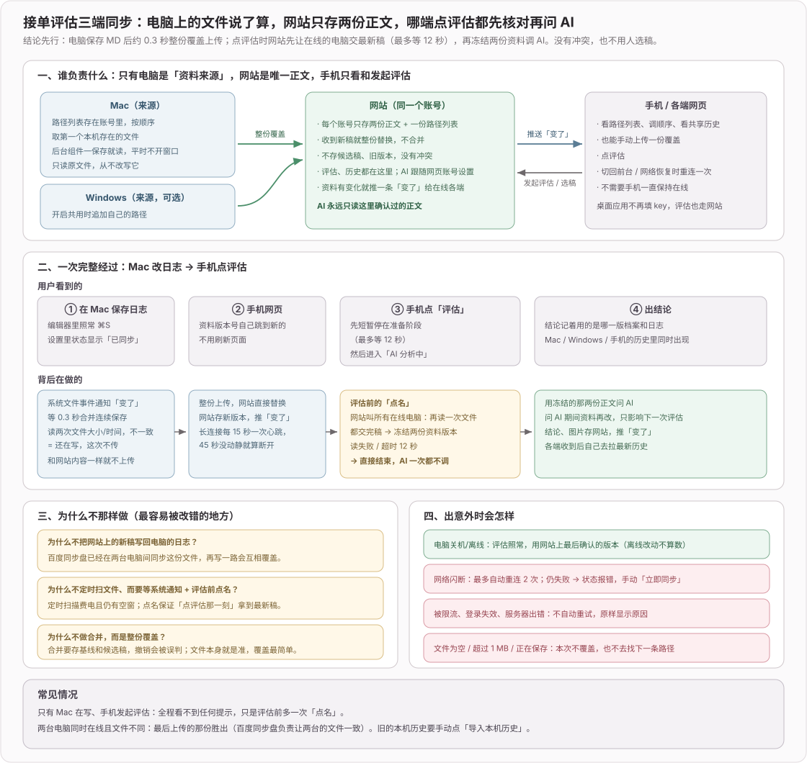
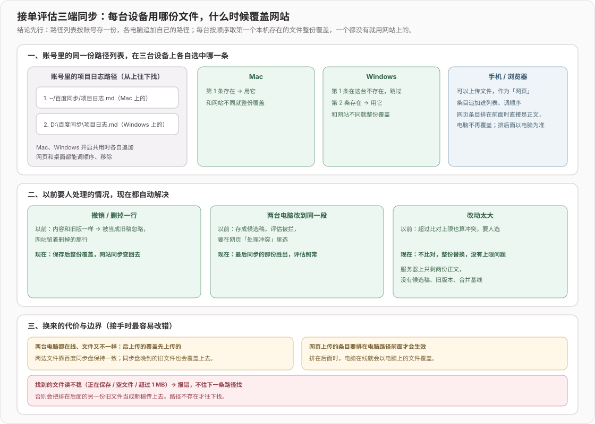

# 2026 接单评估

## 2026-11-09 fix(order-judge): 流程图改成可缩放平移的画布

**修改后效果**
- 流程图每一层固定一行，不再因为一层放不下换到下一行；放不下就整体缩小适应宽度，开发者侧编辑时右上角有「还原」
- 放大：滚轮加 Ctrl（Mac 是 ⌘）；平移：拖空白处；动过之后不再自动适应，双击空白处恢复；触屏不能缩放和平移
- 所有连线常驻：每个功能连到上一层最近前置的是实线，跨层或多个来源的次要线是更细更淡的虚线；悬停某个功能时它的线加粗，其余变淡；A→B→C 已成立时不再另画 A→C
- 「按模块填实际小时」改成整行列表：需求名占满左边自动换行，输入框和「小时」靠右对齐，手机宽度下同样一行

**关键决策**
- 上一版想「次要线悬停才画」，离开就消失，实测不好用；真正乱的是同一层换行后多出的横向通道，换成每层一行就不需要藏线了
- 画布缩放用整块 transform，连线测量时把屏幕坐标除以缩放比换回舞台坐标；拖节点、拉线同理
- 节点最宽 220px，长标题自己换行，避免一层被撑得太宽导致缩得太小

**边界 / 风险**
- 某一层节点很多时整体会缩得较小，需要放大看字；缩放下限 30%，上限 250%
- 触屏不能缩放和平移，窄屏只能看自动缩小后的样子；浏览器里没实测，只过了类型检查、算法测试和构建（内置浏览器连接超时，本机没装 Playwright）
- 长跨层连线仍会从中间层节点的缝隙穿过

## 2026-11-09 feat(order-judge): 成交后可按模块填实际小时，校准改为汇总全站项目，流程图去掉多余连线

**修改后效果**
- 成交后「做完后填」多一栏「按模块填实际小时（可选）」，每个要花时间的需求一行，占位显示 AI 估的小时；不填照旧，只填整类用时也行
- 填了的模块直接当这条的实际，没填的分整类实际扣掉已填后的余量；每个要花时间的模块都填了而整类留空时，合计当作整类实际；只填一部分不会被当成整类
- 时间值、小时系数、各类工作的修正（确认 / 验证 / 接手 / 上线）改为汇总所有用户的项目来学：每类客户最近动过的 50 个项目，不再只看自己的。「系统目前学到了什么」里的单数是全站的
- 每个人仍只能看到自己的项目；给 AI 的「历史条目经验」仍只用自己账号的条目标题；不愿贡献的项目整个不进汇总
- 流程图：A→B→C 已经成立时不再另画 A→C，中间的功能没选才保留（那是真缺东西）；没悬停时线条淡一些，悬停某个功能时该功能的线加粗，线多时靠这个看清谁连谁

**关键决策**
- 汇总在服务端做，只把算出来的时间值、系数和说明发给前端，别人的项目数据不下发；汇总只读版本里的清单和报价，不含原文、图片、附件和标题
- 结果缓存到任何人保存为止（最长 10 分钟），保存后下一次打开就包含新数据；汇总取最近更新的 1000 个项目的版本
- 按模块实际只影响「条目级」的学习（每类工作的小时修正、给 AI 的经验），整类小时系数仍用整类实际；这样不会因为只填了一个模块就把整类系数拉偏
- 画线只做视觉去冗余，冲突检查仍用完整依赖，客户去掉前置功能时仍标红

**边界 / 风险**
- 前端优先用服务端的汇总，没有时（桌面端）仍只用本机项目，桌面端没改，也没有按模块填的输入框
- 目前用户很少，汇总和个人结果几乎一样；人多后一个人的极端数据会被中位数摊薄，但「最近 50 个」按全站时间排，活跃用户会挤掉别人
- 样本不分行业，所有人的小时共用一套系数；如果接单类型差别很大，要再按项目类型分组
- 流程图只验证了类型检查和构建，没在浏览器里看实际效果；浏览器回归需要 Playwright，本机没装
- 新提示词和汇总没用真实多用户数据验证

## 2026-11-09 feat(order-judge): 流程图可拖动连线，单项工时可直接输入并限 7 天

**修改后效果**
- 客户确认页的流程图：拖节点换位置，从节点底部圆点拖到另一个节点加一条「要先有」，点线删掉，右上角「还原」恢复；手动加删的线参与「需要先有…」的冲突检查，只在当前页面有效，刷新还原，不随提交发送
- 整理需求时，同一件事要在多个分身、窗口里各做一遍只写一条，数量写进标题，不再每个分身各列一份串进流程
- 报价状态「已报价」下，客户结果多一项「同意」，只做记录，不改状态、不进校准统计
- 成交后回填的两栏改名：「从零做的部分用时」「验证和改旧代码用时」
- 单项工时：滑块固定 0～7 天（56 小时），数字可点开直接输入；到 7 天时提示「建议把合作方式改成长期」

**关键决策**
- 单项上限统一用 `ITEM_MAX_HOURS`，滑块、输入框、整体倍率、保存校验共用一个值；原先滑块上限 `max(16, AI 估计 × 3)` 会让小项被卡在 2 天
- 整体倍率是按 AI 估计相乘，AI 估 0 小时的条目放大后仍是 0，这是原有口径，没改
- 流程图拖动用 transform 位移，连线继续靠量 DOM 重新走线，所以拖动后自动避让

**边界 / 风险**
- 基础 / 推荐 / 完整三档仍在，报价条还显示「基础档」，是否改成一口价待定
- 分身去重只改了提示词，已有清单不变，没用真实 AI 验证
- 流程图拖动没在浏览器里实测；开发者侧流程图仍只读
- AI 原始估计超过 7 天的条目，没动过时报价仍按 AI 原值算

## 2026-11-07 feat(order-judge): 客户可通过链接确认需求，长期项目改按月固定费

**修改后效果**
- 整理后先进需求阶段：只看多个互斥方案（选一条路，不是分期或大小档，方向已定时只给 1 个方案）、流程图和要问的问题；客户确认或你直接选定方案后，才出现必须 / 不做 / 不包含和估价
- 项目里可生成免登录链接发给客户：客户选方向、勾选功能、看功能怎么连起来、自己加需求、回答问题后提交；看不到价格和小时
- 客户去掉前置功能时流程图标红，写明缺什么，可一键补回，也可以照样提交，开发者这边看得到冲突
- 开发者点「按这份生成新版本」后，确认项转必须、没勾的进不包含，报价只出一份范围
- AI 判断项目是一次性还是长期，开发者可覆盖；长期单不报总价，月费 = 每月投入小时 × 时间值 + 支出，客户版写明第一个月交付什么；没有依据时按清单小时摊 3 个月给粗估

**关键决策**
- 客户文字不可信：id 只认这一版清单里的，AI 只估新增条目和吸收回答，范围由程序确定，改不了
- 清单出新版本后旧链接作废；AI 估算期间客户又提交时拒绝应用，不用旧内容覆盖
- 详见 [022](../ideas/022-客户确认需求与长期合作.md)

**边界 / 风险**
- 方案、依赖、合作方式的提示词没有用真实 AI 验证，只跑过夹具
- 链接不进备份，恢复备份会丢掉未应用的客户提交
- token 在接口路径里，会进 nginx 访问日志
- 只改网页版，桌面端不显示新面板
- 层内换行时连线可能从节点背后穿过

## 2026-11-05 fix(order-judge): 实际报价填 0 保存后不再消失

**修改后效果**
- 实际报价填 0 并保存后，输入框保留 0，报价单也按 0 出价，不再回到「默认 50」的占位状态

**关键决策**
- 原因是归一化把 0 当成空值写成 null；现在只有留空才是 null，算报价单时也用「是否为 null」判断，不再用真假判断
- 桌面端共用同一份归一化，一并生效

**边界 / 风险**
- 没跑 `test:order-judge-quote`（环境未装依赖），也没有为 0 补专门用例

## 2026-11-05 fix(order-judge): 论文和读代码不再按人工时估，时间值统一从 67 起步

**修改后效果**
- 论文、报告这类纯文档单，每章都算 AI 直接写好，只单列一条人工核对，整份 0.5～3 小时；真实 AI 回测同一份论文单从约 29 小时、¥2,430 降到 3～5 小时、¥260～¥420，实际是 3 小时，报 ¥288，成交 ¥200
- 改别人代码时，AI 读代码和修改都不计时间，只算环境、问规则、回归验证这些人绕不开的部分；标签改成「旧系统里要人做的」
- 所有客户类型的时间值起点从 31 / 267 统一成 67；同一份团购需求的回测报价从 ¥8,770 降到 ¥3,650
- 保修和售后答疑不再单列条目

**关键决策**
- 67 来自目前唯一的真实成交（¥200 ÷ 3 小时，开发者觉得值），这单只用来定起点，不进行情样本
- 宁可从低处起步：报低了做完选「亏」能抬上去，报高了客户直接走人，要嫌贵满 3 单才会压价

**边界 / 风险**
- 67 只来自一单学生论文，商单很可能偏低，要靠成交后回填修正
- 回测用的正是调提示词时看的那一单，不算独立验证；其他文档单和代码单是否准确要等新单子
- 「保修不单列」没有用真实 AI 重跑；论文单 AI 仍常把 kind 标成接手改，时间值统一后暂不影响价格，以后两档拉开时论文类的核对时间可能按高价算
- 算法测试仍用 31 / 267 两档，才测得出新做和接手有没有算混

## 2026-11-04 feat(order-judge): 小时可用滑块调整，客户版按判断分项列价

**修改后效果**
- 新增同类行情：AI 给每单标项目类型，成交和客户拒绝的结果匿名进样本库；同类型同客户类型近一年凑够 3 单才显示「多数在 ¥X ～ ¥Y」，不够时明说是粗算
- 用户的项目不再自动删除（原来超过 50 个会删最久没动的），校准只用最近动过的 50 个
- 相邻两档价差不到 1 成时合并成范围大的那档；自用版开头去掉时间值来源，移到「系统目前学到了什么」；算法全貌见 `docs/web/接单评估算法说明.md`
- 校准不再被单笔带偏：亏和值取中位数；客户嫌贵攒够 3 单会压低时间值，和亏冲突时取中间；小时系数攒够 3 单才生效
- 新增实际报价：填了就只报这一个价，分项按比例摊；已报价或已成交时可选不贡献，默认匿名贡献
- 报价区顶部实时显示各档价格，默认不用动就能出价；一根「整体」滑块（× 0.5～2）缩放全部小时，单项滑块只露出占钱 80% 的条目，其余收起，拖过的一直露出，8 小时起按天显示，可一键恢复 AI 的估计
- 需求清单不再显示小时，小时只在滑块里看和改；离开草稿后滑块锁定
- 每条需求标出小时花在哪：确认 / 验证 / 接手 / 上线 / 直接做。客户版把「交付」拆成需求确认、可行性验证、接手旧代码、上线保障分项列价，加起来等于报价，仍不露小时；只有最低收费时仍叫「交付」
- AI 整理时：涉及收钱、真实用户数据、第三方额度、数据迁移、高峰流量的，必须单列上线条目；对客户在意的结果没帮助的，优先级不高于「可以」
- 验证可行性改按接手改的高时间值（默认 267）算，确认和上线仍按 31；直接能做的再多也只收最低收费，价差来自要验证多少
- 保存滑块后，小时系数以最后保存的值为校正样本，没拖的条目算认可；没拖就报出去也算一次认可，未处理的草稿不算；做完填了实际小时的以实际为准
- 每天投入默认改为 8 小时；不常用的设置收进「更多设置」，已填过的打开时展开
- 修复：追加版本没有任何变更时，变更单也收 ¥50 最低收费

**关键决策**
- 依据文章第三条和 Shopify 说 AI 没改变的三个难题（做什么、为什么值得做、怎么在真实用户面前站得住），口径见 `docs/ideas/021-接单评估重新定位.md`「滑块与判断分项」
- 拖的值存在每版的报价设置里，不改 AI 的清单，恢复和比对都有原值；拖过的小时不再乘历史系数；每个项目只算一个样本，没拖的条目算认可
- 变更单从空白设置开始，AI 小时没变的条目沿用成交时调定的小时，否则调低过的条目会被重复收费

**边界 / 风险**
- 新提示词没用真 AI 跑过，判断分类和上线条目的质量未验证；测试用的是假 AI
- 样本只含类型、价格、结果、预算和月份，与账号不可关联；用户删项目时样本一起删，注销账号时匿名样本保留
- 上线初期没有行情，所有价格都是粗算；目前只有开发者一人使用，行情就是自己的历史成交，以后有其他用户再考虑人数门槛
- 价格很依赖 AI 把哪些小时标成验证，没用真 AI 验证过；267 来自假设题，要靠成交回填修正
- 老项目的每天投入仍是保存时的值，判断分类按小时、接手、未说清推断
- 桌面版只过了类型检查，没在真机 Electron 里点过

## 2026-11-04 feat(order-judge): 报价改按要想多久计价，客户类型手选，新增工期和最低收费

**修改后效果**
- 整理前先手选客户类型（商单 / 学生单 / 个人单），选择会记住；没选就提示「先选客户类型」，不再由 AI 猜
- 小时只算「人要花的时间」，不算写代码：直接能做的功能 0 小时，需求没说清要确认、要先验证可行性、要读懂别人旧代码才计小时。三个直接能做的功能只收最低收费 ¥50，三档价格一样时只留范围最大的一档
- 学生单、个人单没有兜底，14 天保修照给，报价单写明不另外收费；商单保持原样
- 新增工期：各档总小时 ÷ 每天投入（默认 4 小时，可改）得出预计几天；填了截止日（材料里的「12 月 20 日」「明天」会自动读成日期，也可手填）就逐档判断来不来得及，赶不上时指出哪一档能赶上。客户版只写「预计 N 天交付」，不加急加价
- 去掉「不找你会怎么办」；「预算」改叫「客户预算」
- 追加需求后输入区收成一条，需求清单和报价并排显示，不再左侧大片空白
- 修复上一次提交（eb898af）遗漏的桌面端错误卡片：它仍引用已删除的 `openWeb`，桌面端编译不过，现已去掉那个「去网页版设置 AI」按钮

**关键决策**
- 口径来自开发者 2026-11-04：AI 写代码、处理边界和安全近乎零，真正的成本是想清需求和验证可行性；功能可行后实现是秒级的。所以价格跟着「要想多久、多不确定」走，简单需求只象征性收费
- 不做加急加价：客户看重价格，加价反而不想做；截止日只用来判断来不来得及，并回答客户「多久能做完」
- 客户类型走请求体（`clientType`），服务端强制写进需求清单，网页和桌面一起改，必须一起上线

```
手选类型 → 随材料交给 AI（小时只算人的时间）→ 逐条小时 × 时间值
        → 不足最低收费就按 ¥50 → 三档（同价留大范围）→ 各档小时 ÷ 每天投入 = 工期
        → 和截止日比：来得及 / 哪一档能赶上 / 来不及
```

**边界 / 风险**
- 最低收费 50、每天投入 4 小时都是默认值，未经实测；每天投入可在报价面板改，最低收费目前只能改代码里的默认设置
- 小时数仍由 AI 估，提示词里给了分档口径，但是否估准要靠成交后回填实际小时校准；没用真 AI 验证过
- 变更单里只有直接能做的新增功能时，也会收最低收费，是否合适待观察
- 旧版本（没有手选类型）的项目，「待确认」类型仍按商单口径算兜底
- 桌面版只改了类型选择、字段和截止日输入，布局没动；桌面端没在真机 Electron 里点过，只过了类型检查

## 2026-11-04 test(order-judge): 新增接单评估手动点的夹具

**效果**：`npm run test:order-judge-ui:serve`（在 `web/` 下）起一个隔离的接单评估页面，终端打印自动登录地址和夹具账号密码，打开后可以手动点完整流程：整理、追加版本、报价、成交、月维护。用临时数据目录和假 AI，不花额度，不碰生产数据，Ctrl+C 退出后临时数据一并删除

**关键决策**：假 AI 第 1 次返回第 1 版、之后返回第 2 版；材料里写「余额」模拟 402，写「限流」模拟 429，用来看错误提示。登录入口 `/__login` 只在夹具里有

**边界 / 风险**：回复写死，只能看页面和交互，看不到真实整理质量；没在真机里跑过

## 2026-11-04 feat(order-judge): 桌面版接单评估固定用服务器 Key，去掉在网页打开按钮

**效果**：桌面版整理需求清单一律用服务器的 AI Key，不看网页账号里选的是服务器还是自己的，只有网页版能切换。服务器 Key 失效、余额用完、今日次数或费用额度用完时，桌面版提示等待，材料还在，不再提示去设置里改用自己的。接单评估页头的「在网页打开」按钮已去掉

**关键决策**：桌面请求统一带 `X-Maple-Client: desktop`，服务器据此强制走服务器连接；额度仍按登录会话里的账号计，这个头只决定用哪把 Key。头可以被伪造，但伪造只会改用服务器 Key，额度、次数和全站并发限制照常生效，没有多出权限

**边界 / 风险**：服务器没更新时，桌面版仍跟着账号设置走；没在真机 Electron 里点过，也没跑类型检查

## 2026-11-04 feat(order-judge): 桌面版也能开月维护

**效果**：桌面版项目成交后同样出现月维护面板，定月费、记每月交付和实际小时、复制或下载月维护说明，保存后写回网页账号，计算和文字与网页版共用

**边界 / 风险**：没在真机 Electron 里点过，只过了类型检查

## 2026-11-04 feat(order-judge): 成交后可以开月维护，定月费并按月记录

**效果**：项目里有成交过的版本后，多一块「月维护」：状态（不做 / 在做 / 已停）、月费、开始月份、每月支出，以及每月记录（月份、交付了什么、实际小时、亏 / 刚好 / 值）。月费输入框会显示建议值，记过月份后月费锁定不再改。客户版是月维护说明：每月多少钱、包含加功能改功能优化修复重构、做不完排到下个月不另收钱、约定的日子付款当天交付、随时可以停停了按变更单另算，不出现小时；自用版写明建议月费的来源和每月实际每小时拿到多少

**关键决策**：月维护挂在项目上（`order_judge_projects.maintenance` 列，老库自动加列、老备份按「不做」恢复），不占版本；这个项目的记录不改它自己的月费，只给下一个月维护项目当依据，并参与新做时间值的校准

**边界 / 风险**：第一个月维护项目的建议月费不含小维护，会偏低，这是定好的：吃一次亏换来数据；KPI 区间奖金不做

## 2026-11-04 feat(order-judge): 桌面版商单报价也能加成效奖金

**效果**：桌面版报价面板同样可以给商单加成效奖金、填条款、选把握、记奖金结果，算法和文字与网页版共用

**边界 / 风险**：没在真机 Electron 里点过，只过了类型检查

## 2026-11-04 feat(order-judge): 商单报价可加成效奖金，先付底线、达标再付

**效果**：客户类型是商单（或待确认）时，报价面板多一项「成效奖金」。选「加」后填看什么、现在、目标、怎么算达标、考核期，再选达标把握（3 / 5 / 7 / 9 成）。客户版在三档后面多一块「成效方案」：先付主推档的底线，达标后再付奖金，没达标不付奖金、先付的不退。奖金 = (报价 − 底线) ÷ 把握，平均下来等于原报价，自用版写明这笔怎么算、条款还缺什么、奖金占客户多赚的百分比。成交后可记奖金结果，校准时间值按实际收到的钱算

**边界 / 风险**：把握是你自己的判断，填得太乐观奖金就偏低；月维护 + KPI 区间奖金没有做

## 2026-11-04 feat(order-judge): 桌面版报价也能回填结果并自动校准

**效果**：桌面版报价面板同样可以记客户结果、实际小时和亏 / 刚好 / 值，校准算法与网页版共用，数据存在同一个网页账号里

**边界 / 风险**：没在真机 Electron 里点过，只过了类型检查

## 2026-11-04 feat(order-judge): 报价后回填结果，时间值和小时估计自动校准

**效果**：报价状态是「已报价」时，可以记客户结果：嫌贵没成交（顺手填客户说的预算）、没回音、我没接；成交了就把状态改成「已成交」，做完按新做 / 接手改分别填实际花了几小时，再点亏 / 刚好 / 值。之后打开任何草稿，报价都按回填自动校准，自用版顶上写明每个数怎么来的、依据几单：

| 回填 | 校准什么 | 怎么算 |
|---|---|---|
| 实际小时 | 小时系数（乘在 AI 预估上） | 实际 ÷ 预估，取中位数 |
| 亏 / 刚好 / 值 | 时间值 | （实收 − 支出）按金额比例分到新做 / 接手改，再 ÷ 实际小时。亏 ⇒ 时间值至少到它；值 ⇒ 不高于它；刚好取中位数 |
| 我没接 | 时间值 | 报价 ÷ 预计小时，时间值高于它 |
| 嫌贵 + 预算 | 不改价 | 同类客户预算中位数，只在自用版里给参考 |

**关键决策**：状态离开草稿时把当时的时间值和小时系数冻结进这一版，报出去的价不会因为后来的回填变掉；回到草稿才解冻

**边界 / 风险**：前几单数据少，一单「亏」就能把时间值抬上去，这是有意的（你说过只遇到过亏）；感受前后矛盾时（亏的那单每小时反而比值的那单高）取中间值并在自用版写明

## 2026-11-04 feat(order-judge): 桌面版需求清单下面也出报价单

**效果**：桌面版和网页版一样，在每一版需求清单下面填报价设置、看自用版 / 客户版报价单、复制或下载，保存后写回网页账号，两端看到同一份

**边界 / 风险**：没在真机 Electron 里点过，只过了类型检查；下载走 Electron 默认的保存对话框

## 2026-11-04 feat(order-judge): 需求清单下面直接出报价单，可复制给客户

**效果**：每一版需求清单下面多一块「报价」：选状态（草稿 / 已报价 / 已成交）、主推哪档、预算（不填就用材料里读到的）、交付后修改几小时、实际支出、人情折让（不让 / 5% ~ 20% 加原因），改动立刻反映到下面的报价单，点保存才写回。报价单分自用版和客户版：客户版完整档放最前，主推档标出来，只有一口价和包含的条目，分成交付、兜底、交付后修改、实际支出几块，写清 14 天保修算什么不算什么、不包含什么，不出现小时和底线；自用版逐行列出小时 × 单价和理由、每档底线和最低可收、预算能不能成交。可以复制或下载成纯文字。某一版标为已成交后，再追加的版本自动变成变更单，只算新增和改动

```text
新版本的报价设置：项目里没有已成交版本 → 沿用上一版（状态回草稿）
                  已有已成交版本 → 从空白开始（支出、交付后修改已在原单收过）
```

**关键决策**：报价设置存在版本行的 `quote` 列（老库启动时自动加列，老备份恢复时按草稿补上），计算和文字都在共享模块里，网页和桌面出的报价单逐字一致；客户版用全角括号和圆点而不是 Markdown，客户多在微信里看

**边界 / 风险**：商单的成效奖金还没有（第六阶段）；成交和实际小时的回填、时间值校准在第五阶段

## 2026-11-04 feat(order-judge): 需求清单可算出底线、三档报价和变更单

**效果**：新增报价计算，界面还没接上（第四阶段做）。需求清单每条按「新做 31 / 接手改 267 元每小时」算钱，未说清的条目加半条小时作兜底，再加交付后修改和实际支出，得到底线；报价 = 底线 ÷ 0.8，人情折让最多 2 成，正好不低于底线。按必须、应该、可以切出基础、推荐、完整三档。有预算时判断能不能成交：不够就先砍「可以」再砍「应该」，只剩必须还不够就判定不成立。成交后的追加需求单独出变更单，只算新增和改动。需求整理里，在本单之前做过的部分上改仍标「新做」。每一笔都写明怎么算的，口径见 [021](../ideas/021-接单评估重新定位.md)「第三阶段的计算口径」，`npm run test:order-judge-quote` 用固定数据验证

**边界 / 风险**：时间值来自假设题，还没被真实成交校准。后来定下：三档一律保修 14 天，更长保修和加急走变更单；成交后去掉的条目客户不提就不退

## 2026-11-04 feat(order-judge): 桌面版接单评估改为整理需求清单

**效果**：桌面版和网页版用同一个账号下的同一份项目。放材料点「整理需求」得到第 1 版需求清单；选中项目点「追加需求」，按钮变成「整理第 N 版」，新版本标出新增、有改动和去掉的条目；右侧「项目」列表可切换版本、删除项目。去掉评估设置面板、能力档案和项目日志路径、本机历史和后台同步（`npm run sync:judge`）。启动时删掉重做前留在本机的设置、历史、截图和迁移备份

```text
渲染进程预处理材料 → IPC order-judge:organize → 主进程用网页账号 POST /api/order-judge/projects(/:id/versions) → NDJSON 阶段 → 项目
截图：archivist://judge/<账号>/<版本>/<文件> → 主进程带登录态取 /api/order-judge/versions/<版本>/<文件>
```

**边界 / 风险**：没有常驻的变更推送，网页那头改了要等桌面窗口重新获得焦点才刷新；附件只显示文件名，要下载请在网页打开。桌面版仍不支持 ZIP / RAR

## 2026-11-04 feat(order-judge): 接单评估改为整理需求清单并按版本追加

**效果**：去掉能力档案、项目日志、「能不能接」结论和按人天的估价。材料（文字、截图、视频、PDF / Word、ZIP / RAR、网址、Excel）整理成一份需求清单：客户在意的结果、预算、截止、不找你会怎么办（没提到的标「待问」），条目按必须 / 应该 / 可以 / 不做分组，每条写新做还是接手改、小时数和依据，另列不包含和要问客户的。一单一个项目，客户追加或调整需求就点「追加需求」整理出新版本，新版本标出新增、有改动、去掉的条目，旧版本可以切回去看。旧数据（表和文件）在服务端启动时全部删除，旧版备份恢复时跳过。方案和后续阶段（报价、兜底、反馈校准）见 [021](../ideas/021-接单评估重新定位.md)

```text
新项目：材料 → AI 出完整清单 → 第 1 版
追加：上一版清单（带条目 id）+ 新材料 → AI 出完整新清单 → 服务端只认上一版已有的 id → 按 id 算新增 / 改动 / 去掉 → 第 N 版
```

**关键决策**：差异由服务端按条目 id 计算，不让 AI 自报「改了什么」，AI 编出来的新 id 一律当新增；每个版本只存这次放进来的材料，截图和附件落 `order-judge/<账号>/<版本 id>/`，与版本行同进同退，备份一起备、一起恢复

**边界 / 风险**：小时数是 AI 按条目估的内部参考，还没有换算成报价；每个账号最多 50 个项目、每个项目最多 20 个版本

## 2026-11-01 feat(order-judge): 重做评估设置面板并新增每日工资

**效果**：设置面板顶部新增「每日工资」，默认 160，改成 200 后点保存，之后的估价就按 200 元 / 天算（价格 = 日薪 × 工期天数，加急说明里的单价和例子同步用这个值）；已出的历史估价保持当时的价格。「上传文件」「下载模版」不再各占一整行，改成并排的小按钮；档案只有一个文件时不再重复显示文件卡和列表行。平板居中成卡片，手机仍贴底成抽屉，按钮平分一行

```text
设置面板保存日薪 → PUT /api/order-judge/settings → order_judge_settings(每人一行) + 同步序号加一
评估点「估价」 → finishEstimate 读该账号日薪 → quote(..., dayRate) → 结果带 dayRate 存进历史
```

**关键决策**：日薪存服务端按账号一份，换设备、桌面版同步都能读到；估价结果里记下当时的日薪，所以改日薪不会让历史价格和说明对不上。备份恢复把新表当可选项，旧备份没有这张表也能导入，已有资料时不被日薪行当成「已有数据」而跳过恢复

**文案**：设置面板的说明、成功和出错提示统一成纱雾口吻（「记下了」「收好了」「别乱写哦」）；档案、日志用途说明只在网页版改，桌面版仍用共用模版里的原文

**边界 / 风险**：日薪只接受 1～99999 的整数；只影响网页版估价，桌面版暂未提供入口

## 2026-10-29 perf(order-judge): 优化「接单评估」使用体验

**效果**：在设置里用「上传文件」选过的能力档案、项目日志，浏览器会记住这个本机文件；之后每次打开或刷新页面、切回标签页，都会重读该文件，本地改过就自动覆盖上传，不用再手动传一遍。浏览器收回读取权限时，不弹按钮，借页面上的第一次点击或按键顺带重新申请读取权限，浏览器会弹一次授权，选「每次访问时允许」后就不再询问。上传过多个文件时每一条各自记住自己的本机文件，都会自动同步；列表里每条关联过的网页条目带一个文件夹按钮「打开所在位置」，点开的系统选择窗口直接停在这一条文件所在的文件夹，访达 / 资源管理器里能看到完整位置，顺手选的文件会作为新条目上传。移除条目时一并忘掉它的本机文件

```text
选文件(showOpenFilePicker) → 句柄按「类型 + 文件名」存 IndexedDB → 打开页面 / 切回标签 → 逐条重读列表里还在的网页条目 → 服务端按内容哈希去重
```

**边界 / 风险**：浏览器出于安全不提供文件真实路径，网页上只能显示文件名，位置靠系统选择窗口展示；系统窗口是否高亮该文件取决于操作系统；File System Access API 仅 Chromium 系浏览器可用，Safari / Firefox 仍是手动上传。句柄跨会话的读取权限由浏览器决定，收回后要等用户第一次点击页面才能重新申请，浏览器的授权弹窗无法绕过

## 2026-10-28 style(order-judge): 精简材料说明并补充小程序录屏提示

**效果**：「登录页、小程序」合并为一类，统一提示提供截图、长图或录屏。其余材料说明缩短为操作要点，保留视频不识别声音、扫描件和配图需补截图、压缩包需解密等关键提醒；聊天记录提示前补齐句号，Excel 的读取范围与 CSV 说明分开，避免把 CSV 误写成工作表限额。

**验证**：桌面、手机的真实浏览器文案断言、构建及既有压缩包回归通过；只调整帮助文案，不改变解析行为。

## 2026-10-28 fix(order-judge): 修复网页版接单评估读取压缩包

**效果**：ZIP、RAR 不再直接标成未知文件。解包后的文档、截图和视频沿用现有文字提取、图片处理和视频抽帧流程；原包按既有附件配额留存历史。加密、损坏、超限及包内材料读取失败会显示具体原因并停止提交，取消评估会终止当前解包。

```text
添加 ZIP / RAR → 浏览器独立解包任务 → 检查目录和大小 → 提取支持的文件
                                                     → 现有材料预处理 → 文字 / JPEG → 评估
原压缩包 ───────────────────────────────────────────→ 历史附件（沿用留存配额）
出错 / 超时 / 取消 → 释放解包任务，不提交残缺材料
```

**关键决策**：解包在浏览器 Worker 内完成，不增加服务器解压接口。Worker 和 WASM 从本站加载，路径版本取自锁定依赖；CSP 响应头与构建期 meta 同步允许 WASM 编译，不开放 JavaScript 动态求值。共享预处理只增加可选解包钩子，桌面端不接入网页解压依赖。诊断经现有日志接口落到服务端终端。

**边界**：单包最多 32 MB、100 项，包内单文件最多 16 MB、合计最多 64 MB，解包限时 30 秒；拒绝异常路径与重名条目，不跟随链接、不递归内层压缩包，跳过项列入材料提示。评估仍最多 40 张图、20 万字，原包历史留存仍受单个 6 MB、合计 8 MB、10 个附件限制。视频只抽帧、不识别声音；PDF/Word 仍按既有规则提取文字。

**验证**：构建、TypeScript 严格检查、12 项压缩包检查、真实浏览器 RAR4/RAR5/ZIP 与生产 CSP、手机宽度、取消及异常提示、原包下载字节一致性、既有 32 项接单回归通过；移除解包入口、大小与路径守卫时断言分别失败，补丁重放和回滚验证通过。模型边界使用夹具，截图中的原始压缩包未附，未做线上验收。

## 2026-10-26 fix(order-judge): 评估写的需求要写明客户已有什么，不再把修错写成从零做

**效果**：评估结论里的「需求」（会被原样复制到 RadQuote 这类只收文字的平台估价）现在必须写清：是新做、改造还是修错，客户手里已有什么，以及几个端或模块的规模。Maxwell 那单原来写成「把 MATLAB 算法改写为 Python」，读起来像从零重写；现在 3 次都写成「客户已有一版从 MATLAB 改写来的 Python 脚本，目前运行报错，需要改到不报错……」。桌面版与网页版共用这份提示词，一起生效。

**关键决策**：同一单，网站估价用完整材料（md + 截图）得 305~479 h，把那句需求原样发给 RadQuote 得 981 h，差 2~3 倍。对照原文，客户材料里说「我改写了一版，运行报错，需要改对」，而整理出的那句丢了「已有一版」，把一个修错活放大成了重写。需求这一句本身就是估价的输入，写丢事实比估价提示词本身的偏差大得多，所以改的是评估提示词，不是估价。另外两单（Visio、净水）完整材料和那一句估出的小时本来就接近，不是普遍失真，没有改估价的输入。

```
评估 → 需求一句话（现在必含：新做 / 改造 / 修错 + 已有什么 + 规模）
        ├→ 用户复制到 RadQuote
        └→ 估价仍用完整材料（不变）
```

**验证**：用 Maxwell 的 md 跑评估 3 次，需求都带上「已有一版、运行报错、改到不报错」；用这几句话跑我们的估价，416~506 h（开发 170~222 h），与完整材料估出的 305~479 h 一致。用新需求发给 RadQuote 的结果待用户补，对照后再追加。

**边界 / 风险**：
- 需求字数上限从 80 字放宽到 100 字，历史页和手机宽度的版式没有逐一核对。
- 只在 Maxwell 一单上验证；其他单的需求写法有没有被拖长、有没有漏写「已有」，要靠后续评估观察。
- 模型有时仍会漏写已有项，漏写后的估价偏高；这是写法规则能降低但不能杜绝的。

## 2026-10-26 fix(web): 估价对转换、移植、对接这类技术功能需求不再按完整产品估

**效果**：Visio ↔ Flowable 泳道图互转这类「一项技术功能」的需求，估价从 RadQuote 的 2.3~3.3 倍（1361~1922 h，RadQuote 589 h）降到 +9%~+40%；钱包基本不变，语音会议偏低一些（−28%~+3%）。代价是 Maxwell 改写这单从原来贴近 RadQuote（−6%~+16%）掉到 −44%~−56%，还没解决。

**关键代码决策**（`web/server/order-judge-estimate.ts` 的范围提示词）：原来一律「按可上线的生产级产品理解」，会给转换工具补管理后台、用户权限、部署上线、上线后支持。RadQuote 只估功能本身，Visio 那单只给了 5 个组、27 个任务。现在加了一条例外：描述的是一项技术功能（格式转换、导入导出、算法移植、接口对接、脚本、单个模块）时只拆功能本身，不补用户系统、后台、监控，也不出现部署上线、上线后支持、项目管理这样的组；任何独立运营的网站、App、平台、小程序、会议、钱包明确不适用。

试过三版，用同一批对照单（每单 3 次，总小时对 RadQuote 的偏差）：

| 版本 | 语音会议 | 钱包 | Visio | 净水 | 说明 |
|---|---|---|---|---|---|
| 改前 | −11%~+9% | −21%~+6% | +149%~+178% | −26%~−9% | 工具类被当成完整产品 |
| 一｜整句换成「范围跟着需求走」 | −40%~−3% | −37%~−19% | −21%~−6% | −39%~−28% | Visio 对上了，但完整产品也被一起缩小，作废 |
| 二｜保留原句 + 例外「需求没点到的不补」 | −28%~−21% | −6%~+19% | −13%~+27% | −13%~−4% | 语音会议明显偏低 |
| 三｜例外只在需求没出现用户 / 页面 / 平台等词时生效 | −15%~−8% | −11%~+11% | +58%~+119% | −24%~−11% | 触发太窄，Visio 只改善一半 |
| 四｜例外按「一项技术功能 vs 独立运营的产品」判断（现行） | −28%~+3% | +2%~+19% | +9%~+40% | −27%~−16% | 采用；Maxwell 单 434~553 h，比 RadQuote 的 981 h 低 44%~56%，没解决 |
| 五｜四 + 要求功能本身拆到交付级细度 | −39%~−22% | −18%~+4% | +22%（网络中断只跑了 1 次） | 未跑完 | 语音会议更低，作废，退回四 |

**边界 / 风险**：
- 每格只有 3 次，同一版本同一单自身波动就有 20 个百分点，二和四的平均偏差都在 16%~18%，差距在噪声内，选四是因为它把「产品不适用」写得最明确。
- 这是在 RadQuote 页面上有对照的 5 单（语音会议、钱包、Visio、净水、Maxwell 改写）上调的，样本仍然少。Maxwell 在例外条款生效前同一句需求是 920~1140 h（对 981 h 在 −6%~+16%），例外条款让它掉到 434~553 h：RadQuote 对「一项技术功能」并不总是估小，Visio 589 h 与 Maxwell 981 h（开发 798 h）差别很大，单靠提示词里一条例外无法同时对上。
- 对照输入是评估结论里的「需求」那一句（用户原样贴给 RadQuote 的）。线上估价用的是完整材料（含文档、截图），同一单结果会和只用一句话不同，对照时输入要一致。
- 钱包 / 语音会议偏低、净水偏低的趋势没有处理，需要更多样本再看是否有系统偏差。
- 基准脚本遇到 `fetch failed`（本机代理偶发连接超时）会整轮中断，没有自动重试，重跑即可。

## 2026-10-26 feat(web): 接单评估历史留存上传的附件，并能读 Excel

**效果**：评估时放进来的 PDF、Word、md/txt/csv、Excel 等文件会原样存进历史，详情里缩略图下面列出文件名和大小：PDF 点「预览」在新标签页用浏览器查看器打开，md/txt/csv/html/rtf 点「预览」在页面里展开文本，所有文件都能「下载」。图片和视频不在此列（已有切块 / 抽帧留存）。另外 .xlsx、.csv 现在能被评估读到文字；老版 .xls 读不了，评估里标「读不了」，「不同材料怎么放」写明先另存为 .xlsx

**关键代码决策**：
- 附件随 `/judge` 请求的 `files`（base64）上送，服务端存到该条历史目录下的 `att-NN.<扩展名>`，清单写进 `order_judge_history.files`。下载走 `/history/:id/files/:file`，先查清单再读盘；非 PDF / 文本一律 `application/octet-stream` + `attachment`，不内联渲染
- 存盘与清单两半同进同退：删除记录、超出 50 条淘汰沿用整目录 `rm`；备份 ZIP 带上附件，恢复时旧备份没有 `files` 列按空处理
- 限额：最多 10 个、单个 6 MB、合计 8 MB（base64 后仍在 20 MB 请求体内）；超出的不存，进度卡片的整理材料明细写「xx 太大，没存进历史」
- xlsx 在浏览器里读：复用 docx 的 zip 解析，取共享字符串表 + 每张工作表 XML，列用制表符、保留空列位置，公式取缓存值；最多 5 张表、每张 300 行，再受 2 万字总上限截断

**边界 / 风险**：
- 旧历史没有附件，补不回
- 从历史点「恢复」只还原图片，附件不放回材料区
- 公式从未在 Excel 里算过时缓存为空；批注、图表、图片读不到
- 共享的 `prepareMaterials` 多返回 `attachments`，桌面版不使用，但超限提示「没存进历史」也会出现在桌面的整理明细里；桌面自己的历史没有改

## 2026-10-23 feat(order-judge): 桌面接单评估也显示估价

**效果**：桌面版评估（与网页版共用）点一次同时出结论和估价，和网页版同一份数据：结论先显示，下面接估价卡片（拆任务 / 估工时进度 → 总小时、两档不加急报价、加急说明、各组小时可展开看任务），估价失败只在卡片里显示原因和错误码。历史里点开一条，也能看到当时的估价。样式按桌面版 MD3。桌面不做「重新估价」，估价失败时重新评估一次，或在网页上重试。

**关键代码决策**：主进程照样只发一个 `/judge` 请求（带 `estimate: true`），复用已有的 `order-judge:progress` 通道，多两种事件：

```
done 事件     → progress { stage: 'verdict', entry }   渲染进程立刻显示结论
estimate 事件 → progress { stage: 'estimate', event }  估价卡片更新
流结束        → IPC 调用才返回（结论与先前一致）
```

**边界 / 风险**：桌面版要连上已部署这几次改动的网站才有估价；网站还是旧版本时流里没有估价事件，评估结束后卡片显示 `NO_ESTIMATE`，结论不受影响。

## 2026-10-23 chore(order-judge): 桌面评估忽略网页新增的估价事件

**效果**：评估流里多了 `estimate` 事件类型，桌面版不请求估价、收到也只忽略，行为不变；只为跟上共享协议的类型。

## 2026-10-23 feat(web): 接单评估点一次同时出结论和估价，估价随历史保存

**效果**：网页版接单评估点「评估」后，结论下面多一张估价卡片：总小时、两档不加急报价（工作日 · 交付日 · 日历天数 · 金额）、加急怎么算的一句说明、各组小时（点开看任务和小时）。结论先到先显示，估价约 15~20 秒后接上，进行中显示「拆任务 → 估工时 已估完 N / 8 组」。估价失败不影响结论，卡片里显示原因和错误码，可以单独「重新估价」。估价写进这条历史，在历史里和手机单条页都能看到。交期落进节假日未公布的年份时用小标签标出「按双休估算」，跨春节时再标「可能顺延」。设计稿 `docs/design-mockups/web/接单评估.html` 新增估价中 / 跨年未公布 / 估价出错三屏。

**关键代码决策**（`web/server/order-judge.ts`）：估价和评估放在**同一个请求、同一个 AI 回合**里并行。最初按方案拆成两个请求，实测第二个直接 `RUN_BUSY`：服务器 AI 每人同一时间只能占一个回合。

```
POST /judge { estimate: true }
  回合开始 ─┬─ 评估 → 写历史 → 立刻发 done（不等估价）
            └─ 估价 → 发 estimate 事件（scope / group / done / error）
                 → 按当天（北京时间）算交期价格 → 写进同一条历史
  两边都结束才释放回合（估价的计费要在回合内结算），流随后关闭
估价先完成、历史还没写：暂存内存，写历史时一并带上；评估失败则丢弃
```

单独重试走 `POST /estimate`（同一个 requestId，结果补进那条历史），算一回合额度。历史表新增 `estimate` 列；导入不带这一列的旧备份时按空值恢复。

**边界 / 风险**：估价暂存只在内存里，服务恰好在两者之间重启会丢（当时页面上已经显示过）。估价占的 token 让单回合预留费用到约 $0.07，接近每回合上限 $0.08，材料很长时可能报 `COST_LIMIT`。「下单次日」恰逢周末时也从那天起算日历天数。桌面版只是忽略新事件，展示留到下一阶段。

## 2026-10-23 feat(order-judge): 估价按 RadQuote 口径拆任务估小时，20 秒内出结果

**效果**：估价阶段 2，新增 `POST /api/order-judge/estimate`（材料格式同评估），流式返回：定完范围报任务数，各任务组估完逐个推送，最后给总小时、任务数和按组小时。还没接界面、不进历史。AI 走评估同一条连接，一次估价算一回合额度；与评估分开计「每分钟 6 次」和「同时只跑一单」，同一次点击可以两个一起发。

**关键代码决策**（`web/server/order-judge-estimate.ts`）：

```
定范围（一次调用，13~16 s）→ 全部任务 + 所属组
   └→ 8 个组并行估（各 2~5 s）：每个任务按参与角色各估一个数，任务工时 = 角色之和
服务端求和得组小时、总小时，不用模型报的总数
```

两份提示词都以 RadQuote 首页两份公开示例的完整任务树（企业官网 40 条 / 416 h、电商 101 条 / 2617 h，`scripts/sync-estimate-reference.ts` 拉取，存 `order-judge-estimate-reference.json`）作参考样例。对齐的两个关键都来自 RadQuote 的真实数据：

- 每个任务按角色分别估、再求和（示例平均每任务 2.7~3.6 条角色工时）。只让模型给「每任务一个数」时，大项目稳定低估 40%~60%。
- 角色用它那张固定费率卡（客户经理、项目经理、分析、设计、前端、后端、运维、内容、测试、全栈、SEO、文案，没有 iOS / Android），且开发类任务里同样挂项目经理、分析、设计、测试的份。钱包那单在 RadQuote 后台看到「开发」组 = 项目经理 77 + 分析 44 + 设计 57 + 前端 194 + 后端 295 + 运维 79 + 测试 115。之前写成「只算动手的人」，开发组少了一半。

对照（`npm run bench:order-judge-estimate`，deepseek-flash，每单 3 次，RadQuote 多次取均值）：

| 需求 | RadQuote 总 / 开发 | 我们 总 | 我们 开发 | 耗时 |
|---|---|---|---|---|
| 语音会议 | 1350 / 650 | 1163~1335（−14%~−1%） | 452~548（−31%~−16%） | 15~17 s |
| 多链钱包 | 1964 / 831 | 1996~2159（+2%~+10%） | 856~1026（+3%~+23%） | 17~20 s |

**边界 / 风险**：总小时 6 次里 5 次在 ±10% 内，开发小时只有 2 次在 ±15% 内——各组怎么分摊本来就飘（RadQuote 同一单两次开发差 11%、测试差 38%），而报价只用总小时。试过照 RadQuote 把「项目管理」组换成「方案架构」组，总小时反而多出一层，退回。deepseek-v4-pro 更慢（22~49 s）且小项目偏差更大，不用。只有 2 单对照，样本太少，接界面后持续追加。RadQuote 后台显示钱包那单 2202 h，邮件 / 试用页给的是 2007 h（金额相同），对照按用户看到的 2007。

## 2026-10-23 feat(order-judge): 估价按国务院节假日安排计算交期和价格

**效果**：估价阶段 1，暂未接界面（方案见 [020](../ideas/020-接单评估估价.md)）。给定总小时和下单日，按 ×0.06 / ×0.075 算出两档小时与工作日，从下单次日起数工作日、跳过节假日、调休日照常上班，得出交期和日历天数，价格 = 日历天数 × 160（不加急）。1350 h、10-22 下单 → 11-06 / 11-10，2400 ~ 3040。

**关键代码决策**：计算是纯函数 `web/shared/order-judge-quote.ts`，网页和桌面共用；节假日由服务端 `order-judge-holidays.ts` 从 holiday-cn 按年拉取并缓存到数据目录：

```
已公布的年份 → 读缓存，不再请求
未发文（days 为空）→ 一天最多重查一次，期间按双休算，结果带 assumedYears
工期压到未公布年份的春节段（1/20~2/20）→ springFestivalRisk
拉取失败 → 用旧缓存；没有缓存 → 抛错，不静默按双休
```

**边界 / 风险**：数据源只有 jsDelivr 一处，它不可用且没缓存时估价会报错。`npm run test:order-judge-quote` 首段真实联网。

## 2026-10-22 chore(order-judge): 优化下载模版说明

**效果**：档案说不能、日志里做过的，仍按日志判能；但日志里只是沾边的经验（和这单核心需求不同类），最多判「勉强」，不再被放大成「能」。下载模版的日志说明去掉「比档案更新」，免得被理解成按文件修改时间比新旧，现在写的是「记录实际做过、学会的事。档案说不能、日志里做过的，评估按日志判能。」网页和桌面共用同一份提示词和说明，两端同时生效。

**边界 / 风险**：「同类」由 AI 判断，没有硬规则；提示词里「每日更新，比能力档案新」那半句保留，它描述的是日志的维护方式，不影响模版说明。

## 2026-10-22 feat(order-judge): 评估设置新增能力档案和项目日志的下载模版

**效果**：网页和桌面的评估设置里，能力档案、项目日志各多一个「下载模版」，标题下一行说明用途：档案划定能接什么不能接什么，日志记录实际做过、学会的事，档案说不能但日志做过的按日志判能。档案模版按评估用的「能 / 勉强 / 不能」三档分区，日志模版按日期倒序，每条写做了什么、技术、耗时、踩坑、结果。

**关键代码决策**：模版和说明文字只在 `web/shared/order-judge-templates.ts` 一份，两端共用；分区依据是 `order-judge.ts` 提示词的判断标准，改提示词档位时同步改模版。

**边界 / 风险**：桌面版下载走浏览器式 blob 下载，未在打包后的 Electron 里验证保存行为。

## 2026-10-22 feat(order-judge): 桌面应用接单评估改用网页账号同步资料和历史

**效果**：桌面评估设置只剩一个开关「与网页版共用评估和历史」，去掉了 DeepSeek Key、「自动同步所选 MD」和立即同步 / 网页评估设置 / 导入本机历史三个按钮。评估一律走网站，AI 跟随网页账号设置（默认服务器 AI，网页里改成自己的 key 就用用户的）；未登录时勾选只在底部提示先登录，未开启时不能评估、只能查看旧的本机历史。开启共用时，本机路径追加进账号的路径列表，本机旧历史先备份校验再自动上传一次（重复上传去重）。之后桌面添加、调顺序、移除都改账号里那份列表，本机不存在的路径变淡，正在用的那条图标亮起。`npm run sync:judge` 以无窗口模式常驻同步，与桌面窗口共用一把单实例锁。同步规则与配图见上一条 `feat(web)`。

**状态流**（`src/main/order-judge/sync-manager.ts`）：

```
开启共用 → POST /paths/merge（追加本机路径）→ 上传本机历史（只做一次）
同步：GET /sync 取正文 + 路径列表 → 只看第一条网页条目之前的路径
      → 第一个本机存在的文件 ≠ 正文 → PUT /docs/:kind（带 path，整份覆盖）
路径列表变了 → 重建父目录监听（本机不存在的目录跳过）
事件流 check → 再读一次文件交稿 → 回执；401/429/5xx 不重试，断线最多重连 2 次
```

**边界 / 风险**：找到的文件正在保存、为空或超过 1 MB 时报错，不往下一条路径找，避免把排在后面的旧文件当新稿传上去。网页里用自己的 key 时 key 只在那台浏览器里，桌面评估前需要先在网页连接一次。历史上传在共享历史满 50 条或单条超过 20 MB 时停下并报错，开关保持开启、原记录与备份保留。旧设置文件里的加密 Key 不再使用，下次保存设置时清掉。

## 2026-10-22 feat(web): 接单评估资料按路径列表在多端同步，网页和手机也能上传

**效果**：服务器每个账号只存能力档案、项目日志两份正文，外加一份按账号共用的路径列表（每类最多 12 条，标明来自哪台电脑）。列表顺序就是优先级：每台电脑取第一个本机存在的文件整份覆盖正文，不合并、不存候选稿和旧版本，也就没有冲突要人处理；撤销、删行和普通修改一样直接生效。网页（含手机）「上传文件」作为一条「网页」条目追加到列表末尾，同名再传替换内容；它排在电脑路径前面时立刻成为正文、电脑不再覆盖，排在后面时以电脑文件为准。评估设置里能看到整份列表，可以调顺序、移除，当前正文来自哪一条会描边标出。评估前仍先让在线电脑重读文件，再冻结两份正文调 AI。




**关键代码决策**（`web/server/order-judge-data.ts`）：网页条目的正文存在 `order_judge_paths.content`，客户端调顺序时只能引用已有的网页条目，伪造的会被拒；列表一变就按下面的规则决定要不要立刻换正文。电脑路径上的文件只有那台电脑读得到，所以服务器只处理网页条目，其余交给电脑下次同步：

```
first = 列表里第一条网页条目；source = 当前正文来自的那一条
source 不在列表里，或排在 first 后面 → 正文换成 first 的内容
电脑同步：只看 first 之前的路径，第一个本机存在的文件和正文不同就覆盖
```

**边界 / 风险**：两台电脑都在线且选中的文件不同时，后上传的覆盖先上传的；两边文件一致靠百度同步盘，晚到的旧文件也会覆盖上去。路径列表会把各台电脑的绝对路径存到服务器，网页上看得到。启动时会删掉旧的版本、候选稿、合并基线和操作记录四张表，旧备份里的这些表恢复时忽略。

## 2026-10-20 feat(order-judge): 需求描述可以脱离材料

**效果**：桌面版和网页版共用一份 Prompt（`web/shared/order-judge.ts`），一起生效。结论里的「需求」要能原样复制到只收文字的平台去估价。有视频时分两行：第一行只有「做的是什么。交付物、预算工期、额外要求。」，第二行「视频演示：」按画面顺序用「→」串起操作流程，功能只在第二行出现，不重复；没视频时照旧一段复述。截图 / 文件里影响工作量的信息写进来，不写「见截图」「如图」这类指代。两端的需求段落保留换行（`white-space: pre-line`）

**关键代码决策**：有视频时不让模型写自由的 summary。实测 deepseek-flash 无论怎么要求「别重复」、给错误示范、给固定格式，都会在第一行把视频里的功能再列一遍。改成模型分别输出 `video`（步骤数组）和 `terms`（只放交付、预算工期、额外要求），`normalizeReport` 里用 `title + terms` 拼第一行、步骤拼第二行，再合回 `summary` 一个字符串，历史记录和两端界面都不用改：

```
有视频：summary = title。terms。\n视频演示：步骤1 → 步骤2 → …
没视频：summary = 模型写的 summary
```

**边界 / 风险**：视频只抽 12 帧，帧之间发生的操作模型看不到，流程是按帧推断的；短而快的关键操作可能漏掉

## 2026-10-18 feat(web): 接单评估默认用服务器的 AI，跟随设置里选的来源

**效果**：接单评估不再单独填 DeepSeek Key。用谁的 AI 跟随设置页「点评助手 · 写点评时用谁的」，和纱雾助手是同一份设置，默认用服务器的。评估设置弹窗只管能力档案和项目日志。设置里选了用自己的但还没填 Key 时，提示条写「设置里选了用你自己的 AI，但还没填 API key」，按钮跳到设置页。用服务器 AI 时，和纱雾助手共用每日轮次与费用额度，整单评估算一轮。同一个错误码按来源给不同文案：401 / 402 用服务器时叫用户改用自己的，用自己的时叫用户检查 Key 或充值。另外新增材料超长、今日额度用完、费用额度不够、全站繁忙、助手正在回答这几种错误提示。

**数据流**：

```
POST /api/order-judge/judge
  aiSource(uid)                    ← users.ai_config，助手同一份
  judgeConnection(uid)
    server：prepareExternal → 服务器连接
            execute = externalQuota.turn（整单一轮）
            call    = 按 estimateRequestTokens 预授权 → 调用 → 按实报结算
    byok  ：助手那条自配连接，不走项目额度
  HTTP 401/402/连接失败 → 丢掉这条连接，下次重新准备；不自动重试
```

**关键代码**：图片不能按 base64 体积估 token（一张 1280² JPEG 会估出约 55 万），预授权改按「文字按体积、图片按张」（`web/server/agent/context-provider.ts`）：

```ts
export const IMAGE_INPUT_TOKENS = 1100
export function estimateRequestTokens(body: Record<string, unknown>): number {
  const { text, images } = withoutImages(body)
  return estimateContextTokens(text) + images * IMAGE_INPUT_TOKENS
}
```

**边界 / 风险**：用服务器 AI 时，同一账号的评估和纱雾助手回合不能同时跑：后到的一方直接报 `RUN_BUSY`，不排队、不自动重试。

## 2026-10-18 feat(web): 网页版新增接单评估

**效果**：网页版导航新增「接单评估」（手机底栏叫「接单」），界面按 `docs/design-mockups/web/接单评估.html` 实现。登录后把派单的文字、截图、长图、视频、PDF、Word 放进来点「评估」，右边出一张盖了「能接 / 不接 / 待补」章的批改单。桌面端材料和结论左右两栏，整页可以直接粘贴、拖入文件；平板和手机是三段流程：编辑材料 → 点评估后整页切到评估过程（上面是这单材料的缩略，下面是进度）→ 结论单独一屏，顶部「返回修改」保留材料回到编辑、「再评一单」清空重来。评估中可以随时「取消评估」，材料原样留着。手机端用「粘贴」「添加文件」两个按钮放材料。能力档案、项目日志上传 .md 存在账号下，换设备也在。DeepSeek Key 和网站助手共用同一条「自配 API」连接，模型 `deepseek-v4-flash-vision-exp`。历史是单独的视图，最多 50 条，带当时压缩后的图，可以删除，也可以放回材料区重新评估。出错时按真实原因显示，错误码原样附上。

**数据流**：

```
浏览器（web/shared/order-judge-prepare.ts，桌面版共用）     服务端 /api/order-judge
截图 / 长图 / 视频 12 帧 → JPEG；PDF → pdf.js（CMap 走 /pdfjs/cmaps/）
docx / odt → 自带 zip 解析；wmv 等解不了的格式标「读不了」
        ↓ POST /judge：文字 + 最多 40 张 JPEG（≤20MB）
                                 登录 + 同源校验 + 每人每分钟 6 次、同时 1 单
                                 byokConnection(uid)：取助手那条连接，项目 Key 不代付
                                 打开网址（每跳校验公网地址并固定连接，同站间隔 3–5 秒）
                                 DeepSeek（JSON 模式，空内容最多试 3 次，HTTP 错误不重试）
        ← NDJSON：stage links → stage ai → done / error
                                 历史：order_judge_history 行 + dataDir/order-judge/<uid>/<id>/NN.jpg
```

**关键代码**：

复用助手连接，Key 不另存一份，也只认用户自己的 Key（`web/server/agent/external-runtime.ts`）：

```ts
export function byokConnection(uid:number):{transport:ProviderTransport;model:string}{
  if(!externalEnabled('byok'))throw new AgentRunError('AGENT_AI_DISABLED',503)
  if(selection(uid).choice.provider!=='byok')throw new AgentRunError('BYOK_REQUIRED',409)
  const c=selectedConnection(uid);if(!c)throw new AgentRunError('PROVIDER_CONNECTION_REQUIRED',409)
  return {transport:c.transport,model:c.profile.model}
}
```

派单里的网址来自用户材料，服务端打开前每一跳都解析 DNS、只放行公网地址，再把连接固定到校验过的地址，重定向手动跟、每跳重新校验（`web/server/order-judge.ts` 的 `fetchPage`）。

**边界 / 风险**：
- 助手的自配连接在服务器内存里只保留 30 分钟，过期后要在「评估设置」里重新填 Key（和助手一致）。在这里连接会把账号的 AI 来源切到「自配 API」，助手也会跟着用这把 Key
- 视频取帧依赖浏览器解码：wmv、avi 和部分手机录屏格式读不出画面，只能截图
- 1280～1365px 宽的桌面顶栏放不下印章装饰，`sketch-ui.css` 的窄桌面断点从 1279 提到 1365
- 接单评估的数据不在「备份导入导出」里

## 2026-10-18 refactor(order-judge): 材料预处理改为桌面版与网页版共用

**效果**：截图缩放、长图切块、视频取帧、Word / PDF 取字的逻辑移到 `web/shared/order-judge-prepare.ts`，桌面版行为不变。桌面版通过 `hooks.convert` 接上本机工具兜底（ffmpeg、HEIC、textutil），网页版不传这个钩子。

## 2026-10-18 feat(order-judge): 新增接单评估

**效果**：侧栏新增「接单评估」，功能对齐原来的 Python 本地工具（`~/Downloads/order-judge`），界面按 `docs/design-mockups/接单评估.html` 实现。粘贴文字、截图，或拖入视频、长图、PDF、Word 后点「评估」，页面给出能 / 不能 / 信息不足和完整理由。Key、能力档案、项目日志在页头右侧的「评估设置」里配置，项目日志直接读所选文件，不用每天复制。历史常驻右栏，可以打开详情、放回输入框重新评估、单条删除。

**数据流**：

```
渲染进程（浏览器能力，网页版可复用）          主进程
截图 → canvas 缩到长边 1280 → JPEG
长图 → 按 2 倍宽切块（重叠 100px）
视频 → <video> 跳到 12 个时间点截帧 ──┐
PDF  → pdf.js（主线程运行，CMap 经 IPC 取）│ 解不了的格式 → order-judge:convert
docx / odt → 自带 zip 解析               │   ffmpeg / 系统图片解码 / textutil
        ↓ 文字 + 最多 40 张 JPEG                    ↓
order-judge:judge ──────────────────────→ 读能力档案 + 项目日志
                                          打开网址（同站间隔 3–5 秒，异站并发）
                                          DeepSeek（JSON 模式，空内容最多试 3 次）
                                          存历史：userData/order-judge/<id>/NN.jpg
```

**关键决策**：
- Prompt 和结论结构放在 `web/shared/order-judge.ts`，网页版服务端以后直接复用，不再各写一份。
- 视频在本地取帧后只发 12 张图，网页版也可以照此处理，不需要上传整段视频。
- `pdfjs-dist` 放 devDependencies：它的可选依赖 `canvas` 是原生模块，放在生产依赖里会被 electron-builder 按 Electron 重新编译。渲染进程本来就由 vite 打包，放开发依赖不影响打包结果。CMap 通过 extraResources 拷到 `resources/pdf-cmaps`。
- 出错按原因分开展示（缺 Key / 缺档案 / 401 / 402 / 429 / 其他 HTTP / 网络 / 空返回 / 解析失败），每种都先写日志再返回给界面；只有空返回会重试，HTTP 错误不重试。

**边界 / 风险**：
- 离开页面后，输入框里的材料和正在显示的结论不会保留；已经评估完成的结果都在历史里
- 历史最多保留 50 条，每条带着当时发出的图片，超出后删除最早的记录和图片
- Windows 上没装 ffmpeg 时，Chromium 解不了的视频（wmv、avi 等）读不出画面，会在输入区提示，并写进发给 AI 的文字里；doc / pages 文件只有 mac 能读
- Python 版的旧历史不迁移
