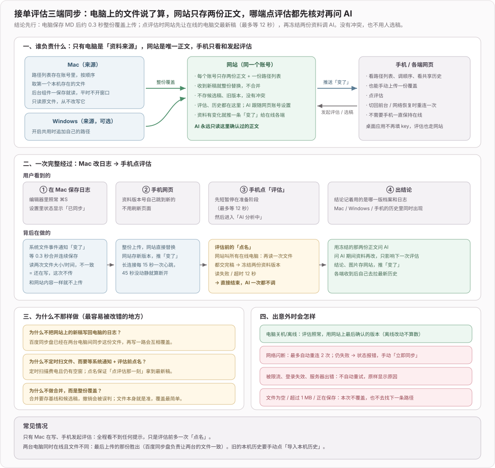
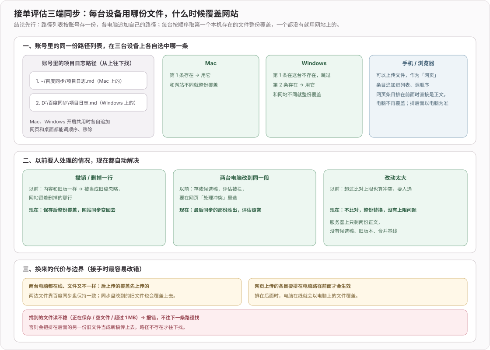

# 2026 接单评估

## 2026-10-26 fix(web): 估价对转换、移植、对接这类技术功能需求不再按完整产品估

**效果**：Visio ↔ Flowable 泳道图互转这类「一项技术功能」的需求，估价从 RadQuote 的 2.3~3.3 倍（1361~1922 h，RadQuote 589 h）降到 +9%~+40%；钱包基本不变，语音会议偏低一些（−28%~+3%）。代价是 Maxwell 改写这单从原来贴近 RadQuote（−6%~+16%）掉到 −44%~−56%，还没解决。

**关键代码决策**（`web/server/order-judge-estimate.ts` 的范围提示词）：原来一律「按可上线的生产级产品理解」，会给转换工具补管理后台、用户权限、部署上线、上线后支持。RadQuote 只估功能本身，Visio 那单只给了 5 个组、27 个任务。现在加了一条例外：描述的是一项技术功能（格式转换、导入导出、算法移植、接口对接、脚本、单个模块）时只拆功能本身，不补用户系统、后台、监控，也不出现部署上线、上线后支持、项目管理这样的组；任何独立运营的网站、App、平台、小程序、会议、钱包明确不适用。

试过三版，用同一批对照单（每单 3 次，总小时对 RadQuote 的偏差）：

| 版本 | 语音会议 | 钱包 | Visio | 净水 | 说明 |
|---|---|---|---|---|---|
| 改前 | −11%~+9% | −21%~+6% | +149%~+178% | −26%~−9% | 工具类被当成完整产品 |
| 一｜整句换成「范围跟着需求走」 | −40%~−3% | −37%~−19% | −21%~−6% | −39%~−28% | Visio 对上了，但完整产品也被一起缩小，作废 |
| 二｜保留原句 + 例外「需求没点到的不补」 | −28%~−21% | −6%~+19% | −13%~+27% | −13%~−4% | 语音会议明显偏低 |
| 三｜例外只在需求没出现用户 / 页面 / 平台等词时生效 | −15%~−8% | −11%~+11% | +58%~+119% | −24%~−11% | 触发太窄，Visio 只改善一半 |
| 四｜例外按「一项技术功能 vs 独立运营的产品」判断（现行） | −28%~+3% | +2%~+19% | +9%~+40% | −27%~−16% | 采用；Maxwell 单 434~553 h，比 RadQuote 的 981 h 低 44%~56%，没解决 |
| 五｜四 + 要求功能本身拆到交付级细度 | −39%~−22% | −18%~+4% | +22%（网络中断只跑了 1 次） | 未跑完 | 语音会议更低，作废，退回四 |

**边界 / 风险**：
- 每格只有 3 次，同一版本同一单自身波动就有 20 个百分点，二和四的平均偏差都在 16%~18%，差距在噪声内，选四是因为它把「产品不适用」写得最明确。
- 这是在 RadQuote 页面上有对照的 5 单（语音会议、钱包、Visio、净水、Maxwell 改写）上调的，样本仍然少。Maxwell 在例外条款生效前同一句需求是 920~1140 h（对 981 h 在 −6%~+16%），例外条款让它掉到 434~553 h：RadQuote 对「一项技术功能」并不总是估小，Visio 589 h 与 Maxwell 981 h（开发 798 h）差别很大，单靠提示词里一条例外无法同时对上。
- 对照输入是评估结论里的「需求」那一句（用户原样贴给 RadQuote 的）。线上估价用的是完整材料（含文档、截图），同一单结果会和只用一句话不同，对照时输入要一致。
- 钱包 / 语音会议偏低、净水偏低的趋势没有处理，需要更多样本再看是否有系统偏差。
- 基准脚本遇到 `fetch failed`（本机代理偶发连接超时）会整轮中断，没有自动重试，重跑即可。

## 2026-10-26 feat(web): 接单评估历史留存上传的附件，并能读 Excel

**效果**：评估时放进来的 PDF、Word、md/txt/csv、Excel 等文件会原样存进历史，详情里缩略图下面列出文件名和大小：PDF 点「预览」在新标签页用浏览器查看器打开，md/txt/csv/html/rtf 点「预览」在页面里展开文本，所有文件都能「下载」。图片和视频不在此列（已有切块 / 抽帧留存）。另外 .xlsx、.csv 现在能被评估读到文字；老版 .xls 读不了，评估里标「读不了」，「不同材料怎么放」写明先另存为 .xlsx

**关键代码决策**：
- 附件随 `/judge` 请求的 `files`（base64）上送，服务端存到该条历史目录下的 `att-NN.<扩展名>`，清单写进 `order_judge_history.files`。下载走 `/history/:id/files/:file`，先查清单再读盘；非 PDF / 文本一律 `application/octet-stream` + `attachment`，不内联渲染
- 存盘与清单两半同进同退：删除记录、超出 50 条淘汰沿用整目录 `rm`；备份 ZIP 带上附件，恢复时旧备份没有 `files` 列按空处理
- 限额：最多 10 个、单个 6 MB、合计 8 MB（base64 后仍在 20 MB 请求体内）；超出的不存，进度卡片的整理材料明细写「xx 太大，没存进历史」
- xlsx 在浏览器里读：复用 docx 的 zip 解析，取共享字符串表 + 每张工作表 XML，列用制表符、保留空列位置，公式取缓存值；最多 5 张表、每张 300 行，再受 2 万字总上限截断

**边界 / 风险**：
- 旧历史没有附件，补不回
- 从历史点「恢复」只还原图片，附件不放回材料区
- 公式从未在 Excel 里算过时缓存为空；批注、图表、图片读不到
- 共享的 `prepareMaterials` 多返回 `attachments`，桌面版不使用，但超限提示「没存进历史」也会出现在桌面的整理明细里；桌面自己的历史没有改

## 2026-10-23 feat(order-judge): 桌面接单评估也显示估价

**效果**：桌面版评估（与网页版共用）点一次同时出结论和估价，和网页版同一份数据：结论先显示，下面接估价卡片（拆任务 / 估工时进度 → 总小时、两档不加急报价、加急说明、各组小时可展开看任务），估价失败只在卡片里显示原因和错误码。历史里点开一条，也能看到当时的估价。样式按桌面版 MD3。桌面不做「重新估价」，估价失败时重新评估一次，或在网页上重试。

**关键代码决策**：主进程照样只发一个 `/judge` 请求（带 `estimate: true`），复用已有的 `order-judge:progress` 通道，多两种事件：

```
done 事件     → progress { stage: 'verdict', entry }   渲染进程立刻显示结论
estimate 事件 → progress { stage: 'estimate', event }  估价卡片更新
流结束        → IPC 调用才返回（结论与先前一致）
```

**边界 / 风险**：桌面版要连上已部署这几次改动的网站才有估价；网站还是旧版本时流里没有估价事件，评估结束后卡片显示 `NO_ESTIMATE`，结论不受影响。

## 2026-10-23 chore(order-judge): 桌面评估忽略网页新增的估价事件

**效果**：评估流里多了 `estimate` 事件类型，桌面版不请求估价、收到也只忽略，行为不变；只为跟上共享协议的类型。

## 2026-10-23 feat(web): 接单评估点一次同时出结论和估价，估价随历史保存

**效果**：网页版接单评估点「评估」后，结论下面多一张估价卡片：总小时、两档不加急报价（工作日 · 交付日 · 日历天数 · 金额）、加急怎么算的一句说明、各组小时（点开看任务和小时）。结论先到先显示，估价约 15~20 秒后接上，进行中显示「拆任务 → 估工时 已估完 N / 8 组」。估价失败不影响结论，卡片里显示原因和错误码，可以单独「重新估价」。估价写进这条历史，在历史里和手机单条页都能看到。交期落进节假日未公布的年份时用小标签标出「按双休估算」，跨春节时再标「可能顺延」。设计稿 `docs/design-mockups/web/接单评估.html` 新增估价中 / 跨年未公布 / 估价出错三屏。

**关键代码决策**（`web/server/order-judge.ts`）：估价和评估放在**同一个请求、同一个 AI 回合**里并行。最初按方案拆成两个请求，实测第二个直接 `RUN_BUSY`：服务器 AI 每人同一时间只能占一个回合。

```
POST /judge { estimate: true }
  回合开始 ─┬─ 评估 → 写历史 → 立刻发 done（不等估价）
            └─ 估价 → 发 estimate 事件（scope / group / done / error）
                 → 按当天（北京时间）算交期价格 → 写进同一条历史
  两边都结束才释放回合（估价的计费要在回合内结算），流随后关闭
估价先完成、历史还没写：暂存内存，写历史时一并带上；评估失败则丢弃
```

单独重试走 `POST /estimate`（同一个 requestId，结果补进那条历史），算一回合额度。历史表新增 `estimate` 列；导入不带这一列的旧备份时按空值恢复。

**边界 / 风险**：估价暂存只在内存里，服务恰好在两者之间重启会丢（当时页面上已经显示过）。估价占的 token 让单回合预留费用到约 $0.07，接近每回合上限 $0.08，材料很长时可能报 `COST_LIMIT`。「下单次日」恰逢周末时也从那天起算日历天数。桌面版只是忽略新事件，展示留到下一阶段。

## 2026-10-23 feat(order-judge): 估价按 RadQuote 口径拆任务估小时，20 秒内出结果

**效果**：估价阶段 2，新增 `POST /api/order-judge/estimate`（材料格式同评估），流式返回：定完范围报任务数，各任务组估完逐个推送，最后给总小时、任务数和按组小时。还没接界面、不进历史。AI 走评估同一条连接，一次估价算一回合额度；与评估分开计「每分钟 6 次」和「同时只跑一单」，同一次点击可以两个一起发。

**关键代码决策**（`web/server/order-judge-estimate.ts`）：

```
定范围（一次调用，13~16 s）→ 全部任务 + 所属组
   └→ 8 个组并行估（各 2~5 s）：每个任务按参与角色各估一个数，任务工时 = 角色之和
服务端求和得组小时、总小时，不用模型报的总数
```

两份提示词都以 RadQuote 首页两份公开示例的完整任务树（企业官网 40 条 / 416 h、电商 101 条 / 2617 h，`scripts/sync-estimate-reference.ts` 拉取，存 `order-judge-estimate-reference.json`）作参考样例。对齐的两个关键都来自 RadQuote 的真实数据：

- 每个任务按角色分别估、再求和（示例平均每任务 2.7~3.6 条角色工时）。只让模型给「每任务一个数」时，大项目稳定低估 40%~60%。
- 角色用它那张固定费率卡（客户经理、项目经理、分析、设计、前端、后端、运维、内容、测试、全栈、SEO、文案，没有 iOS / Android），且开发类任务里同样挂项目经理、分析、设计、测试的份。钱包那单在 RadQuote 后台看到「开发」组 = 项目经理 77 + 分析 44 + 设计 57 + 前端 194 + 后端 295 + 运维 79 + 测试 115。之前写成「只算动手的人」，开发组少了一半。

对照（`npm run bench:order-judge-estimate`，deepseek-flash，每单 3 次，RadQuote 多次取均值）：

| 需求 | RadQuote 总 / 开发 | 我们 总 | 我们 开发 | 耗时 |
|---|---|---|---|---|
| 语音会议 | 1350 / 650 | 1163~1335（−14%~−1%） | 452~548（−31%~−16%） | 15~17 s |
| 多链钱包 | 1964 / 831 | 1996~2159（+2%~+10%） | 856~1026（+3%~+23%） | 17~20 s |

**边界 / 风险**：总小时 6 次里 5 次在 ±10% 内，开发小时只有 2 次在 ±15% 内——各组怎么分摊本来就飘（RadQuote 同一单两次开发差 11%、测试差 38%），而报价只用总小时。试过照 RadQuote 把「项目管理」组换成「方案架构」组，总小时反而多出一层，退回。deepseek-v4-pro 更慢（22~49 s）且小项目偏差更大，不用。只有 2 单对照，样本太少，接界面后持续追加。RadQuote 后台显示钱包那单 2202 h，邮件 / 试用页给的是 2007 h（金额相同），对照按用户看到的 2007。

## 2026-10-23 feat(order-judge): 估价按国务院节假日安排计算交期和价格

**效果**：估价阶段 1，暂未接界面（方案见 [020](../ideas/020-接单评估估价.md)）。给定总小时和下单日，按 ×0.06 / ×0.075 算出两档小时与工作日，从下单次日起数工作日、跳过节假日、调休日照常上班，得出交期和日历天数，价格 = 日历天数 × 160（不加急）。1350 h、10-22 下单 → 11-06 / 11-10，2400 ~ 3040。

**关键代码决策**：计算是纯函数 `web/shared/order-judge-quote.ts`，网页和桌面共用；节假日由服务端 `order-judge-holidays.ts` 从 holiday-cn 按年拉取并缓存到数据目录：

```
已公布的年份 → 读缓存，不再请求
未发文（days 为空）→ 一天最多重查一次，期间按双休算，结果带 assumedYears
工期压到未公布年份的春节段（1/20~2/20）→ springFestivalRisk
拉取失败 → 用旧缓存；没有缓存 → 抛错，不静默按双休
```

**边界 / 风险**：数据源只有 jsDelivr 一处，它不可用且没缓存时估价会报错。`npm run test:order-judge-quote` 首段真实联网。

## 2026-10-22 chore(order-judge): 优化下载模版说明

**效果**：档案说不能、日志里做过的，仍按日志判能；但日志里只是沾边的经验（和这单核心需求不同类），最多判「勉强」，不再被放大成「能」。下载模版的日志说明去掉「比档案更新」，免得被理解成按文件修改时间比新旧，现在写的是「记录实际做过、学会的事。档案说不能、日志里做过的，评估按日志判能。」网页和桌面共用同一份提示词和说明，两端同时生效。

**边界 / 风险**：「同类」由 AI 判断，没有硬规则；提示词里「每日更新，比能力档案新」那半句保留，它描述的是日志的维护方式，不影响模版说明。

## 2026-10-22 feat(order-judge): 评估设置新增能力档案和项目日志的下载模版

**效果**：网页和桌面的评估设置里，能力档案、项目日志各多一个「下载模版」，标题下一行说明用途：档案划定能接什么不能接什么，日志记录实际做过、学会的事，档案说不能但日志做过的按日志判能。档案模版按评估用的「能 / 勉强 / 不能」三档分区，日志模版按日期倒序，每条写做了什么、技术、耗时、踩坑、结果。

**关键代码决策**：模版和说明文字只在 `web/shared/order-judge-templates.ts` 一份，两端共用；分区依据是 `order-judge.ts` 提示词的判断标准，改提示词档位时同步改模版。

**边界 / 风险**：桌面版下载走浏览器式 blob 下载，未在打包后的 Electron 里验证保存行为。

## 2026-10-22 feat(order-judge): 桌面应用接单评估改用网页账号同步资料和历史

**效果**：桌面评估设置只剩一个开关「与网页版共用评估和历史」，去掉了 DeepSeek Key、「自动同步所选 MD」和立即同步 / 网页评估设置 / 导入本机历史三个按钮。评估一律走网站，AI 跟随网页账号设置（默认服务器 AI，网页里改成自己的 key 就用用户的）；未登录时勾选只在底部提示先登录，未开启时不能评估、只能查看旧的本机历史。开启共用时，本机路径追加进账号的路径列表，本机旧历史先备份校验再自动上传一次（重复上传去重）。之后桌面添加、调顺序、移除都改账号里那份列表，本机不存在的路径变淡，正在用的那条图标亮起。`npm run sync:judge` 以无窗口模式常驻同步，与桌面窗口共用一把单实例锁。同步规则与配图见上一条 `feat(web)`。

**状态流**（`src/main/order-judge/sync-manager.ts`）：

```
开启共用 → POST /paths/merge（追加本机路径）→ 上传本机历史（只做一次）
同步：GET /sync 取正文 + 路径列表 → 只看第一条网页条目之前的路径
      → 第一个本机存在的文件 ≠ 正文 → PUT /docs/:kind（带 path，整份覆盖）
路径列表变了 → 重建父目录监听（本机不存在的目录跳过）
事件流 check → 再读一次文件交稿 → 回执；401/429/5xx 不重试，断线最多重连 2 次
```

**边界 / 风险**：找到的文件正在保存、为空或超过 1 MB 时报错，不往下一条路径找，避免把排在后面的旧文件当新稿传上去。网页里用自己的 key 时 key 只在那台浏览器里，桌面评估前需要先在网页连接一次。历史上传在共享历史满 50 条或单条超过 20 MB 时停下并报错，开关保持开启、原记录与备份保留。旧设置文件里的加密 Key 不再使用，下次保存设置时清掉。

## 2026-10-22 feat(web): 接单评估资料按路径列表在多端同步，网页和手机也能上传

**效果**：服务器每个账号只存能力档案、项目日志两份正文，外加一份按账号共用的路径列表（每类最多 12 条，标明来自哪台电脑）。列表顺序就是优先级：每台电脑取第一个本机存在的文件整份覆盖正文，不合并、不存候选稿和旧版本，也就没有冲突要人处理；撤销、删行和普通修改一样直接生效。网页（含手机）「上传文件」作为一条「网页」条目追加到列表末尾，同名再传替换内容；它排在电脑路径前面时立刻成为正文、电脑不再覆盖，排在后面时以电脑文件为准。评估设置里能看到整份列表，可以调顺序、移除，当前正文来自哪一条会描边标出。评估前仍先让在线电脑重读文件，再冻结两份正文调 AI。




**关键代码决策**（`web/server/order-judge-data.ts`）：网页条目的正文存在 `order_judge_paths.content`，客户端调顺序时只能引用已有的网页条目，伪造的会被拒；列表一变就按下面的规则决定要不要立刻换正文。电脑路径上的文件只有那台电脑读得到，所以服务器只处理网页条目，其余交给电脑下次同步：

```
first = 列表里第一条网页条目；source = 当前正文来自的那一条
source 不在列表里，或排在 first 后面 → 正文换成 first 的内容
电脑同步：只看 first 之前的路径，第一个本机存在的文件和正文不同就覆盖
```

**边界 / 风险**：两台电脑都在线且选中的文件不同时，后上传的覆盖先上传的；两边文件一致靠百度同步盘，晚到的旧文件也会覆盖上去。路径列表会把各台电脑的绝对路径存到服务器，网页上看得到。启动时会删掉旧的版本、候选稿、合并基线和操作记录四张表，旧备份里的这些表恢复时忽略。

## 2026-10-20 feat(order-judge): 需求描述可以脱离材料

**效果**：桌面版和网页版共用一份 Prompt（`web/shared/order-judge.ts`），一起生效。结论里的「需求」要能原样复制到只收文字的平台去估价。有视频时分两行：第一行只有「做的是什么。交付物、预算工期、额外要求。」，第二行「视频演示：」按画面顺序用「→」串起操作流程，功能只在第二行出现，不重复；没视频时照旧一段复述。截图 / 文件里影响工作量的信息写进来，不写「见截图」「如图」这类指代。两端的需求段落保留换行（`white-space: pre-line`）

**关键代码决策**：有视频时不让模型写自由的 summary。实测 deepseek-flash 无论怎么要求「别重复」、给错误示范、给固定格式，都会在第一行把视频里的功能再列一遍。改成模型分别输出 `video`（步骤数组）和 `terms`（只放交付、预算工期、额外要求），`normalizeReport` 里用 `title + terms` 拼第一行、步骤拼第二行，再合回 `summary` 一个字符串，历史记录和两端界面都不用改：

```
有视频：summary = title。terms。\n视频演示：步骤1 → 步骤2 → …
没视频：summary = 模型写的 summary
```

**边界 / 风险**：视频只抽 12 帧，帧之间发生的操作模型看不到，流程是按帧推断的；短而快的关键操作可能漏掉

## 2026-10-18 feat(web): 接单评估默认用服务器的 AI，跟随设置里选的来源

**效果**：接单评估不再单独填 DeepSeek Key。用谁的 AI 跟随设置页「点评助手 · 写点评时用谁的」，和纱雾助手是同一份设置，默认用服务器的。评估设置弹窗只管能力档案和项目日志。设置里选了用自己的但还没填 Key 时，提示条写「设置里选了用你自己的 AI，但还没填 API key」，按钮跳到设置页。用服务器 AI 时，和纱雾助手共用每日轮次与费用额度，整单评估算一轮。同一个错误码按来源给不同文案：401 / 402 用服务器时叫用户改用自己的，用自己的时叫用户检查 Key 或充值。另外新增材料超长、今日额度用完、费用额度不够、全站繁忙、助手正在回答这几种错误提示。

**数据流**：

```
POST /api/order-judge/judge
  aiSource(uid)                    ← users.ai_config，助手同一份
  judgeConnection(uid)
    server：prepareExternal → 服务器连接
            execute = externalQuota.turn（整单一轮）
            call    = 按 estimateRequestTokens 预授权 → 调用 → 按实报结算
    byok  ：助手那条自配连接，不走项目额度
  HTTP 401/402/连接失败 → 丢掉这条连接，下次重新准备；不自动重试
```

**关键代码**：图片不能按 base64 体积估 token（一张 1280² JPEG 会估出约 55 万），预授权改按「文字按体积、图片按张」（`web/server/agent/context-provider.ts`）：

```ts
export const IMAGE_INPUT_TOKENS = 1100
export function estimateRequestTokens(body: Record<string, unknown>): number {
  const { text, images } = withoutImages(body)
  return estimateContextTokens(text) + images * IMAGE_INPUT_TOKENS
}
```

**边界 / 风险**：用服务器 AI 时，同一账号的评估和纱雾助手回合不能同时跑：后到的一方直接报 `RUN_BUSY`，不排队、不自动重试。

## 2026-10-18 feat(web): 网页版新增接单评估

**效果**：网页版导航新增「接单评估」（手机底栏叫「接单」），界面按 `docs/design-mockups/web/接单评估.html` 实现。登录后把派单的文字、截图、长图、视频、PDF、Word 放进来点「评估」，右边出一张盖了「能接 / 不接 / 待补」章的批改单。桌面端材料和结论左右两栏，整页可以直接粘贴、拖入文件；平板和手机是三段流程：编辑材料 → 点评估后整页切到评估过程（上面是这单材料的缩略，下面是进度）→ 结论单独一屏，顶部「返回修改」保留材料回到编辑、「再评一单」清空重来。评估中可以随时「取消评估」，材料原样留着。手机端用「粘贴」「添加文件」两个按钮放材料。能力档案、项目日志上传 .md 存在账号下，换设备也在。DeepSeek Key 和网站助手共用同一条「自配 API」连接，模型 `deepseek-v4-flash-vision-exp`。历史是单独的视图，最多 50 条，带当时压缩后的图，可以删除，也可以放回材料区重新评估。出错时按真实原因显示，错误码原样附上。

**数据流**：

```
浏览器（web/shared/order-judge-prepare.ts，桌面版共用）     服务端 /api/order-judge
截图 / 长图 / 视频 12 帧 → JPEG；PDF → pdf.js（CMap 走 /pdfjs/cmaps/）
docx / odt → 自带 zip 解析；wmv 等解不了的格式标「读不了」
        ↓ POST /judge：文字 + 最多 40 张 JPEG（≤20MB）
                                 登录 + 同源校验 + 每人每分钟 6 次、同时 1 单
                                 byokConnection(uid)：取助手那条连接，项目 Key 不代付
                                 打开网址（每跳校验公网地址并固定连接，同站间隔 3–5 秒）
                                 DeepSeek（JSON 模式，空内容最多试 3 次，HTTP 错误不重试）
        ← NDJSON：stage links → stage ai → done / error
                                 历史：order_judge_history 行 + dataDir/order-judge/<uid>/<id>/NN.jpg
```

**关键代码**：

复用助手连接，Key 不另存一份，也只认用户自己的 Key（`web/server/agent/external-runtime.ts`）：

```ts
export function byokConnection(uid:number):{transport:ProviderTransport;model:string}{
  if(!externalEnabled('byok'))throw new AgentRunError('AGENT_AI_DISABLED',503)
  if(selection(uid).choice.provider!=='byok')throw new AgentRunError('BYOK_REQUIRED',409)
  const c=selectedConnection(uid);if(!c)throw new AgentRunError('PROVIDER_CONNECTION_REQUIRED',409)
  return {transport:c.transport,model:c.profile.model}
}
```

派单里的网址来自用户材料，服务端打开前每一跳都解析 DNS、只放行公网地址，再把连接固定到校验过的地址，重定向手动跟、每跳重新校验（`web/server/order-judge.ts` 的 `fetchPage`）。

**边界 / 风险**：
- 助手的自配连接在服务器内存里只保留 30 分钟，过期后要在「评估设置」里重新填 Key（和助手一致）。在这里连接会把账号的 AI 来源切到「自配 API」，助手也会跟着用这把 Key
- 视频取帧依赖浏览器解码：wmv、avi 和部分手机录屏格式读不出画面，只能截图
- 1280～1365px 宽的桌面顶栏放不下印章装饰，`sketch-ui.css` 的窄桌面断点从 1279 提到 1365
- 接单评估的数据不在「备份导入导出」里

## 2026-10-18 refactor(order-judge): 材料预处理改为桌面版与网页版共用

**效果**：截图缩放、长图切块、视频取帧、Word / PDF 取字的逻辑移到 `web/shared/order-judge-prepare.ts`，桌面版行为不变。桌面版通过 `hooks.convert` 接上本机工具兜底（ffmpeg、HEIC、textutil），网页版不传这个钩子。

## 2026-10-18 feat(order-judge): 新增接单评估

**效果**：侧栏新增「接单评估」，功能对齐原来的 Python 本地工具（`~/Downloads/order-judge`），界面按 `docs/design-mockups/接单评估.html` 实现。粘贴文字、截图，或拖入视频、长图、PDF、Word 后点「评估」，页面给出能 / 不能 / 信息不足和完整理由。Key、能力档案、项目日志在页头右侧的「评估设置」里配置，项目日志直接读所选文件，不用每天复制。历史常驻右栏，可以打开详情、放回输入框重新评估、单条删除。

**数据流**：

```
渲染进程（浏览器能力，网页版可复用）          主进程
截图 → canvas 缩到长边 1280 → JPEG
长图 → 按 2 倍宽切块（重叠 100px）
视频 → <video> 跳到 12 个时间点截帧 ──┐
PDF  → pdf.js（主线程运行，CMap 经 IPC 取）│ 解不了的格式 → order-judge:convert
docx / odt → 自带 zip 解析               │   ffmpeg / 系统图片解码 / textutil
        ↓ 文字 + 最多 40 张 JPEG                    ↓
order-judge:judge ──────────────────────→ 读能力档案 + 项目日志
                                          打开网址（同站间隔 3–5 秒，异站并发）
                                          DeepSeek（JSON 模式，空内容最多试 3 次）
                                          存历史：userData/order-judge/<id>/NN.jpg
```

**关键决策**：
- Prompt 和结论结构放在 `web/shared/order-judge.ts`，网页版服务端以后直接复用，不再各写一份。
- 视频在本地取帧后只发 12 张图，网页版也可以照此处理，不需要上传整段视频。
- `pdfjs-dist` 放 devDependencies：它的可选依赖 `canvas` 是原生模块，放在生产依赖里会被 electron-builder 按 Electron 重新编译。渲染进程本来就由 vite 打包，放开发依赖不影响打包结果。CMap 通过 extraResources 拷到 `resources/pdf-cmaps`。
- 出错按原因分开展示（缺 Key / 缺档案 / 401 / 402 / 429 / 其他 HTTP / 网络 / 空返回 / 解析失败），每种都先写日志再返回给界面；只有空返回会重试，HTTP 错误不重试。

**边界 / 风险**：
- 离开页面后，输入框里的材料和正在显示的结论不会保留；已经评估完成的结果都在历史里
- 历史最多保留 50 条，每条带着当时发出的图片，超出后删除最早的记录和图片
- Windows 上没装 ffmpeg 时，Chromium 解不了的视频（wmv、avi 等）读不出画面，会在输入区提示，并写进发给 AI 的文字里；doc / pages 文件只有 mac 能读
- Python 版的旧历史不迁移
