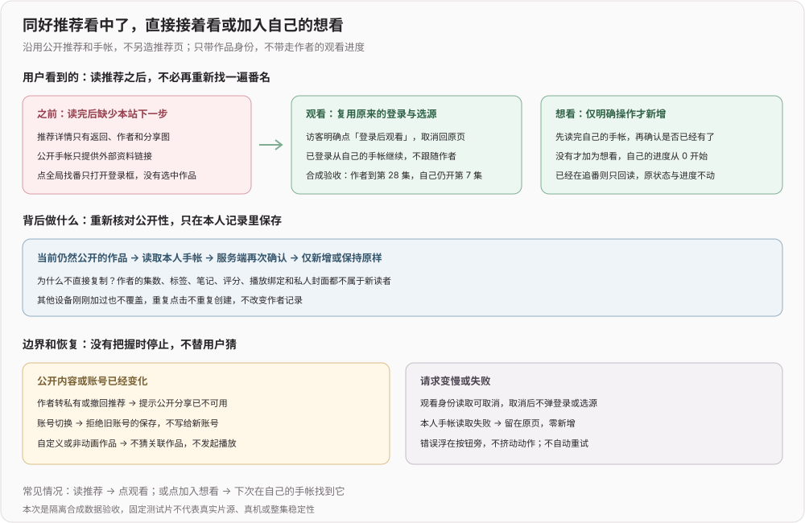
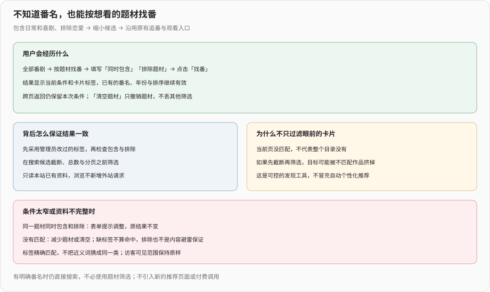
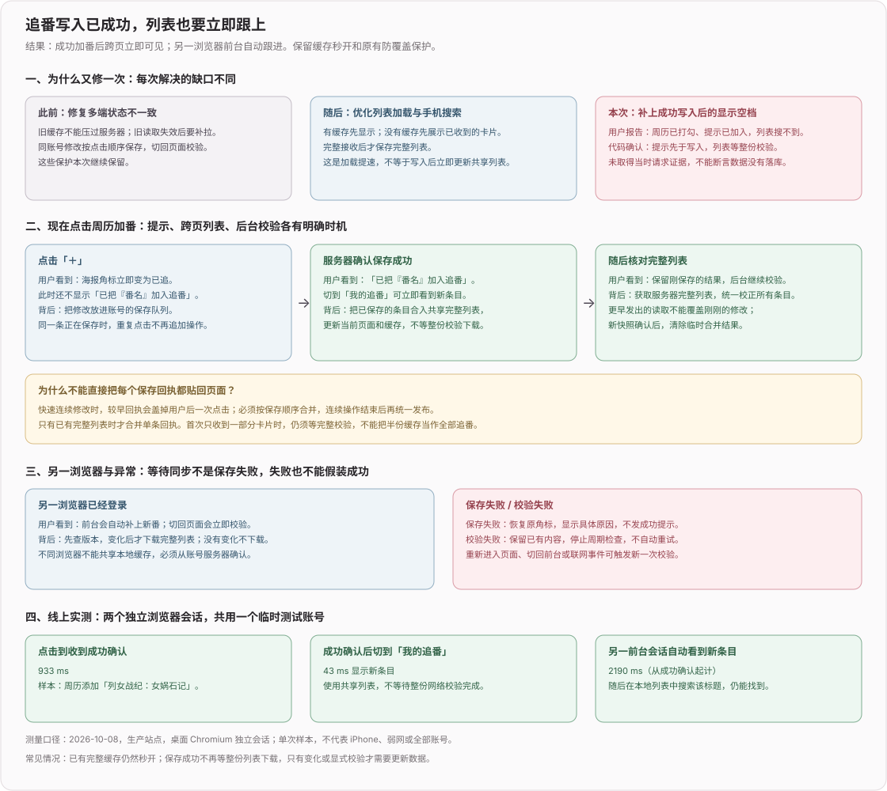
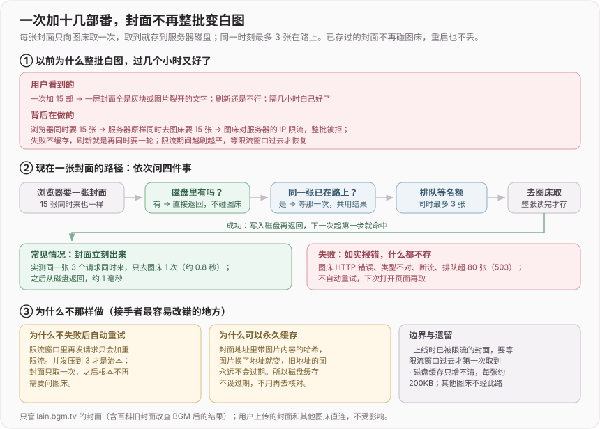
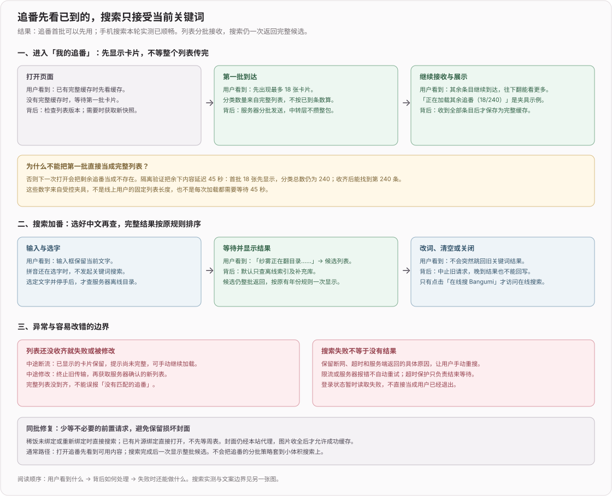
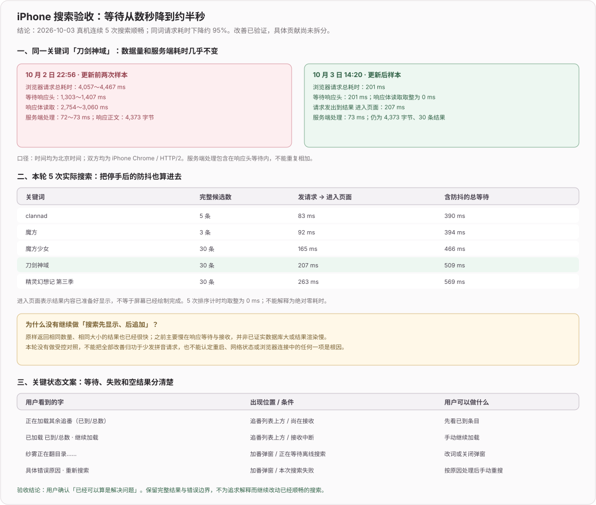

# 网页版（2026）


## 2026-11-12 feat(web): 从同好推荐直接观看或加入自己的想看

**修改后效果**：公开推荐详情和公开手帐卡片增加同一套作品动作，访客可以带着当前作品进入原登录观看流程，已登录可以观看或明确加入自己的想看；已有记录不改状态和进度，不复制分享者的手帐



[公开推荐入口的合成实测](../devlog-assets/community-actions-review.jpg) · [390px 手帐动作的合成实测](../devlog-assets/community-actions-narrow.jpg)

**关键决策**：动作发起时重查当前公开作品身份，复用已有 `requestAnimeWatch`，选集取读者自己的手帐；想看先完整读本人手帐，再通过既有 tracks PUT 的 `communitySource` 分支只新增。服务端事务内重查公开来源并确认有无记录，已有则原样回读，不 bump revision；新增固定 plan/0，仅采用服务器读到的作品名和放送日期，不信客户端夹带的集数、标签、笔记、评分或封面。`expectedOwner` 防止旧页面把保存发给刚切换的账号，取消和卸载中止前端请求；写入处理中不显示可回滚保存的“取消”承诺

**边界**：公开作者转私有、推荐撤回、非动画、自定义负 ID、空作品身份都停止动作；访客不提供写入按钮，个人数据不进公开响应。读取失败保留原页并显示具体原因，不自动重试；公开手帐新增全宽底部动作行，保留原封面、正文和外链，浮动错误不挤按钮

**验证**：新增 `npm run test:community-actions` 验证公开投影、仅新增、重复保存、已有第7集不被作者第28集覆盖、账号与公开撤回边界，三个守卫分别拆除均出现行为断言失败。CUA 实走首页→同好手帐→推荐→观看选源，打开本人第7话，固定生成视频从0推进到31.712302秒；访客取消、读取失败零新增、想看保存 plan/0、慢请求取消及390px布局均留证，未访问真实媒体

**夹具对齐**：公开作者链接需要 `/u/:username` 的 SPA 入口，旧夹具只服务根路径，本次补成与生产 node 兜底一致；既有观看登录回归在原 main 和改动版都卡在目录入口，原因是老目录夹具缺当前必需的 genres，补空数组后原8场景通过。这两项是隔离测试准备修正，不宣称生产故障

**风险 / 回滚**：未合并部署，未测真实账号、真实片源、真机与整集稳定性；跨标签页账号保存由服务端回归覆盖，本轮未另做双标签CUA。明示保存后沿用已有本人元数据补全，测试中该路径只有合成响应。回滚本提交撤回新动作和来源分支即可，不回删用户已经明确加入的想看记录

## 2026-11-10 fix(web): 修复百度百科和维基图床封面无法加载

**效果**：
- 管理员填网图地址后，图片存成服务器上的文件，卡片、页头扇面、编辑弹窗用同一个本站地址，保存后不刷新就一起换成新图
- 百度百科、维基这类图床的地址都能用
- 中间被「…」省略的地址（从浏览器开发者工具里复制出来的）保存时直接提示，不再存进去；已经存着的这类地址读出来当作没填，卡片回到默认封面
- 取不到图时按原因提示：网站返回的 HTTP 状态、不是图片、超过 4MB、服务器连不上、20 秒没下完

**关键决策**：

```
填地址 → 管理员浏览器取图（不带 Referer）─ 取到 → 走本地上传
                                        └ 取不到 → 服务器下载 ─ 成功 → 存文件
                                                              └ 失败 → 报原因，封面不变
```

- 不再把外链交给浏览器显示。原来卡片直接请求外链，扇面遇到百科地址却改去取 BGM 原封面，同一部番两处显示不一致；百科图床对外站 Referer 回 403，卡片必裂
- 先让浏览器取：线上服务器在香港，连百科图床卡在握手一直超时，而管理员看得到这张图，浏览器就取得到。两个图床都允许跨域读取
- 服务器下载按文件头认图片类型，不信 `Content-Type`；每一跳都校验不是内网地址，再把连接固定到校验过的地址上
- `catalog_override.cover_url` 只剩旧数据还在读，新写入一律置空

**边界**：
- 旧数据里完整可用的外链没有迁移，仍按外链显示；在弹窗里点封面再点「确定」会转成文件
- 图床既不允许跨域读取、服务器又连不上时只能先存到本地再上传
- 填 `lain.bgm.tv` 的地址时服务器直接下载一次，不经过 BGM 的错峰队列和 429 冷却

## 2026-11-10 feat(web): 按题材找番新增更多题材

**效果**：
- 题材按钮跟着光标走：光标最后在「排除题材」框里，点题材就加进排除框（粉色删除线）；否则加进「同时包含」（绿色）。在另一个框里的同名题材会自动移过来
- 去掉「找番」按钮，输入或点题材后约 0.3 秒自动刷新结果
- 快捷题材不再写死，收录 100 部以上的标签按部数从多到少列出，默认露出 20 个，其余收进「更多」
- 管理员点「管理题材」可以看到所有过门槛的标签和各自部数（降序），勾选决定是否显示，保存后对所有人生效
- 去掉副标题和输入框下的说明文字；已选条件和报错显示在标题右侧，出现、消失都不推动下面的卡片

**关键决策**：门槛取 100。2026-11-02 本地索引访客可见约 2.9 万部，共 17161 个标签：≥500 部 59 个、≥200 部 111 个、≥100 部 202 个、≥50 部 392 个。取 100 时，悬疑 248、魔法少女 216、推理 177、武侠 155 这类中等题材都进得来，管理员一次要审的约 200 个也审得完。过门槛的标签一大半是 TV、短片、剧场版、欧美、年份、制作公司，不是题材，所以交给管理员挑：纯年份标签默认隐藏，其余默认显示，管理员改过的以保存的为准。访客只按自己能看到的番计数，管理员按全部条目计数

**回归**：`cd web && npm run test:catalog-discovery` 覆盖门槛、访客计数、年份默认隐藏、管理员显示 / 隐藏立即生效、管理员列表降序且含已隐藏项、未登录读写都被拒；逐个拆掉这些防护都会断言失败

**边界**：线上管理员第一次打开时，TV、欧美、SUNRISE 等非题材标签默认是显示的，需要手动隐藏一遍。近义标签（搞笑 / 喜剧）不合并

## 2026-11-10 fix(web): 全部番剧搜索后能切换「最新」排序

**效果**：搜索番名后「评分 / 最新」不再被禁用，切换后结果真的按所选顺序重排；清空搜索后两种排序照旧。这个问题从「全部番剧」页上线起就有（搜索时按钮 `disabled`，服务端也忽略 `sort`），不是题材找番那次引入的

**关键决策**：仍先按相关度截出前 120 条候选，再用快照里预排好的评分 / 最新名次重排这批候选，不增加查询。代价是搜索结果不再按相关度排列，默认的「评分」下最匹配的番不一定排第一

## 2026-11-10 perf(web): 全部番剧切换年份、排序和题材不再等几秒

**效果**：切年份、排序、题材时服务端只做内存过滤，单次从全表扫描约 36ms（本机，线上 CPU 更慢）降到约 1ms；切回看过的条件（如 2027 年 → 全部年份）直接摆出上次的列表，后台照常刷新；新条件加载时旧列表变灰保留，不再先清空再转圈；管理员改标签后原地更新卡片，不重读目录、不丢滚动位置

**关键决策**：整表只读一次，按评分、按最新两种顺序预排好，存可见性、年份和生效标签（含管理员覆盖）；索引换新（只读句柄变了）或管理员改标签时重建，约 100ms。每页只按 id 取 48 行。前端缓存键带账号，退出登录后不会把只给登录用户看的条目摆给访客

**回归**：`cd web && npm run test:catalog-discovery` 新增「管理员改标签 / 恢复默认后结果立刻跟着变」；拆掉改标签后的重建、索引换新后的重建、访客可见过滤、包含交集、排除、覆盖标签、截断前筛选，各自都会断言失败。本机真实索引上 6 组排序 / 年份 / 分页组合与原 SQL 结果逐条一致

**边界**：快照约占几 MB 内存，常驻服务端；番名搜索先按原 SQL 相关度截候选，题材候选改从快照取

## 2026-11-08 feat(web): 不知道番名时也能按题材组合找番

**效果**：全部番剧新增「同时包含」「排除题材」，可与番名和年份组合，结果展示已有标签；清空题材和跨页返回保留其他条件，追番与观看沿用原入口



**关键决策**：先合并有效标签，再筛候选、搜索排序与分页，不只过滤当前页；筛选是精确标签匹配而非自动推荐，不触发外站抓取或付费模型

**边界**：标签缺失和近义词不自动推断，排除不保证避雷；沿用访客可见性。无迁移，回滚提交恢复旧目录。较大索引的生产耗时与真机尚未验收

**方案与验收**：[题材组合找番](../ideas/023-题材组合找番.md)

## 2026-11-04 fix(web): 番名搜索时同时应用年份筛选

**效果**：在「全部番剧」输入番名后，选择年份会真正缩小结果，不再混入其他年份或未定档条目；切回「全部年份」仍能找回这些匹配，没有该年份结果时也明确显示所选年份，不再让用户误以为番名写错

**关键决策**：关键词 + 年份 → 同一批离线候选 → 原相关度排序 → 现有候选上限与分页。年份先限定再截断，避免先拿其他年份的高相关结果、再过滤时把目标年份漏掉；其他搜索调用仍默认不限年份，访客可见性与搜索排序不变

**回归**：`cd web && npm run test:catalog-search-year` 覆盖关键词与年份组合、全部年份恢复未定档、别名、分页总数、访客可见性及真实页面往返；额外构造121条其他年份干扰，故意把年份移到候选截断后过滤会在目标遗漏断言失败，恢复后完整通过

**边界**：使用现有隔离夹具和 Electron，不新增框架，不触发外部检索或真实模型；真实全量索引性能、真机和生产部署未覆盖

## 2026-11-04 fix(web): 回到今天时完整显示日期标题

**效果**：周历点「回到今天」后，今天的日期和在播部数完整停在顶栏下方，不再只看见卡片、还要往回滚一点确认日期；桌面横向、整周纵向和窄屏纵向都保留同一落点，窄屏横向仍按原方式选中今天

**关键决策**：仅用现有顶栏高度变量给日期分节补原生滚动留白，不改卡片排版、日期选择、数据请求或根页面滚动；「回到页头」仍回到原位置

**回归**：`cd web && npm run test:calendar-today` 在 1360×980、390×844 两个内容视口核对四种布局场景；等平滑滚动停稳后比较日期标题与顶栏的实际边界，最后要求四场景完成标记，避免只跑到第一种布局就误报通过；原样式与移除留白保护时均在遮挡断言失败，恢复后通过

**边界**：窄视口回归不等于真实手机验收，真实 iOS 工具栏变化与放大字体尚未覆盖；没有合并、部署或修改生产数据

## 2026-11-04 fix(web): 连续手动加番时保留输入方式

**效果**：在「自己记一条」新增成功后仍停留在手动输入，清空已经提交的番名并把焦点放回输入框，可以直接接着记下一部，不再每次跳回 BGM 搜索；关闭后重新打开仍从默认搜索方式开始

**回归**：`cd web && npm run test:manual-add-mode` 使用隔离账号和实际页面，核对连续新增两条只选择一次输入方式、成功后清空与聚焦、空标题不发送写入、关闭重开没有旧输入；基线会在保留方式断言失败，修复后通过，拆除空标题拦截后会在写请求计数断言失败

**边界**：只调整同一个新增弹窗内的成功收尾，不改 BGM 搜索、回填、权限或追番状态筛选；未替用户合并或部署

## 2026-11-03 fix(auth): 修正注册与找回密码的弹窗名称

**效果**：登录弹窗切到注册、邮箱验证码登录或找回密码时，辅助阅读使用对应的准确名称，不再始终报成「登录番外小站」；密码登录名称保持原样，表单、提交和账号权限均不变

**回归**：`cd web && npm run test:auth-dialog-labels` 渲染真实组件，核对四种模式的弹窗名称与关闭状态，并禁止测试发出网络请求；原行为会在注册模式断言失败，修复后四种模式均通过

**边界**：本轮仅修正可访问名称，未改变可见界面或认证逻辑；真机 VoiceOver / TalkBack 的实际朗读仍需单独验收

## 2026-11-03 fix(web): 返回全部番剧时保留搜索和筛选

**效果**：在全部番剧搜到一部作品后，切到我的追番等页面再返回，搜索词、年份和排序保持原样，不必重新输入；清空搜索后再返回也仍为空

**边界**：只记住本次打开网站期间的筛选，不持久化到磁盘、不缓存番剧列表，登录或退出后仍重新读取当前账号可见的条目；刷新或重新打开网站后恢复默认筛选，不恢复已加载页数和滚动位置

**回归**：`cd web && npm run test:catalog-navigation:serve` 启动仅监听本机的隔离夹具，用虚构目录数据走“首页 → 全部番剧 → 搜索 → 我的追番 → 浏览器返回”，核对搜索和结果仍在，再核对清空搜索及年份/排序返回；夹具不接生产数据库或外部 AI，浏览器步骤另行执行，不把服务器启动成功当作回归通过

## 2026-11-03 feat(web): 全部番剧编辑卡片支持填写封面网址

**效果**：全部番剧「编辑卡片」的封面改成和我的追番一样的交互：点封面弹出小框，显示当前网图地址（本地上传的图显示为空），可以填网址点「确定」/ 回车，也可以点「本地上传」。网址只收 https（http 自动改成 https），显示时照常经 lain 代理分流。原来封面下方的「上传封面」按钮去掉，「恢复默认」保留

**两种来源互斥**：`catalog_override` 新增 `cover_url` 列（老库启动时自动补列）。填网址时同一条写入清空 `cover_mime` 并删掉 `catalog-covers/<bgmId>`；本地上传时清空 `cover_url`；恢复默认两者一起清，三项都空才整行删除。三条写路径都在同一部番的顺序锁里执行，不会出现旧图删除晚于新图写入

## 2026-11-02 docs(web): 更新公告

**效果**：首页开屏公告换成 10-18 之后的更新（改名番外小站、找番、全部番剧、周历搜索、追番排序、放映室、缓存播放器开关、接单评估），公告 id 改为 `site-updates-20261102-v1`，之前点过「近期不再出现」的用户会重新看到一次

## 2026-11-02 feat(web): 设置新增缓存播放器开关

**效果**：设置页多一项「缓存播放器」，默认关闭，开关记在本机浏览器。关着时在线播放不再把整集写进本机硬盘，照常经服务端播放，已经缓存过的集仍可播放和在放映室管理。关着时开播会从源站直连读约 2MB 测一次速，交给放映室的全站线路速度（稀饭 mp4，每个源站每次打开页面最多一次）

**边界**：测速失败只写一行日志，不重试、不标坏源站；HLS 和 Girigiri 不测。开关在下一次开播或换集时生效，正在下载的那集不会被打断

## 2026-11-02 feat(web): 全部番剧支持管理员编辑卡片，部分内容仅登录可见

**效果**：管理员在全部番剧每张海报左上角多一枚铅笔，点开能改中文名、标签和封面（本地上传），每项都能「恢复默认」；改动全站共用，访客看到的也是改过的。R18 条目没有封面的问题靠这里手动上传解决。全部番剧的 R18 条目只有登录用户能看到（未登录时列表、搜索、年份筛选里都没有，手动封面图片也要登录才给），登录后照常列出，但不显示索引里的标签，封面默认是占位，后台也不给它们补封面，管理员手填的标签和封面除外。登录 / 退出后页面自动重新加载列表。按评分排序时，评分人数不到 50 的番排在后面，第一屏不再是一两个人打出 10 分的未播企划。新番立项时还没有海报的，之后会再去问：放送日期在半年内或未定档的番，没封面的 14 天复查一次，有封面的 30 天复查一次，换成正式海报后跟着更新；老番没封面的 180 天再看一眼，有封面的不再复查。复查失败或条目没了，保留已有的封面

**管理员手改**：存在 `web.db` 的 `catalog_override` 表，没改的项是 NULL、沿用索引；上传的封面字节在 `catalog-covers/<bgmId>`，表里的 `cover_mime` 是另一半凭据，上传是先写文件再记库、删除是先清库再删文件，同一部番的上传 / 删除按顺序执行。三项都恢复默认后整行删掉。封面地址带 `?v=<换图时间>`，只改文字不变，换图才是新地址。按中文名搜索仍然只搜索引里的名字

**数据**：离线索引新增 `nsfw`、`votes`（评分人数，来自档里的 `score_details`）两列，周四的定时重建后生效。重建前线上还是旧索引，按「R18」「里番」标签过滤，评分排序不设人数门槛

```
补封面每一轮挑下一部（按目录默认的评分顺序）
  从没问过的 → 先补
  全都问过   → 挑第一部到期该复查的
  也没有到期的 → 等到第二天 0:05
```

## 2026-11-02 fix(web): 修复放映室一些bug

**效果**：纱雾头像和气泡合成一组，桌面照旧排在标题右边；手机上整组换到标题下一行，气泡尾巴始终指着左边的头像，不再指向空白。胶片柜条目按缓存里的 `bgmId` 走现有的 `/api/subject-cover/<id>`（302 到 `/api/cover/*`，图片字节由封面缓存 SW 留存），缓存元数据不变，不存任何封面地址；没有 `bgmId`、离线或取图失败时图片自己移除，露出原来的色块和首字

## 2026-11-02 feat(web): 我的追番新增排序，卡片显示播出季

**效果**：「我的追番」工具栏多一个排序下拉：最新加入（默认）/ 最早加入 / 最早播出 / 最新播出（四项同为四字，触发器固定宽度，切换时工具栏不跳）。页头工具栏桌面宽度下不再换行，空间不够只压缩搜索框；961~1199 且有「今天的功课」便签时固定为搜索框一行、其余控件一行，卡片和列表都生效，选择记在本机浏览器。播出排序精确到日（2016-04-01 排在 2016-04-02 前面），方便按播出顺序一部部追系列番，缺日期的不论升降都沉底；只有默认排序时「今天更新」才置顶，主动选了别的顺序就严格按那个顺序。时间线视图本身按加入时间分组，不显示排序。每张卡片封面右下角盖一枚播出季印章「2017 春」，1~3 月冬、4~6 月春、7~9 月夏、10~12 月秋，四季各一色，悬停看完整放送日期；缺日期盖虚线「未定」。手机卡片不显示封面，印章挪到状态章旁边；列表行在集数前显示小章。设计稿 `docs/design-mockups/tracks-season-sort.html`

**补日期**：打开追番页时后台补详情原来只挑「缺封面」的条目，有封面、缺放送日期的永远补不上。改为缺封面或缺日期都挑，并跳过本进程已排过的，免得 BGM 本身就没日期的条目一直占着每次 20 条的名额。补详情本身仍是逐字段只填空值，走原有 BGM 请求队列，不重试

**边界**：BGM 上确实没有日期的条目和未对上 BGM 的自定义条目会一直显示「未定」

## 2026-11-02 feat(web): 纱雾助手入口更显眼，手机头像菜单加设置

**效果**：桌面右下角头像左边常驻一枚「问纱雾」小标签，新用户第一次进站时头像上方冒一个气泡「找番、看点评、找能看的片源，都可以问我」，点开助手或点 × 后不再出现（`localStorage` 的 `agent-intro-seen`）。平板和手机（≤960px）右下角让给「找番」浮钮，不再显示头像；手机顶栏头像左边常驻「问纱雾」按钮，底部「目录」里也有「纱雾助手」一格，点了直接打开面板，面板收起后整层隐藏；点顶栏头像弹出的菜单新增「设置」。手机设备原来完全不挂载助手，现在会挂载但只通过目录打开

**为什么右下角头像没人认出来**：文档站的入口是「图标 + Ask AI」文字，访客本来就是来提问的；这里只有一张角色头像，看着像吉祥物，追番用户也不预期番剧站有 AI 助手，加上手机端此前根本没有入口

**边界**：手机上的面板沿用桌面浮层的尺寸计算（左右各留 16px、避开底部导航），没有单独做全屏版；输入法弹起时的表现未在真机上验证

## 2026-11-02 feat(web): 番剧周历新增搜索，优化往期入口

**效果**：周历页头下方新增搜索框，输入几个字就只留下中文名或原名含这些字的番，忽略大小写、空格和常见标点；搜索时不管横向还是纵向，都按星期展开所有命中的天，没命中的天直接隐藏，和「隐藏没追的」可以叠加。搜不到时提示「本季没有……」并给一个「去找番」按钮，打开全站找番弹窗，周历搜索本身不跨季。标题下原来那颗小「往期 ›」换成一排季度条「本季 / 最近两季 / 更多往期 ›」，点某一季直接进往期页并选中该季（`#/history?s=<key>`），手机上季度条可横向滑动，位置在设计稿标题与日期行之间

**边界**：BGM 周历数据只有中文名和原名，搜不到别名；往期页暂无搜索。季度列表拿不到时季度条只剩「本季」和「更多往期」，原因打到控制台

## 2026-11-02 feat(web): 新增「全部番剧」页，追番大厅改名「同好手帐」

**效果**：导航多了「全部番剧」（`#/anime`），把离线索引里的全部动画做成周历同款的拍立得海报墙：可搜番名 / 日文名 / 别名，按年份筛选，按评分或最新排序，滚动分页加载；海报上点圆章直接追番（状态为想看），已登录还能「试看」挑片源。页头右边不放立绘，而是把当前列表前三张封面叠成一把拍立得扇面，跟着搜索 / 年份 / 排序变化；没有封面时页头收成紧凑高度；搜索、年份、排序收在页头里；旧版立绘没有页头画稿时页头收成紧凑高度，不留空白。手机两列，照设计稿 poster-grid。全站下拉浮层沿用 4px 滚动条且上下让开圆角，选项单行省略，窄触发器里不再折行。「我的追番」桌面版宽度收回和其他页一致（1080），切页时左右边距不再跳。原「追番大厅」改名「同好手帐」，和新页面区分开。顶栏多了一项后，1700 以下导航只留字、1800 以下收起印章装饰，961~1920 各宽度不溢出

**封面数据流**：离线档没有封面字段，每部番只能问 BGM 一次

```
服务启动 60 秒后 → 后台补封面任务（server/bgm/catalog.ts）
  按评分从高到低挑 web.db anime_cover 里还没有的番
  → GET api.bgm.tv/v0/subjects/:id 取图床路径（与周历封面共用错峰队列和 429 冷却）
  → 立刻把 /r/400 缩略图下到服务器 bgm-cover-cache，全站共享
  → anime_cover 记 ok / none（没有封面，不再问）/ error（一周后再试）
  每部之间隔 8 秒；遇到 429 或队列冷却当天停，第二天 0:05 接着补
页面 /api/catalog 只读离线索引 + anime_cover，浏览永远不触发 BGM 请求，没补到的显示占位
```

**边界**：约 3 万部番补完要两三天，期间多数卡片是占位。封面结果存在 web.db，不随每周索引重建丢失，新入库的番自然排进队尾。dev 不启动补封面任务（只在 `server/node.ts` 启动），`CATALOG_COVER_BACKFILL=0` 可关闭。离线索引文件存在但为空时按「还没整理好」处理，不报服务器内部错误

## 2026-11-02 feat(web): 全站追加「找番」入口

**效果**：新用户不用先进「我的追番」也能找番。桌面顶栏品牌右边一枚「找番」主按钮，手机在周历、往期、我的追番、追番大厅右下角放圆形浮钮（照设计稿 `#fab`，位于底部书签条上方）。点开是原加番弹窗的搜索部分，每条结果并排「试看」和「追番」：试看直接挑片源开播、不进追番列表（已追的显示「继续看」），追番按钮把番加进列表（状态为想看）。未登录点入口先弹登录。「我的追番」空状态换成「找番 / 从 Bangumi 导入」两个按钮。加番 / 找番的结果行不再截断番名，原名、年份、评分一并完整换行，同名多季能分清；手机上按钮挪到番名下方一行。顶栏多了这枚按钮后，1600 以下收起印章装饰，1200~1349 导航只留字，各宽度都不溢出

**关键决策**：`FindAnime.tsx` 挂在 App 壳上，任意页用 `openFindAnime()` 打开；搜索、在线搜、索引过期提示都复用 `AddSearchModal`（传 `renderTry` 即找番模式，不显示「自己记一条」页签）；试看沿用周历的试看口径和 `useSourceWatch`，绑定按 bgmId 落库，之后追上直接沿用。追番写入走 `runTrackMutation`，追番页的共享列表由写队列收口刷新

**边界**：找番里不提供「自己记一条」，BGM 没收录的番仍从「我的追番 → 加番」记

## 2026-10-21 feat(web): 网页版改名为「番外小站」

**效果**：站点标题、导航、启动页、登录弹窗、关于页、隐私页、验证码 / 重置密码 / 反馈通知邮件、发件显示名、点评分享图、纱雾自我介绍、备份文件名都改成「番外小站」。关于页补上「接单评估」小节。首页和关于页的 description、关于页导语保留一次「原 MapleTools」，老名字还能搜到。

**关键决策**：用户看不到的标识一律不动，包括 Bangumi / GitHub 请求的 User-Agent（BGM 登录会话绑定 UA，改了会掉登录）、备份 `format` 字段、localStorage / BroadcastChannel 键名、`MAPLETOOLS_ENV_FILE` 和部署路径。线上 `ecosystem.config.cjs` 的 `SMTP_FROM_NAME` 会覆盖代码里的默认值，需要同步改。

## 2026-10-19 feat(web): 纱雾助手访客也能附图提问

**效果**：没登录的访客也能在纱雾助手里粘贴截图、拖进面板或点「图片」选文件，和文字一起发，一条最多 4 张，只发图也行。发过的缩略图留在本页对话里，点开看大图，刷新后和临时对话一起消失。服务器不保存访客的图。之后的回合只知道那条消息附过几张图。服务器模型看不了图时，扣额度前就拒绝（`IMAGE_UNSUPPORTED`），访客看到的提示是「去掉图片再发」，不会叫他去换模型。设计稿见 `docs/design-mockups/web/助手附图.html` 状态 9、10。

**数据流**：访客没有会话可以挂图，所以不走上传接口，图直接内联在提问请求里，只在内存中经过：

```
浏览器：shrinkImage（长边 1280、JPEG、≤1.5MB）→ base64
  → POST /api/agent/guest/turns { body, images:[base64…], history:[{role, body, images?:张数}] }
      只有这条路由的 body 上限放宽到 4 张图 + 64KB，其他访客接口仍是 64KB
      parseGuestInput：jpegSize 验 JPEG 结构、长边、字节数；不落盘
      模型看不了图 → 400 IMAGE_UNSUPPORTED（在写入请求记录、扣额度之前）
  → 本轮模型请求：图以 data URL 附在 user 消息上（与登录后同一个 userContent）
    长度检查：文字按体积估 + 每张图 IMAGE_INPUT_TOKENS；预授权的 meteredTransport 本来就按张计
    历史里只带张数，交给模型时写成「[附图 N 张]」
```

实测（本地 dev，deepseek-flash）：一张 1600×900 截图缩成 23KB JPEG，实报输入 3418 token，模型读出了图里的暗号和图形；追问时模型知道上一条附了 1 张图。

**边界 / 风险**：访客的每日轮数和费用上限没有因为附图另加一档，一张图约 1000 token，4 张图一轮约多 US$0.0013。附图条、「图片」按钮和看大图抽成了 `AgentCards.tsx` 里的共用组件，登录后的面板也换用了它们。

## 2026-10-18 chore(web): 纱雾助手默认模型改为 deepseek-flash，价格按 V4.1 更新

**效果**：服务器 AI 和自配 API 的默认型号改成 DeepSeek 现在的正式名 `deepseek-flash`（DeepSeek-V4.1-Flash-1017）。旧名 `deepseek-v4-flash`、`deepseek-v4-flash-vision-exp` 写在 `.env` 的 `AI_MODEL` 或用户保存的自配型号里时，会被自动改成新名，发请求和核准匹配都用新名。官方说明旧名仍可调用，但已从模型列表里移除。费用估算的价格卡更新为官方 2026-10-17 的 Flash 峰时价，单位 USD / 百万 token：输入未命中 0.30、命中 0.006、输出 1.20，原来是 0.44 / 0.014 / 1.32。每日、单轮的费用上限没有改。

**关键代码**：旧名统一在一处改写（`web/server/agent/policy.ts`），`selectServerModel` 和 `matchEndpoint` 都先过这一层：

```ts
const LEGACY_MODELS = new Set(['deepseek-v4-flash', 'deepseek-v4-flash-vision-exp'])
export const canonicalModel = (model: string): string => LEGACY_MODELS.has(model) ? DEFAULT_AGENT_MODEL : model
```

**边界 / 风险**：价格卡只按峰时价估，空闲时段实际只收一半。人民币价格（峰时命中 0.04 元、未命中 2 元、输出 8 元）不参与计算。

## 2026-10-18 perf(web): 纱雾助手每次调用的固定输入减少约四分之一

**效果**：同一个问题的实报输入从 8507 token 降到 6396 token。新会话第一轮的缓存命中从 2816 token 升到 6144 token；追问时没命中缓存的部分从 2302 token 降到 328 token（deepseek-v4-flash-vision-exp）。回答内容、工具合同和服务端校验都不变。

**关键代码**：工具参数原来发两遍，一遍在输出合同的 `calls` 里，一遍在 user 消息的工具列表里。现在参数只留在合同里，工具列表只发名称和说明，并移进系统消息。能力快照只发模型用得上的字段。版本 / 发布哈希每次发版都变，会让系统消息前缀对不上缓存，所以不发（`web/server/agent/external-provider.ts`）：

```ts
export function modelKnowledge(snapshot:KnowledgeSnapshot){
  return {notice:snapshot.notice,features:snapshot.features.map(({id,title,purpose,entry,steps,limitations,tools})=>({id,title,purpose,entry,steps,limitations,...(tools.length?{tools}:{})})),conditions:snapshot.conditions}
}
```

消息顺序：系统消息依次是规则 → 输出合同 → 工具说明 → 能力快照，都是稳定内容；user 消息只放这一轮会变的上下文和工具结果。`requireSameKnowledge` 仍然比对完整快照。

**边界 / 风险**：能力快照里的功能说明（约 12KB）没有删减，那是模型回答网站用法的依据。服务端的 token 估算仍约为实报的 1.5 倍，只会让预授权和预算偏保守。

## 2026-10-18 feat(web): 纱雾助手可以附图提问

**效果**：纱雾助手的输入框可以粘贴截图、把图拖进面板，或点「图片」选文件，图和文字一起发出去，一条最多 4 张。只发图不写字也能发。消息里显示缩略图，点开看大图。编辑重发时原来附的图会带回来。图只在发出的那一轮给模型看，之后的回合只知道那条消息附过几张图。删除或清空对话时图片一起删除。所选模型看不了图时不能附图，上传前就会拦下并提示。访客不能附图。设计稿见 `docs/design-mockups/web/助手附图.html`。

**数据流**：

```
浏览器：长边缩到 1280、转 JPEG（原图不出本机）
  → POST /sessions/:id/images（逐张，≤1.5MB，型号不能看图直接 IMAGE_UNSUPPORTED）
      落盘 dataDir/agent-images/<uid>/<sessionId>/<imageId>.jpg，返回编号
  → POST /sessions/:id/runs { body, images:[编号…] }
      begin 事务：核对编号归属、未被引用 → 写进用户消息行 images_json
  → 本轮模型请求：这条 user 消息改成 content 数组，图以 data URL 附上
    之后的回合 / 摘要：transcript 里只留「[附图 N 张]」
删除：删会话 / 清空 → 先删行，再删整个会话的图目录
      截断（编辑重发）→ 删行后给被截掉的图一小时宽限期；每小时清一次没人引用的过期图
```

**关键代码**：图片按张计 token，不按 base64 体积算，否则一张图就会被上下文预算判成超长（`web/server/agent/run-service.ts`）：

```ts
if(estimateContextTokens({...request,images:[]})+images.length*IMAGE_INPUT_TOKENS>view.budget.maxInputTokens)throw new AgentRunError('CONTEXT_BUDGET')
```

**边界 / 风险**：每人图片总量上限 200MB，超过后报 `IMAGE_STORAGE_LIMIT`，要删旧对话才能再发图。HEIC 这类浏览器解不开的格式会被标成读不了。自配模型默认按看不了图处理，管理员在核准端点里显式标 `vision: true` 才开放。

## 2026-10-18 fix(web): 修复想看卡片的「继续看」在窄卡里换行

**效果**：桌面「我的追番」卡片在窄宽度（如三列、每张约 220px）下，想看卡的「继续看」不再折成两行。窄卡时所有状态的卡片按钮内边距统一收紧，按钮文字也不再允许折行。已在 320～1600px 共 18 个宽度下核对：按钮文字都不换行，也没有按钮超出卡片。

**原因**：窄卡只给能写点评的卡（在看 / 看完）收紧了按钮内边距，想看卡多出的几像素把「继续看」挤成两行。同一处的 `.has-review` 选择器在 2026-09-27「统一在追文案为在看」批量替换时被误改成 `ha在看review`，一直没生效，这次一并改回。

**边界**：≤360px 的小屏手机仍保留更窄的 6px 内边距（选择器提高了优先级，不会被窄卡规则盖掉）。

## 2026-10-18 fix(web): 修复今天更新的番剧卡片爱心与集数重叠

**效果**：桌面「我的追番」卡片里，当天更新的番不再把爱心挤到集数上。「今天更新」改成贴纸，贴在封面左上角（和封面左下角的「観望中」朱印同一种贴法），卡片顶排只剩状态章、爱心、集数，和其他卡片一致。手机端封面本来就隐藏，「今天更新」仍留在顶排，顶排可以换行，不会重叠。

**关键决策**：同一枚贴纸渲染两份，桌面隐藏顶排那份、手机隐藏封面（连带封面上那份）。被隐藏的一份是 `display: none`，读屏不会念两遍。

## 2026-10-15 feat(web): 新增立绘风格开关，可切回旧版全身立绘

**效果**：设置页新增「外观」口袋，「旧版 / 新版」二选一，点击立即生效、无需刷新；选择记在本机浏览器（和周历横纵布局同一套 localStorage 做法），默认新版。旧版是 2026-09-29「立绘调整为波普插画格」之前的全身站立立绘：周历（可拖动的纱雾 + 轮换气泡）、设置（千寿ムラマサ）、我的追番（山田エルフ，桌面页尾 / 手机顶部并排）、登录弹窗（纱雾全身）、追番大厅 / 福利 / 追番空态（Q 版纱雾 + 气泡）、往期周历与时间线空态。新版保持当前画稿贴纸

**素材来源**：旧素材 `chara_03/04.webp`、`sagiri-full.webp`、`sagiri-mascot.webp` 一直留在 `web/public/assets/`，无需从历史找回；找回的是页面结构和样式，取自 `9bed4ce`（立绘调整为波普插画格）的父提交，样式放进新文件 `styles/sprite-legacy.css`，不碰共享样式

**关键决策**：风格状态与取图入口集中在 `sprites.tsx`（`useSpriteStyle` / `spriteSrc` / 旧版立绘组件），各页只判断一次风格、渲染对应节点，旧版节点只在选旧版时才渲染，新版路径不变

**边界**：旧版下「我的追番」页头的「今天的功课」便签随画稿一起不显示；旧版不带新版的登录挡脸动画和周历滚动上色。风格目前只记本机，不随账号同步

## 2026-10-15 feat(web): 平板和手机新增反馈与建议、退出登录入口

**效果**：平板、手机宽度（≤960px）下，顶栏右上的头像圆可以点开，菜单里有用户名、「反馈与建议」和「退出登录」。点「反馈与建议」打开反馈面板，点「退出登录」退出并回到周历，顶栏恢复为「登录 / 注册」。有未读回复时头像右上角带红色数字角标（超过 99 显示 99+），菜单里「反馈与建议」右侧同样显示数字；角标绝对定位，不改变头像和菜单尺寸。菜单走全站统一浮层，右缘与头像对齐。桌面顶栏不变

**决策**：移动端设计稿里没有这两个入口的位置，选了贴近现有风格的头像菜单，复用追番卡片「更多」菜单的样式；没放进设置页，因为反馈要随时能点到

## 2026-10-15 feat(web): 番剧周历支持“继续看”

**效果**：登录后，周历每张海报下方多一排「继续看 / 试看」和「BGM」。已追的番显示「继续看」，按追番进度开第 N 话；没追的番显示「试看」，默认第 1 话。点开后和「我的追番」一样挑源（稀饭 / Girigiri）、选「在纱雾这儿看」或「跳去源站看」，认过的源下次直接开。BGM 按钮跳到 Bangumi 条目页。按钮常驻、整排占海报底部一行，手机两列布局下已核对不溢出。往期周历暂不带这排按钮。

**关键决策**：继续看的源绑定、片源定位、候选 / 搜索弹窗原来写在 `TracksPage` 里，现抽成 `tracks/useSourceWatch.tsx`，我的追番和周历共用同一份，请求预算与绑定缓存只有一套。试看的绑定仍按 BGM 编号落库，之后追上直接沿用；没追的番不会因此进入追番列表。

**边界**：已追番的「继续看第 N 话」尚未用有追番数据的账号实测，只验了试看流程。

## 2026-10-15 style(web): 调整番剧周历筛选按钮文案

**效果**：番剧周历里的「只看我的追番」改为「隐藏没追的」，筛选开启后文字变为「显示全部」，不再与顶部导航「我的追番」重名，避免用户误以为点它会跳转到我的追番页；按钮仍是原地筛选开关。两种文案在同一格内叠放、只切换可见性，按钮宽度始终取较长者，切换时不挤动旁边的刷新、回到今天按钮。

## 2026-10-14 fix(web): 修复追番选源弹窗挤窄溢出

**效果**：追番卡片内的选源弹窗现在覆盖完整视口，不再缩进卡片、把播放按钮挤成竖排；保留卡片旋转效果。弹窗通过 portal 挂到 body，避开旋转卡片建立的 fixed 定位包含块。

**验证**：原版在浏览器回归中触发断言失败；修复后桌面、平板、手机共 5 种视口全部通过，覆盖长绑定标题、两种播放方式、重新匹配、关闭按钮、Esc、点击遮罩及组件卸载。生产构建、TypeScript 检查通过。脚本为 `web/scripts/test-tracks-dialog.cjs`，使用外部 Playwright（可通过 `PLAYWRIGHT_MODULE` 指定路径）和本机 Chrome，不新增项目依赖；夹具阻断外网，不使用线上账号。

## 2026-10-10 fix(feedback): 修复文字与截图一起粘贴时丢失文字

**效果**：写反馈时粘贴同时含文字和图片文件的内容，文字按光标位置插入输入框，图片加入下方截图区。纯文字粘贴、选中文字后替换及多图添加继续沿用原有行为；截图仍限 3 张，图片处理失败或超出限制时不会阻止文字粘贴。

**边界**：实查 Windows QQ 混合复制只提供文字与 HTML 中的本机图片路径，没有图片文件或字节，网页不能读取这些路径。这种粘贴会保留文字并提示逐张复制图片或手动添加截图，无法自动导入 QQ 的两张图片。

> 2026-10-06 收口：7～9 月已完成阶段移入归档。日常接手先看 [012](../ideas/012-网页版.md)，不用顺读旧日志；当前播放修复见 [011](../ideas/011-在线观看.md)。本次只做文档复核，不新增线上验收结论。

## 已完成阶段的结果与保留决策

| 模块 | 已落地 / 已替换 | 继续维护时保留的边界 |
|---|---|---|
| 基础与部署 | 独立 Web 子项目、周历、账号、设置、低权限 Node + HTTPS 反代 | 数据/密钥在发布目录外，监听 loopback；未知 API 返回 JSON 404，不落 SPA；旧 Oracle/serverless 选型已结束 |
| 追番与搜索 | 状态/标签/进度、手动加番、封面、公开大厅、BGM 导入、离线索引 | 本地查询默认不联网，在线搜 BGM 由用户点击；老的自动在线兜底不是现行规则；已知字段不被后台补全覆盖 |
| 多端一致性 | 服务端 revision、写入串行、生命周期读取、前台轻量校验 | 本地缓存只提速，服务端权威；整包上传事务内比较 baseRev，冲突 409；详见 [014](../ideas/014-网页版多端追番状态一致性.md) |
| 账号与邮件 | 邮箱验证码、第三方入口与配置开关 | 自动填充不是身份；已验证邮箱与提供方身份规则按当前实现区分，别照搬早期 Google 绑定表方案；见 [013](../ideas/013-邮箱快捷注册与登录.md) / [015](../ideas/015-noreply发信与第三方登录接入指南.md) |
| 点评与推荐 | 问答、草稿、发布/撤回、大厅、海报、服务器 AI/BYOK | 发布和账号公开是双门槛；草稿/问答不公开；流式要穿过生产反代验证，海报 blob 需 CSP 放行；见 [017](../ideas/017-网页版推荐与点评助手.md) |
| Agent | 历史/压缩、受控循环、来源、访客、外部 AI、追番与播放动作 | 模型提案不等于执行；用户确认与权威回执独立，阶段 9 尚待总验收；见 [018](../ideas/018-Agent助手.md) / [019](../ideas/019-Agent架构复盘.md) |
| 备份恢复 | ZIP/JSON 导入；ZIP、ZIP+Markdown、Markdown 导出 | 按更新时间合并，不删除备份缺项；他人备份只导追番；Markdown 只供阅读；下载短效票据兼容下载插件，不仅靠 Cookie |
| 放映福利 | 积分、邀请、兑换和扭蛋页面 | 唯一请求号避免重扣；播放名额已移除但福利未删，权益后续用途仍待定，见 [016](../ideas/016-慢源优先观看与抽奖营销.md) |
| 画稿界面 | 周历显影、登录遮脸、追番勾选取代旧静态布局阶段 | 装饰主要在 PC 展示；旧“设置/福利渐进上色”已撤；追番勾选按 updatedAt，改标签也可能算“动过”，不是已看片数证明 |

## 尚未关闭的事项

- 10-04 列表/搜索已有真机历史验收，但首次渐进列表收齐前不能缓存成完整快照；中断保留已收内容、显式继续加载。继续修复保留取消和代次校验。
- Agent 长历史压缩质量、其他 BYOK、生产反代/真实平板的整体验收未被阶段实现自动覆盖；反馈 SMTP 到达与手动截图上传待验，见 [用户反馈](../ideas/用户反馈.md)。
- GitHub 09-12 记录只覆盖隔离接口与 UI：当时未配置真实凭据、未真授权、未部署。本轮未验证后续线上配置，不能据日志断言今天已启用。
- 桌面↔Web 同步当前另有未提交代码改动，不并入本次文档整理；WebDAV 定期备份原待办仍未确认完成。

## 原始记录（仅特殊追溯时阅读）

- [2026-09-网页版-功能与界面](archive/2026-09-网页版-功能与界面.md)
- [2026-09-网页版-Agent](archive/2026-09-网页版-Agent.md)
- [2026-08-网页版-下半月](archive/2026-08-网页版-下半月.md)
- [2026-08-网页版-上半月](archive/2026-08-网页版-上半月.md)
- [2026-07-网页版-建设期](archive/2026-07-网页版-建设期.md)

- [早期在线观看记录](archive/2026-网页版在线观看-早期记录.md)；后续播放日志统一写[在线观看专题](2026-在线观看.md)。

## 本轮文档整理

2026-10-06：拆出原始阶段日志，当前区只留功能结果、关键取舍、未关闭事项及近期记录；关联 ideas 同步收口，原始正文完整保留。后续新日志仍按根 DEVLOG 的提交规范追加，不把“归档”解释为“全部验收完成”。

<a id="tracks-write-sync-20261008"></a>

## 2026-10-08 fix(web): 修复周历加番后列表不显示

**修改后效果**：周历和往期周历点击加番后，角标先响应点击，“已加入”提示等服务端写入成功再显示。已有完整列表时，成功回执立即合入当前浏览器共享列表与缓存，切到“我的追番”不必等整份校验下载；搜索加番、修改、移除也复用同一合并入口。另一浏览器持续前台时的版本检查从 15 秒缩短为 3 秒，切回页面立即校验；版本没变不下载完整列表。



**与此前修复的关系 / 证据边界**：

- 用户报告：周历海报已打勾并提示已加入，但“我的追番”搜不到；另一个已登录浏览器要等一会才看到新增条目。代码确认旧周历在 PUT 完成前就发成功提示，成功回执只等待后续全量读取收口，没有立即更新共享集合；版本检查间隔为 15 秒。未取得报告发生时的请求与数据库证据，不能把这次表现直接定性为“写入失败”，也不能仅凭先后顺序断言是 10-04 性能提交引入。
- [014 多端追番状态一致性](../ideas/014-网页版多端追番状态一致性.md) 保留此前修复：旧缓存不能按本机时间戳压过服务器；同账号写入串行；写入使在途旧读取失效，结束后补拉；生命周期刷新和版本变化校验。本次补的是写入确认与列表显示之间的空档，保留那些保护。
- 本文件的 **2026-10-04 `perf(web): 优化追番列表加载和手机搜索体验`** 记录仍适用：首批先显示，收齐才存完整缓存；手机搜索取消与代次保护保持不变。加载提速与写入后的及时显示是两条不同链路。

**关键决策 / 数据流**：

- `tracksSync.ts` 的 `runTrackMutation` 把成功 PUT 的整条回执或 DELETE 结果按账号写队列合入 `committedData`。合并基底只能是已有完整服务器集合，不能用首批流式卡片冒充全体；连续写全部结束后才统一通知订阅者和缓存，避免较早回执盖掉后一次乐观修改。新挂载页面优先展示这份已确认集合
- 全量权威读取仍然执行；通过原有请求代次与写入版本守卫后，才替换集合并清除临时合并结果。成功回执只是缩短展示等待，不用本地时间戳反压服务器，也不替代跨浏览器校验
- 周历同一条保存期间重复点击不再追加写操作；保存失败恢复角标并透出原因，不发成功提示。追番列表搜索加番的成功提示同样延后到写入确认
- 列表、流式列表、版本检查显式使用 `cache: 'no-store'`；单条 PUT / DELETE 接入已有请求截止时间和终端日志上报。失败不自动重试；版本校验失败后停止周期检查，重新进入页面、恢复前台或联网事件才触发下一次校验

**边界 / 后续排查**：

- 上述为单次桌面会话样本，不是 iPhone / 弱网 / 大列表的固定耗时。3 秒是检查间隔，跨浏览器还要等待版本接口和必要的完整列表传输，不能承诺 3 秒内总能显示；隐藏页面不周期检查
- 首次没有完整集合时，仍等待完整校验后才能发布完整共享列表。只保存过的临时合并集合也不等于已重新取得服务器全量快照
- 后续复现先区分：PUT / DELETE 是否成功 → 成功回执是否合入共享列表 → 新页面是否先展示该集合 → revision / viewRev 是否变化 → 完整校验是否完成或被新写入淘汰。用现有请求 ID 对照 `[request:server]` 与 `[request:client]`；不要把“角标变了”当作已落库证据，也不要把“仍显示缓存”直接叫数据丢失

## 2026-10-07 feat(web): 新增往期周历

**修改后效果**：番剧周历页多了「往期周历」入口，进去是独立页：先选年份（2013 年起），再选冬 / 春 / 夏 / 秋，下面按周一到周日展示那一季的海报，可以直接加追番。本季标明「还在跟着周历更新」；接入前的季度第一次点开要等几秒（约 10 秒）现翻，之后永久存下、秒开，页面注明是按首播日翻出来补的。翻失败会如实显示原因，不自动重试。

**关键决策**：
- BGM 的 `/calendar` 只返回当前在播的番，过季就掉出去，没有往期周历。所以从接入起每季存一份 BGM 周历原样的快照：`$DATA_DIR/calendar-seasons/YYYY-MM.json`，永久保留，不进部署目录；本季内每次拿到新周历按 bgmId 取并集并入（同一部以最新的星期和资料为准，中途完结掉出周历的番不丢），季度一换自然冻结。季度按东八区算。
- 服务端周历缓存从 14 天缩到 7 天（前端同步），本季内的新番和改星期才能每周被收进来；刷新只由用户访问触发，没有后台定时探测。进程启动时已落盘的周历也会补进它所属季度。
- 接入前的季度走「按首播日翻」：BGM 按年月检索接口命中首播日在该季首月的条目，一页 50 条分页取完；该接口的 `platform` 参数无效，只能自己按字段筛，保留 TV + WEB，与 BGM 当季周历收录范围一致（实测 2026 年 10 月季：周历 100 部在检索结果里，其中 TV 80、WEB 20）。星期由首播日（日本当地日期）推算，实测和当季周历对上 100 部里的 98 部。补出来的快照标 `derived`。
- 补季度只在用户点开时触发：同一季只补一次（共享在途请求），所有季度的 BGM 请求排成一条串行队列，不会因连点并发打 BGM；补成功才落盘，失败不存半成品。当季只靠周历快照，不倒推；最早到 2013 年第一季。
- 预热脚本 `npm run warm:seasons`（`web/scripts/warm-calendar-seasons.ts`）：部署后在服务器上跑一次，把 2013 年起没翻过的季度从新到旧翻完，约 20～30 分钟。限流预防：串行；页与页间隔 2.5 秒、季与季间隔 10 秒，各带 ±15% 随机抖动，可用 `--page-gap` / `--season-gap`（毫秒）放慢；任何一次失败（429 / 403 / 5xx / 超时）立刻整体停下，不重试、不跳过继续打，已翻好的季度已落盘，稍后重跑从没翻过的接着来。`--limit N` 先试几个，`--dry-run` 只列清单。数据目录跟服务一致，服务在跑也能跑（落盘原子）。
- 新接口 `GET /api/calendar/seasons`（列表，含未补的季度）和 `/api/calendar/seasons/:key`（单季，缺失的往期季度现补）。已登记进 Agent 功能清单。
- 海报上「追 / 取消追」逻辑从周历页抽成 `useTrackToggle`，周历页和往期页共用。

**边界 / 风险**：
- 补出来的季度只含「首播日在该季首月」的番：前一季接着播的番、晚一两个月才开播的番都不在内，星期偶尔差一天；2026 年 10 月季里有 2 部周历有而检索没有，另有 2 部星期对不上。
- 本季和接入后的季度取决于有人访问周历的时间点；整季没人访问就没有快照，之后也只能靠「按首播日翻」那套近似。
- 季度交替的前几天，上一季没完结的番会被并进新季度快照，之后不会自动清掉。
- 一次现翻对 BGM 发约 3～4 个请求，用户点开不会等间隔，只靠串行队列；部署后建议先跑一遍预热脚本，免得真人逢新季度都等。预热脚本只在本地测过 2 个季度和一次失败即停，没有跑完全部。
- 只在本地验证了桌面和手机宽度的显示、合并与时区的脚本，以及补 2019 年春季、2024 年秋季、2013 年冬季；没有线上实测。

## 2026-10-07 feat(web): 追番页新增按年份和季度排列

**修改后效果**：追番页视图切换由「卡片 / 列表」变为「卡片 / 列表 / 时间线」。时间线按加入追番的时间归到年份，再分冬（1 月）、春（4 月）、夏（7 月）、秋（10 月）四季，每季一张贴了和纸胶带的纸卡，番名是小贴纸：没看完的是粉色虚线，看完的是实线加对勾。观望的番不算追番，不进时间线；搜索、标签、状态筛选在时间线里照常生效。点番名打开编辑弹窗，新增「记在哪一季」，可以手动挪到别的年份和季度，挪完有纱雾口吻的提示。页面文案、空状态均为和泉纱雾的语气。

**关键决策**：
- 原来没有创建时间，只有每次编辑都会刷新的 `updatedAt`，不能拿来归档。新增 `tracks.created_at` 列（`server/db.ts`），只在插入时写入，编辑、同步更新都不动它；老记录用 `updated_at` 回填一次（偏晚，用户可在弹窗里改）。
- 接口返回 `createdAt`；`PUT /api/tracks/:bgmId` 接受 `createdAt` 用于手动挪季度，必须是正整数且不晚于当前时间。挪季度时落在该季度首月 1 号中午，避开时区边界。
- 前端对没有 `createdAt` 的本地旧缓存退回 `updatedAt`，归档逻辑集中在 `src/tracks/TrackTimeline.tsx`。
- 只归档动画；漫画、小说本来就不在网页版追番页里展示。

**边界 / 风险**：
- 从 Bangumi 导入的番，创建时间是导入那一刻，不是用户当初收藏的时间，需要的话手动挪。
- 备份恢复不带创建时间：恢复到新账号时每部番按备份里的最后修改时间归档；已存在的番保留原创建时间。
- 桌面端同步新增的番，创建时间取客户端的最后修改时间（夹到当前时间以内），不是真实加入时间。
- 只在本地用测试账号验证了桌面和手机宽度的显示与挪季度，没有线上实测；纱雾台词为按角色性格撰写，未经反复打磨。

## 2026-10-08 fix(web): 补回加番后缺失的封面

**复测结论**：10 月 7 日的封面代理缓存改动没有解决这次“我的追番”加番缺图。已登录的本地测试账号中，四张缺图卡片的 `cover` 字段为空，页面没有发起图片请求。用户提供的终端日志未见 429，也没有触发 15 分钟停发；日志里两次 15 秒超时是 `/r/400` 取图请求，不能用来解释这四张卡

**原因与改动**：加番后异步获取 Bangumi 条目详情以补封面，原先只随机延迟 0.8～2 秒，连续加番仍会并发请求；失败被静默吞掉。现在详情补全与封面取图共用队列，最多同时进行 2 个上游请求，相邻请求至少错开 1 秒；收到 429 后停发尚未发出的封面请求，不自动重试。失败原因写入服务端终端。读取追番列表时，仍缺封面的旧条目会排入一次补全。系统补图另增网页视图版本，让页面重新读取封面；桌面同步用的 `tracks_rev` 不因补图变化

## 2026-10-07 fix(web): 修复一次加多部番时封面整批加载失败

**修改后效果**：一次加十几部番，封面不再整批变灰块或裂图。每张 BGM 封面只向图床取一次，取到后存进服务器磁盘，之后（含重启、重新部署后）直接从磁盘返回，不再碰图床。



**关键决策**：
- 原因是封面代理 `/api/cover/*` 没有缓存也不限并发：浏览器同时要十几张，服务器原样同时打到 `lain.bgm.tv`，图床对服务器 IP 限流，整批失败；失败不缓存，刷新又是新一轮并发，所以越刷越不好，过几小时限流窗口过去才恢复。这是根据症状的推断，没有抓到线上的上游状态码。
- 取图逻辑抽到 `server/bgm/cover-proxy.ts`：磁盘缓存（`$DATA_DIR/bgm-cover-cache`，在部署目录外）→ 同一张在途请求共用 → 最多 3 个并发、排队上限 80（超出 503）→ 整张读完才写盘（先写临时文件再改名）。
- 不做应用层自动重试，失败原样返回具体原因（上游 HTTP 状态、类型不符等）并打日志，符合 AGENTS 对限流的规定。
- 磁盘缓存不设过期：封面地址带图片内容哈希，图换了地址就变。

**边界 / 风险**：
- 上线时已经被限流的封面，要等限流窗口过去才第一次取到，之后才不再受限流影响。
- 磁盘缓存只增不清，每张约 200KB；追番数量增长时需要留意 `bgm-cover-cache` 的体积。
- 在途去重和排队名额在进程内存里，重启后清零，多实例各算各的。
- 只验证了脚本层：同一张 3 个并发请求只去图床 1 次，第二次约 1 毫秒从磁盘返回。没有在浏览器和线上实测。
- 前端 `coverUrl` 未改；百科旧封面经 `/api/subject-cover/:id` 重定向后同样走这条代理。

## 2026-10-04 perf(web): 优化追番列表加载和手机搜索体验

**效果**：我的追番首次加载时先显示已收到的卡片，其余条目继续传输；已有完整缓存时先显示缓存，再校验版本。加番搜索在中文选字结束后才发请求，改词、清空或关闭弹窗会取消旧搜索，旧结果不能覆盖新词；重复点击当前搜索页签也不会再永久转圈。2026-10-03 的 iPhone Chrome 真机验收中，5 次搜索从停手到结果进入页面为 390～569 ms，用户确认「已经可以算是解决问题」



**关键决策 / 数据流**：

- **列表分批接收，页面分批展示**：首次无完整缓存时采用 NDJSON 快照，首批最多 18 条并携带完整分类计数，后续继续发送；响应显式设置 `X-Accel-Buffering: no`，避免上线后被 Nginx 攒成整包。页面先渲染 18 张卡片，滚动时继续增加展示数量；传输顺序通过条目索引还原，不把首批计数冒充完整列表计数
- **半份列表不进入完整缓存**：只有收齐并校验通过的快照才保存。中途断流保留已显示内容，显示已加载数量和「继续加载」；尚未收齐时，筛选未命中也不能宣称列表中没有这部番。加载中发生修改会中止旧流，重新取得服务器确认的新快照，避免旧数据覆盖刚改的进度或标签
- **搜索保持完整结果与既有排序**：默认只查服务器离线索引及共享补充库，只有用户点击「在线搜 Bangumi」才访问在线搜索。输入保持 300 ms 防抖，拼音组合期间不发送关键词请求；取消请求之外还保留请求代次校验，防止晚到结果回写。搜索仍一次返回整批候选，按原有年份规则排序，不照搬追番列表的分批追加策略
- **失败要有明确终点和原因**：响应头与响应体共用请求截止时间，保留断网、超时及服务端错误原因，提供手动重新搜索；429/5xx 不自动重试，也不伪装成零结果。登录状态读取失败不直接广播退出，仅明确的 401 清除登录身份。超时保护负责结束等待，不作为搜索提速的证据
- **减少片源前置等待，避免缓存残缺图片**：稀饭未绑定及重新绑定直接进入搜索；已有稀饭 / Girigiri 绑定直接返回，不先等待周表。封面仍由本站代理，完整读完图片字节才返回成功缓存头，并更新封面缓存版本。同步调整手机端相关弹窗的布局
- **把浏览器阶段落到服务端日志**：按请求 ID 关联服务端处理与浏览器等待响应头、读取响应体的耗时；搜索补充输入等待、排序及 React DOM 提交计时，快速样本也上报，便于和慢样本比较。被用户取消的旧搜索不再记成失败；日志不只留在浏览器控制台。



**边界 / 还未确定的部分**：本轮真机体验与日志支持问题已解决，但前后不是网络条件严格一致的受控对照，尚不能拆分减少拼音请求、服务重启、网络状态及浏览器连接状态各自的贡献。此前的数秒等待集中在响应等待与接收，不能据此认定离线数据库规模或渲染是根因，也不能把全部改善归功于某一项改动。搜索现已整批返回且使用顺畅，未再增加渐进搜索或自动重试机制
