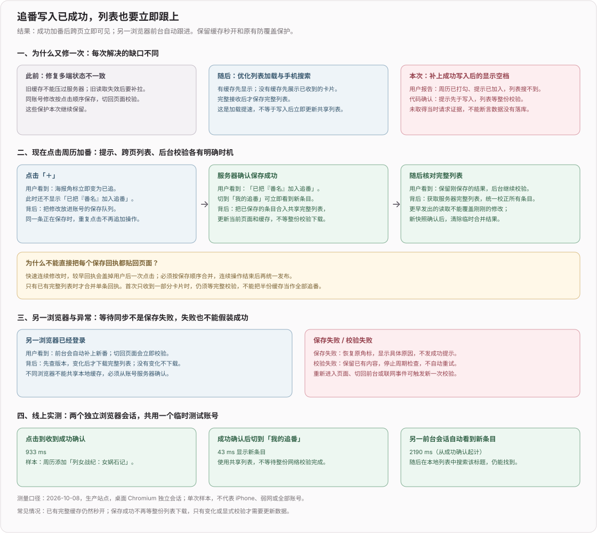
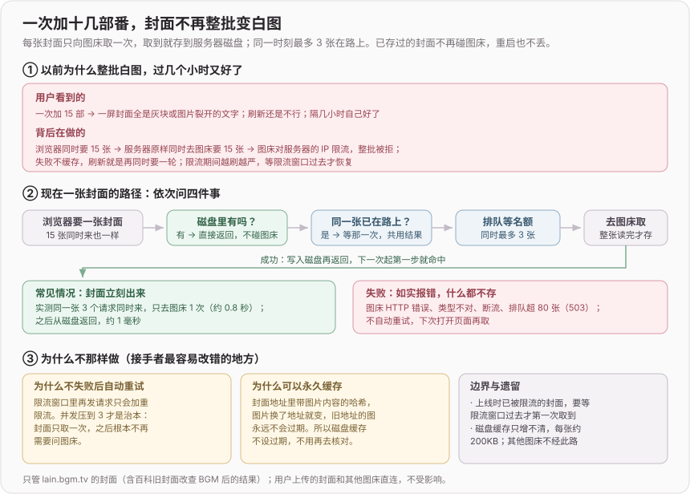
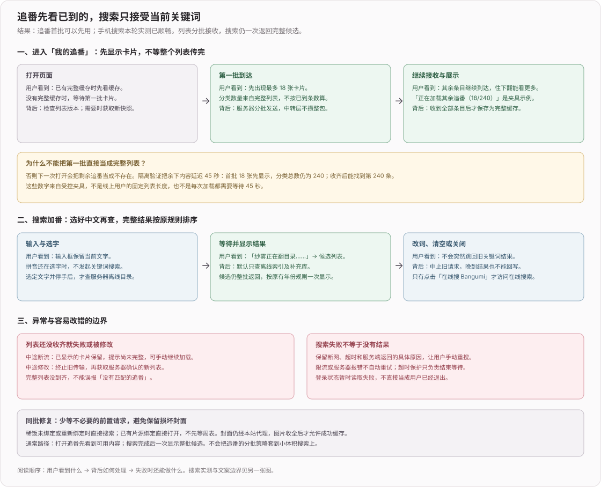
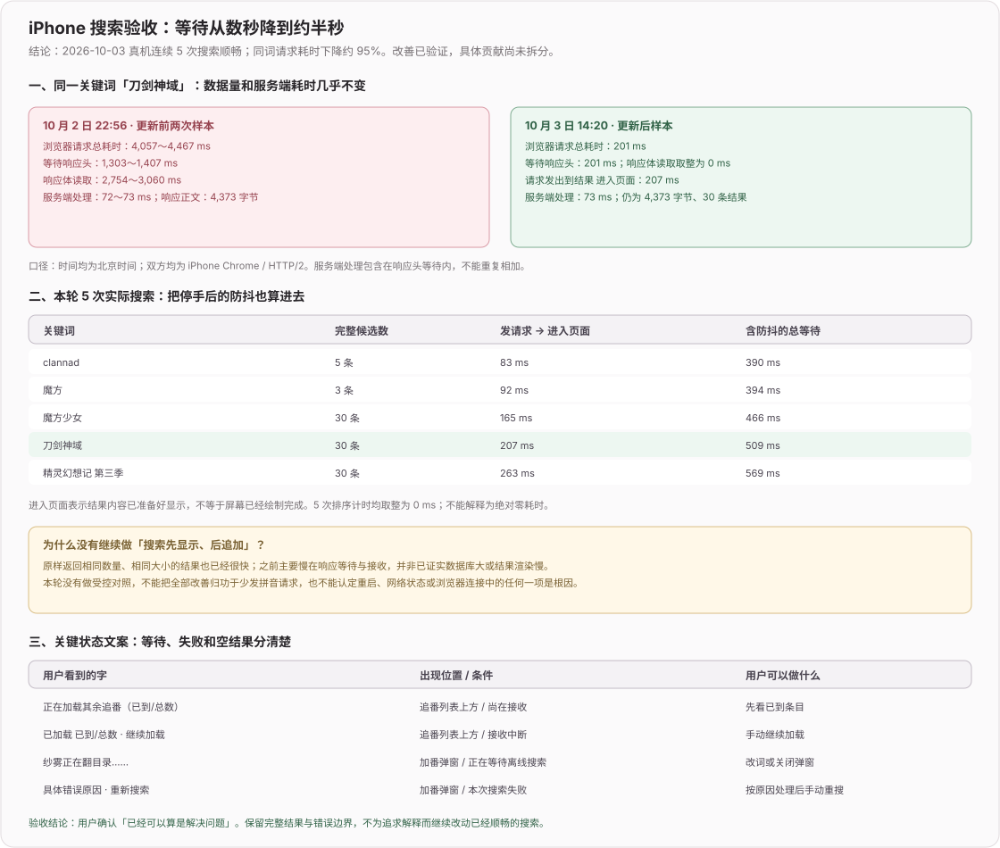

# 网页版（2026）

## 2026-10-18 feat(web): 纱雾助手可以附图提问

**效果**：纱雾助手的输入框可以粘贴截图、把图拖进面板，或点「图片」选文件，图和文字一起发出去，一条最多 4 张。只发图不写字也能发。消息里显示缩略图，点开看大图。编辑重发时原来附的图会带回来。图只在发出的那一轮给模型看，之后的回合只知道那条消息附过几张图。删除或清空对话时图片一起删除。所选模型看不了图时不能附图，上传前就会拦下并提示。访客不能附图。设计稿见 `docs/design-mockups/web/助手附图.html`。

**数据流**：

```
浏览器：长边缩到 1280、转 JPEG（原图不出本机）
  → POST /sessions/:id/images（逐张，≤1.5MB，型号不能看图直接 IMAGE_UNSUPPORTED）
      落盘 dataDir/agent-images/<uid>/<sessionId>/<imageId>.jpg，返回编号
  → POST /sessions/:id/runs { body, images:[编号…] }
      begin 事务：核对编号归属、未被引用 → 写进用户消息行 images_json
  → 本轮模型请求：这条 user 消息改成 content 数组，图以 data URL 附上
    之后的回合 / 摘要：transcript 里只留「[附图 N 张]」
删除：删会话 / 清空 → 先删行，再删整个会话的图目录
      截断（编辑重发）→ 删行后给被截掉的图一小时宽限期；每小时清一次没人引用的过期图
```

**关键代码**：图片按张计 token，不按 base64 体积算，否则一张图就会被上下文预算判成超长（`web/server/agent/run-service.ts`）：

```ts
if(estimateContextTokens({...request,images:[]})+images.length*IMAGE_INPUT_TOKENS>view.budget.maxInputTokens)throw new AgentRunError('CONTEXT_BUDGET')
```

**边界 / 风险**：每人图片总量上限 200MB，超过后报 `IMAGE_STORAGE_LIMIT`，要删旧对话才能再发图。HEIC 这类浏览器解不开的格式会被标成读不了。自配模型默认按看不了图处理，管理员在核准端点里显式标 `vision: true` 才开放。

## 2026-10-18 fix(web): 修复想看卡片的「继续看」在窄卡里换行

**效果**：桌面「我的追番」卡片在窄宽度（如三列、每张约 220px）下，想看卡的「继续看」不再折成两行。窄卡时所有状态的卡片按钮内边距统一收紧，按钮文字也不再允许折行。已在 320～1600px 共 18 个宽度下核对：按钮文字都不换行，也没有按钮超出卡片。

**原因**：窄卡只给能写点评的卡（在看 / 看完）收紧了按钮内边距，想看卡多出的几像素把「继续看」挤成两行。同一处的 `.has-review` 选择器在 2026-09-27「统一在追文案为在看」批量替换时被误改成 `ha在看review`，一直没生效，这次一并改回。

**边界**：≤360px 的小屏手机仍保留更窄的 6px 内边距（选择器提高了优先级，不会被窄卡规则盖掉）。

## 2026-10-18 fix(web): 修复今天更新的番剧卡片爱心与集数重叠

**效果**：桌面「我的追番」卡片里，当天更新的番不再把爱心挤到集数上。「今天更新」改成贴纸，贴在封面左上角（和封面左下角的「観望中」朱印同一种贴法），卡片顶排只剩状态章、爱心、集数，和其他卡片一致。手机端封面本来就隐藏，「今天更新」仍留在顶排，顶排可以换行，不会重叠。

**关键决策**：同一枚贴纸渲染两份，桌面隐藏顶排那份、手机隐藏封面（连带封面上那份）。被隐藏的一份是 `display: none`，读屏不会念两遍。

## 2026-10-15 feat(web): 新增立绘风格开关，可切回旧版全身立绘

**效果**：设置页新增「外观」口袋，「旧版 / 新版」二选一，点击立即生效、无需刷新；选择记在本机浏览器（和周历横纵布局同一套 localStorage 做法），默认新版。旧版是 2026-09-29「立绘调整为波普插画格」之前的全身站立立绘：周历（可拖动的纱雾 + 轮换气泡）、设置（千寿ムラマサ）、我的追番（山田エルフ，桌面页尾 / 手机顶部并排）、登录弹窗（纱雾全身）、追番大厅 / 福利 / 追番空态（Q 版纱雾 + 气泡）、往期周历与时间线空态。新版保持当前画稿贴纸

**素材来源**：旧素材 `chara_03/04.webp`、`sagiri-full.webp`、`sagiri-mascot.webp` 一直留在 `web/public/assets/`，无需从历史找回；找回的是页面结构和样式，取自 `9bed4ce`（立绘调整为波普插画格）的父提交，样式放进新文件 `styles/sprite-legacy.css`，不碰共享样式

**关键决策**：风格状态与取图入口集中在 `sprites.tsx`（`useSpriteStyle` / `spriteSrc` / 旧版立绘组件），各页只判断一次风格、渲染对应节点，旧版节点只在选旧版时才渲染，新版路径不变

**边界**：旧版下「我的追番」页头的「今天的功课」便签随画稿一起不显示；旧版不带新版的登录挡脸动画和周历滚动上色。风格目前只记本机，不随账号同步

## 2026-10-15 feat(web): 平板和手机新增反馈与建议、退出登录入口

**效果**：平板、手机宽度（≤960px）下，顶栏右上的头像圆可以点开，菜单里有用户名、「反馈与建议」和「退出登录」。点「反馈与建议」打开反馈面板，点「退出登录」退出并回到周历，顶栏恢复为「登录 / 注册」。有未读回复时头像右上角带红色数字角标（超过 99 显示 99+），菜单里「反馈与建议」右侧同样显示数字；角标绝对定位，不改变头像和菜单尺寸。菜单走全站统一浮层，右缘与头像对齐。桌面顶栏不变

**决策**：移动端设计稿里没有这两个入口的位置，选了贴近现有风格的头像菜单，复用追番卡片「更多」菜单的样式；没放进设置页，因为反馈要随时能点到

## 2026-10-15 feat(web): 番剧周历支持“继续看”

**效果**：登录后，周历每张海报下方多一排「继续看 / 试看」和「BGM」。已追的番显示「继续看」，按追番进度开第 N 话；没追的番显示「试看」，默认第 1 话。点开后和「我的追番」一样挑源（稀饭 / Girigiri）、选「在纱雾这儿看」或「跳去源站看」，认过的源下次直接开。BGM 按钮跳到 Bangumi 条目页。按钮常驻、整排占海报底部一行，手机两列布局下已核对不溢出。往期周历暂不带这排按钮。

**关键决策**：继续看的源绑定、片源定位、候选 / 搜索弹窗原来写在 `TracksPage` 里，现抽成 `tracks/useSourceWatch.tsx`，我的追番和周历共用同一份，请求预算与绑定缓存只有一套。试看的绑定仍按 BGM 编号落库，之后追上直接沿用；没追的番不会因此进入追番列表。

**边界**：已追番的「继续看第 N 话」尚未用有追番数据的账号实测，只验了试看流程。

## 2026-10-15 style(web): 调整番剧周历筛选按钮文案

**效果**：番剧周历里的「只看我的追番」改为「隐藏没追的」，筛选开启后文字变为「显示全部」，不再与顶部导航「我的追番」重名，避免用户误以为点它会跳转到我的追番页；按钮仍是原地筛选开关。两种文案在同一格内叠放、只切换可见性，按钮宽度始终取较长者，切换时不挤动旁边的刷新、回到今天按钮。

## 2026-10-14 fix(web): 修复追番选源弹窗挤窄溢出

**效果**：追番卡片内的选源弹窗现在覆盖完整视口，不再缩进卡片、把播放按钮挤成竖排；保留卡片旋转效果。弹窗通过 portal 挂到 body，避开旋转卡片建立的 fixed 定位包含块。

**验证**：原版在浏览器回归中触发断言失败；修复后桌面、平板、手机共 5 种视口全部通过，覆盖长绑定标题、两种播放方式、重新匹配、关闭按钮、Esc、点击遮罩及组件卸载。生产构建、TypeScript 检查通过。脚本为 `web/scripts/test-tracks-dialog.cjs`，使用外部 Playwright（可通过 `PLAYWRIGHT_MODULE` 指定路径）和本机 Chrome，不新增项目依赖；夹具阻断外网，不使用线上账号。

## 2026-10-10 fix(feedback): 修复文字与截图一起粘贴时丢失文字

**效果**：写反馈时粘贴同时含文字和图片文件的内容，文字按光标位置插入输入框，图片加入下方截图区。纯文字粘贴、选中文字后替换及多图添加继续沿用原有行为；截图仍限 3 张，图片处理失败或超出限制时不会阻止文字粘贴。

**边界**：实查 Windows QQ 混合复制只提供文字与 HTML 中的本机图片路径，没有图片文件或字节，网页不能读取这些路径。这种粘贴会保留文字并提示逐张复制图片或手动添加截图，无法自动导入 QQ 的两张图片。

> 2026-10-06 收口：7～9 月已完成阶段移入归档。日常接手先看 [012](../ideas/012-网页版.md)，不用顺读旧日志；当前播放修复见 [011](../ideas/011-在线观看.md)。本次只做文档复核，不新增线上验收结论。

## 已完成阶段的结果与保留决策

| 模块 | 已落地 / 已替换 | 继续维护时保留的边界 |
|---|---|---|
| 基础与部署 | 独立 Web 子项目、周历、账号、设置、低权限 Node + HTTPS 反代 | 数据/密钥在发布目录外，监听 loopback；未知 API 返回 JSON 404，不落 SPA；旧 Oracle/serverless 选型已结束 |
| 追番与搜索 | 状态/标签/进度、手动加番、封面、公开大厅、BGM 导入、离线索引 | 本地查询默认不联网，在线搜 BGM 由用户点击；老的自动在线兜底不是现行规则；已知字段不被后台补全覆盖 |
| 多端一致性 | 服务端 revision、写入串行、生命周期读取、前台轻量校验 | 本地缓存只提速，服务端权威；整包上传事务内比较 baseRev，冲突 409；详见 [014](../ideas/014-网页版多端追番状态一致性.md) |
| 账号与邮件 | 邮箱验证码、第三方入口与配置开关 | 自动填充不是身份；已验证邮箱与提供方身份规则按当前实现区分，别照搬早期 Google 绑定表方案；见 [013](../ideas/013-邮箱快捷注册与登录.md) / [015](../ideas/015-noreply发信与第三方登录接入指南.md) |
| 点评与推荐 | 问答、草稿、发布/撤回、大厅、海报、服务器 AI/BYOK | 发布和账号公开是双门槛；草稿/问答不公开；流式要穿过生产反代验证，海报 blob 需 CSP 放行；见 [017](../ideas/017-网页版推荐与点评助手.md) |
| Agent | 历史/压缩、受控循环、来源、访客、外部 AI、追番与播放动作 | 模型提案不等于执行；用户确认与权威回执独立，阶段 9 尚待总验收；见 [018](../ideas/018-Agent助手.md) / [019](../ideas/019-Agent架构复盘.md) |
| 备份恢复 | ZIP/JSON 导入；ZIP、ZIP+Markdown、Markdown 导出 | 按更新时间合并，不删除备份缺项；他人备份只导追番；Markdown 只供阅读；下载短效票据兼容下载插件，不仅靠 Cookie |
| 放映福利 | 积分、邀请、兑换和扭蛋页面 | 唯一请求号避免重扣；播放名额已移除但福利未删，权益后续用途仍待定，见 [016](../ideas/016-慢源优先观看与抽奖营销.md) |
| 画稿界面 | 周历显影、登录遮脸、追番勾选取代旧静态布局阶段 | 装饰主要在 PC 展示；旧“设置/福利渐进上色”已撤；追番勾选按 updatedAt，改标签也可能算“动过”，不是已看片数证明 |

## 尚未关闭的事项

- 10-04 列表/搜索已有真机历史验收，但首次渐进列表收齐前不能缓存成完整快照；中断保留已收内容、显式继续加载。继续修复保留取消和代次校验。
- Agent 长历史压缩质量、其他 BYOK、生产反代/真实平板的整体验收未被阶段实现自动覆盖；反馈 SMTP 到达与手动截图上传待验，见 [用户反馈](../ideas/用户反馈.md)。
- GitHub 09-12 记录只覆盖隔离接口与 UI：当时未配置真实凭据、未真授权、未部署。本轮未验证后续线上配置，不能据日志断言今天已启用。
- 桌面↔Web 同步当前另有未提交代码改动，不并入本次文档整理；WebDAV 定期备份原待办仍未确认完成。

## 原始记录（仅特殊追溯时阅读）

- [2026-09-网页版-功能与界面](archive/2026-09-网页版-功能与界面.md)
- [2026-09-网页版-Agent](archive/2026-09-网页版-Agent.md)
- [2026-08-网页版-下半月](archive/2026-08-网页版-下半月.md)
- [2026-08-网页版-上半月](archive/2026-08-网页版-上半月.md)
- [2026-07-网页版-建设期](archive/2026-07-网页版-建设期.md)

- [早期在线观看记录](archive/2026-网页版在线观看-早期记录.md)；后续播放日志统一写[在线观看专题](2026-在线观看.md)。

## 本轮文档整理

2026-10-06：拆出原始阶段日志，当前区只留功能结果、关键取舍、未关闭事项及近期记录；关联 ideas 同步收口，原始正文完整保留。后续新日志仍按根 DEVLOG 的提交规范追加，不把“归档”解释为“全部验收完成”。

<a id="tracks-write-sync-20261008"></a>

## 2026-10-08 fix(web): 修复周历加番后列表不显示

**修改后效果**：周历和往期周历点击加番后，角标先响应点击，“已加入”提示等服务端写入成功再显示。已有完整列表时，成功回执立即合入当前浏览器共享列表与缓存，切到“我的追番”不必等整份校验下载；搜索加番、修改、移除也复用同一合并入口。另一浏览器持续前台时的版本检查从 15 秒缩短为 3 秒，切回页面立即校验；版本没变不下载完整列表。



**与此前修复的关系 / 证据边界**：

- 用户报告：周历海报已打勾并提示已加入，但“我的追番”搜不到；另一个已登录浏览器要等一会才看到新增条目。代码确认旧周历在 PUT 完成前就发成功提示，成功回执只等待后续全量读取收口，没有立即更新共享集合；版本检查间隔为 15 秒。未取得报告发生时的请求与数据库证据，不能把这次表现直接定性为“写入失败”，也不能仅凭先后顺序断言是 10-04 性能提交引入。
- [014 多端追番状态一致性](../ideas/014-网页版多端追番状态一致性.md) 保留此前修复：旧缓存不能按本机时间戳压过服务器；同账号写入串行；写入使在途旧读取失效，结束后补拉；生命周期刷新和版本变化校验。本次补的是写入确认与列表显示之间的空档，保留那些保护。
- 本文件的 **2026-10-04 `perf(web): 优化追番列表加载和手机搜索体验`** 记录仍适用：首批先显示，收齐才存完整缓存；手机搜索取消与代次保护保持不变。加载提速与写入后的及时显示是两条不同链路。

**关键决策 / 数据流**：

- `tracksSync.ts` 的 `runTrackMutation` 把成功 PUT 的整条回执或 DELETE 结果按账号写队列合入 `committedData`。合并基底只能是已有完整服务器集合，不能用首批流式卡片冒充全体；连续写全部结束后才统一通知订阅者和缓存，避免较早回执盖掉后一次乐观修改。新挂载页面优先展示这份已确认集合
- 全量权威读取仍然执行；通过原有请求代次与写入版本守卫后，才替换集合并清除临时合并结果。成功回执只是缩短展示等待，不用本地时间戳反压服务器，也不替代跨浏览器校验
- 周历同一条保存期间重复点击不再追加写操作；保存失败恢复角标并透出原因，不发成功提示。追番列表搜索加番的成功提示同样延后到写入确认
- 列表、流式列表、版本检查显式使用 `cache: 'no-store'`；单条 PUT / DELETE 接入已有请求截止时间和终端日志上报。失败不自动重试；版本校验失败后停止周期检查，重新进入页面、恢复前台或联网事件才触发下一次校验

**边界 / 后续排查**：

- 上述为单次桌面会话样本，不是 iPhone / 弱网 / 大列表的固定耗时。3 秒是检查间隔，跨浏览器还要等待版本接口和必要的完整列表传输，不能承诺 3 秒内总能显示；隐藏页面不周期检查
- 首次没有完整集合时，仍等待完整校验后才能发布完整共享列表。只保存过的临时合并集合也不等于已重新取得服务器全量快照
- 后续复现先区分：PUT / DELETE 是否成功 → 成功回执是否合入共享列表 → 新页面是否先展示该集合 → revision / viewRev 是否变化 → 完整校验是否完成或被新写入淘汰。用现有请求 ID 对照 `[request:server]` 与 `[request:client]`；不要把“角标变了”当作已落库证据，也不要把“仍显示缓存”直接叫数据丢失

## 2026-10-07 feat(web): 新增往期周历

**修改后效果**：番剧周历页多了「往期周历」入口，进去是独立页：先选年份（2013 年起），再选冬 / 春 / 夏 / 秋，下面按周一到周日展示那一季的海报，可以直接加追番。本季标明「还在跟着周历更新」；接入前的季度第一次点开要等几秒（约 10 秒）现翻，之后永久存下、秒开，页面注明是按首播日翻出来补的。翻失败会如实显示原因，不自动重试。

**关键决策**：
- BGM 的 `/calendar` 只返回当前在播的番，过季就掉出去，没有往期周历。所以从接入起每季存一份 BGM 周历原样的快照：`$DATA_DIR/calendar-seasons/YYYY-MM.json`，永久保留，不进部署目录；本季内每次拿到新周历按 bgmId 取并集并入（同一部以最新的星期和资料为准，中途完结掉出周历的番不丢），季度一换自然冻结。季度按东八区算。
- 服务端周历缓存从 14 天缩到 7 天（前端同步），本季内的新番和改星期才能每周被收进来；刷新只由用户访问触发，没有后台定时探测。进程启动时已落盘的周历也会补进它所属季度。
- 接入前的季度走「按首播日翻」：BGM 按年月检索接口命中首播日在该季首月的条目，一页 50 条分页取完；该接口的 `platform` 参数无效，只能自己按字段筛，保留 TV + WEB，与 BGM 当季周历收录范围一致（实测 2026 年 10 月季：周历 100 部在检索结果里，其中 TV 80、WEB 20）。星期由首播日（日本当地日期）推算，实测和当季周历对上 100 部里的 98 部。补出来的快照标 `derived`。
- 补季度只在用户点开时触发：同一季只补一次（共享在途请求），所有季度的 BGM 请求排成一条串行队列，不会因连点并发打 BGM；补成功才落盘，失败不存半成品。当季只靠周历快照，不倒推；最早到 2013 年第一季。
- 预热脚本 `npm run warm:seasons`（`web/scripts/warm-calendar-seasons.ts`）：部署后在服务器上跑一次，把 2013 年起没翻过的季度从新到旧翻完，约 20～30 分钟。限流预防：串行；页与页间隔 2.5 秒、季与季间隔 10 秒，各带 ±15% 随机抖动，可用 `--page-gap` / `--season-gap`（毫秒）放慢；任何一次失败（429 / 403 / 5xx / 超时）立刻整体停下，不重试、不跳过继续打，已翻好的季度已落盘，稍后重跑从没翻过的接着来。`--limit N` 先试几个，`--dry-run` 只列清单。数据目录跟服务一致，服务在跑也能跑（落盘原子）。
- 新接口 `GET /api/calendar/seasons`（列表，含未补的季度）和 `/api/calendar/seasons/:key`（单季，缺失的往期季度现补）。已登记进 Agent 功能清单。
- 海报上「追 / 取消追」逻辑从周历页抽成 `useTrackToggle`，周历页和往期页共用。

**边界 / 风险**：
- 补出来的季度只含「首播日在该季首月」的番：前一季接着播的番、晚一两个月才开播的番都不在内，星期偶尔差一天；2026 年 10 月季里有 2 部周历有而检索没有，另有 2 部星期对不上。
- 本季和接入后的季度取决于有人访问周历的时间点；整季没人访问就没有快照，之后也只能靠「按首播日翻」那套近似。
- 季度交替的前几天，上一季没完结的番会被并进新季度快照，之后不会自动清掉。
- 一次现翻对 BGM 发约 3～4 个请求，用户点开不会等间隔，只靠串行队列；部署后建议先跑一遍预热脚本，免得真人逢新季度都等。预热脚本只在本地测过 2 个季度和一次失败即停，没有跑完全部。
- 只在本地验证了桌面和手机宽度的显示、合并与时区的脚本，以及补 2019 年春季、2024 年秋季、2013 年冬季；没有线上实测。

## 2026-10-07 feat(web): 追番页新增按年份和季度排列

**修改后效果**：追番页视图切换由「卡片 / 列表」变为「卡片 / 列表 / 时间线」。时间线按加入追番的时间归到年份，再分冬（1 月）、春（4 月）、夏（7 月）、秋（10 月）四季，每季一张贴了和纸胶带的纸卡，番名是小贴纸：没看完的是粉色虚线，看完的是实线加对勾。观望的番不算追番，不进时间线；搜索、标签、状态筛选在时间线里照常生效。点番名打开编辑弹窗，新增「记在哪一季」，可以手动挪到别的年份和季度，挪完有纱雾口吻的提示。页面文案、空状态均为和泉纱雾的语气。

**关键决策**：
- 原来没有创建时间，只有每次编辑都会刷新的 `updatedAt`，不能拿来归档。新增 `tracks.created_at` 列（`server/db.ts`），只在插入时写入，编辑、同步更新都不动它；老记录用 `updated_at` 回填一次（偏晚，用户可在弹窗里改）。
- 接口返回 `createdAt`；`PUT /api/tracks/:bgmId` 接受 `createdAt` 用于手动挪季度，必须是正整数且不晚于当前时间。挪季度时落在该季度首月 1 号中午，避开时区边界。
- 前端对没有 `createdAt` 的本地旧缓存退回 `updatedAt`，归档逻辑集中在 `src/tracks/TrackTimeline.tsx`。
- 只归档动画；漫画、小说本来就不在网页版追番页里展示。

**边界 / 风险**：
- 从 Bangumi 导入的番，创建时间是导入那一刻，不是用户当初收藏的时间，需要的话手动挪。
- 备份恢复不带创建时间：恢复到新账号时每部番按备份里的最后修改时间归档；已存在的番保留原创建时间。
- 桌面端同步新增的番，创建时间取客户端的最后修改时间（夹到当前时间以内），不是真实加入时间。
- 只在本地用测试账号验证了桌面和手机宽度的显示与挪季度，没有线上实测；纱雾台词为按角色性格撰写，未经反复打磨。

## 2026-10-08 fix(web): 补回加番后缺失的封面

**复测结论**：10 月 7 日的封面代理缓存改动没有解决这次“我的追番”加番缺图。已登录的本地测试账号中，四张缺图卡片的 `cover` 字段为空，页面没有发起图片请求。用户提供的终端日志未见 429，也没有触发 15 分钟停发；日志里两次 15 秒超时是 `/r/400` 取图请求，不能用来解释这四张卡

**原因与改动**：加番后异步获取 Bangumi 条目详情以补封面，原先只随机延迟 0.8～2 秒，连续加番仍会并发请求；失败被静默吞掉。现在详情补全与封面取图共用队列，最多同时进行 2 个上游请求，相邻请求至少错开 1 秒；收到 429 后停发尚未发出的封面请求，不自动重试。失败原因写入服务端终端。读取追番列表时，仍缺封面的旧条目会排入一次补全。系统补图另增网页视图版本，让页面重新读取封面；桌面同步用的 `tracks_rev` 不因补图变化

## 2026-10-07 fix(web): 修复一次加多部番时封面整批加载失败

**修改后效果**：一次加十几部番，封面不再整批变灰块或裂图。每张 BGM 封面只向图床取一次，取到后存进服务器磁盘，之后（含重启、重新部署后）直接从磁盘返回，不再碰图床。



**关键决策**：
- 原因是封面代理 `/api/cover/*` 没有缓存也不限并发：浏览器同时要十几张，服务器原样同时打到 `lain.bgm.tv`，图床对服务器 IP 限流，整批失败；失败不缓存，刷新又是新一轮并发，所以越刷越不好，过几小时限流窗口过去才恢复。这是根据症状的推断，没有抓到线上的上游状态码。
- 取图逻辑抽到 `server/bgm/cover-proxy.ts`：磁盘缓存（`$DATA_DIR/bgm-cover-cache`，在部署目录外）→ 同一张在途请求共用 → 最多 3 个并发、排队上限 80（超出 503）→ 整张读完才写盘（先写临时文件再改名）。
- 不做应用层自动重试，失败原样返回具体原因（上游 HTTP 状态、类型不符等）并打日志，符合 AGENTS 对限流的规定。
- 磁盘缓存不设过期：封面地址带图片内容哈希，图换了地址就变。

**边界 / 风险**：
- 上线时已经被限流的封面，要等限流窗口过去才第一次取到，之后才不再受限流影响。
- 磁盘缓存只增不清，每张约 200KB；追番数量增长时需要留意 `bgm-cover-cache` 的体积。
- 在途去重和排队名额在进程内存里，重启后清零，多实例各算各的。
- 只验证了脚本层：同一张 3 个并发请求只去图床 1 次，第二次约 1 毫秒从磁盘返回。没有在浏览器和线上实测。
- 前端 `coverUrl` 未改；百科旧封面经 `/api/subject-cover/:id` 重定向后同样走这条代理。

## 2026-10-04 perf(web): 优化追番列表加载和手机搜索体验

**效果**：我的追番首次加载时先显示已收到的卡片，其余条目继续传输；已有完整缓存时先显示缓存，再校验版本。加番搜索在中文选字结束后才发请求，改词、清空或关闭弹窗会取消旧搜索，旧结果不能覆盖新词；重复点击当前搜索页签也不会再永久转圈。2026-10-03 的 iPhone Chrome 真机验收中，5 次搜索从停手到结果进入页面为 390～569 ms，用户确认「已经可以算是解决问题」



**关键决策 / 数据流**：

- **列表分批接收，页面分批展示**：首次无完整缓存时采用 NDJSON 快照，首批最多 18 条并携带完整分类计数，后续继续发送；响应显式设置 `X-Accel-Buffering: no`，避免上线后被 Nginx 攒成整包。页面先渲染 18 张卡片，滚动时继续增加展示数量；传输顺序通过条目索引还原，不把首批计数冒充完整列表计数
- **半份列表不进入完整缓存**：只有收齐并校验通过的快照才保存。中途断流保留已显示内容，显示已加载数量和「继续加载」；尚未收齐时，筛选未命中也不能宣称列表中没有这部番。加载中发生修改会中止旧流，重新取得服务器确认的新快照，避免旧数据覆盖刚改的进度或标签
- **搜索保持完整结果与既有排序**：默认只查服务器离线索引及共享补充库，只有用户点击「在线搜 Bangumi」才访问在线搜索。输入保持 300 ms 防抖，拼音组合期间不发送关键词请求；取消请求之外还保留请求代次校验，防止晚到结果回写。搜索仍一次返回整批候选，按原有年份规则排序，不照搬追番列表的分批追加策略
- **失败要有明确终点和原因**：响应头与响应体共用请求截止时间，保留断网、超时及服务端错误原因，提供手动重新搜索；429/5xx 不自动重试，也不伪装成零结果。登录状态读取失败不直接广播退出，仅明确的 401 清除登录身份。超时保护负责结束等待，不作为搜索提速的证据
- **减少片源前置等待，避免缓存残缺图片**：稀饭未绑定及重新绑定直接进入搜索；已有稀饭 / Girigiri 绑定直接返回，不先等待周表。封面仍由本站代理，完整读完图片字节才返回成功缓存头，并更新封面缓存版本。同步调整手机端相关弹窗的布局
- **把浏览器阶段落到服务端日志**：按请求 ID 关联服务端处理与浏览器等待响应头、读取响应体的耗时；搜索补充输入等待、排序及 React DOM 提交计时，快速样本也上报，便于和慢样本比较。被用户取消的旧搜索不再记成失败；日志不只留在浏览器控制台。



**边界 / 还未确定的部分**：本轮真机体验与日志支持问题已解决，但前后不是网络条件严格一致的受控对照，尚不能拆分减少拼音请求、服务重启、网络状态及浏览器连接状态各自的贡献。此前的数秒等待集中在响应等待与接收，不能据此认定离线数据库规模或渲染是根因，也不能把全部改善归功于某一项改动。搜索现已整批返回且使用顺畅，未再增加渐进搜索或自动重试机制
