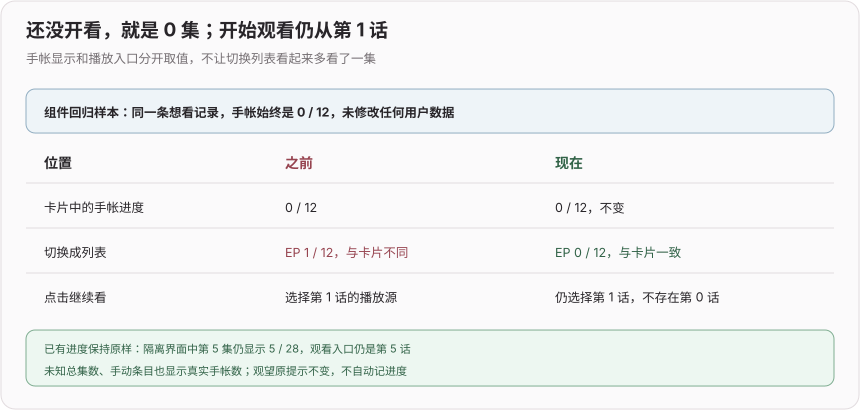
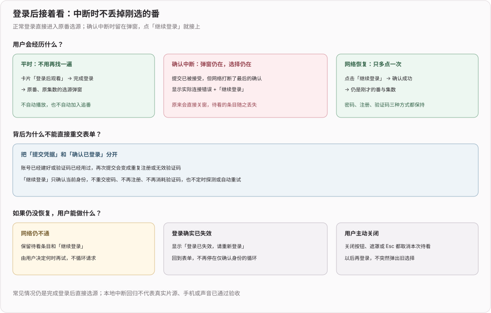
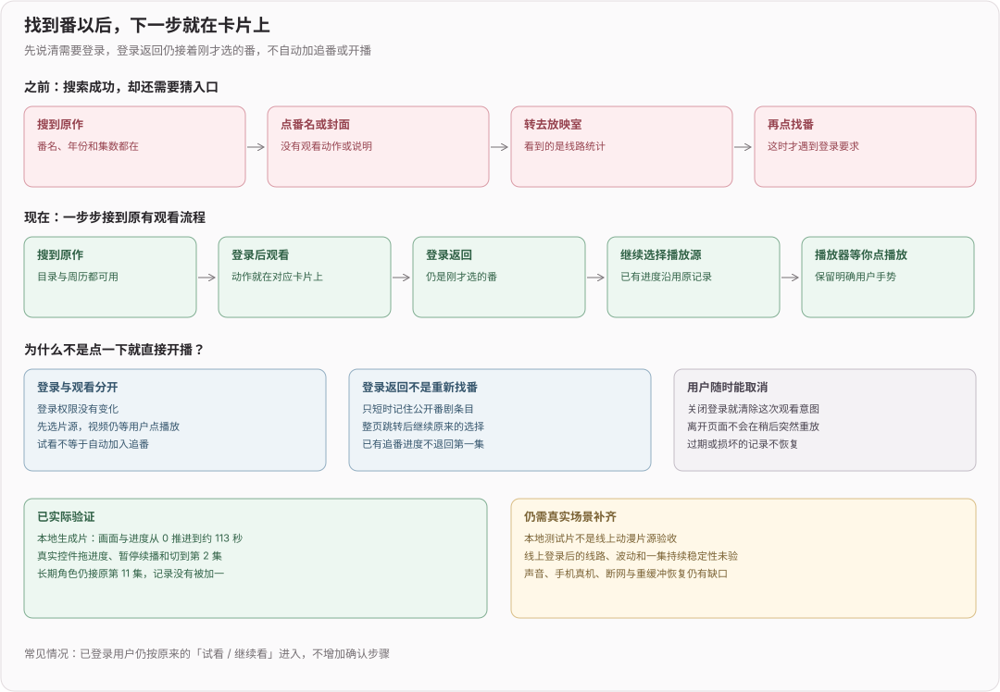

# 观看衔接（2026）

## 2026-11-12 fix(web): 列表中的未开看条目保持零进度

**修改后效果**：未开看的想看条目切换列表后仍显示手帐的 0 集，不再被起播下限改成 EP 1；继续看仍从第 1 话开始，已有进度、总集数和观望提示不变，不写用户记录

[隔离界面实际显示：列表 0 / 13、选源第 1 话](../devlog-assets/watch-journal-zero-actual.jpg)

**审核验收补充**：属于 PR9「手帐是唯一进度、卡片与列表一致」的原有验收边界，不另开小改动 PR。此前回访角色在三条未开看记录上看到卡片 0、列表 1，原因是列表文案误用了播放入口的最小集数，而不是有第二份观看记录

**验证**：既有 `test:watch-entry` 增加实际组件渲染断言，基线 EP 1 / 12 与预期 EP 0 / 12 明确失败，修后覆盖已知/未知总集数、0/7/12 集、观望及手动条目；按钮仍按起播下限至少第 1 话，渲染不修改输入。SSR 夹具关闭无关依赖预构建，避免退出时临时缓存清理竞态遮住原断言。CUA 已核对卡片 0 / 13、列表 EP 0 / 13、选源第 1 话和已有 EP 5 / 28；没有播放真实媒体或修改角色进度

**边界 / 回滚**：保持原发布分支历史，本次只追加显示修正和回归，不合并部署。回滚本追加提交恢复此前展示，用户手帐数据无需回退

## 2026-11-09 chore(web): 去掉与主分支重复的 typecheck 脚本

**修改后效果**
- 合并进最新主分支后，`web/package.json` 里只有一个 `typecheck`；两边各自新增同名脚本，Git 不报冲突，合并后会出现重复键

**边界 / 风险**
- 只删本分支这一行，脚本内容与主分支一致，行为不变

## 2026-11-05 docs(web): 独立登记观看衔接的审核记录

**效果**：观看入口与登录恢复记录集中到本专题，网页版总日志保留主分支现有内容，回归入口放在既有稳定位置，避免两侧都在文件末尾或日志开头追加时产生文本冲突

**关键决策**：只重排本 PR 的脚本登记和日志，保留最新主分支的原文，不合并其他待审功能，不 rebase、不强推；上条同步只保留了两侧内容，仍有文本冲突，本次以组合树结果确认冲突是否真正消除

## 2026-11-05 chore(web): 对齐已合并的回归入口与日志

**效果**：保留已合并到主分支的回归命令和日志，同时保留本 PR 的观看入口与登录恢复记录，记录相邻新增项的合并冲突；没有替换主分支实现、重写已发布历史或改变用户数据

**验证**：基于最新主分支与本分支重新计算组合树，并在隔离副本执行观看登录、入口、弹窗名称、播放协议和类型检查；仅同步两个文本登记文件，未把其他未发布分支堆叠进来

## 2026-11-05 fix(web): 登录确认中断后保留待看条目

**效果**：从番剧卡片进入登录，凭据提交成功但最后一次身份读取中断时，不再直接关窗并丢掉待看的番；弹窗保留连接错误与「继续登录」，网络恢复后继续原番、原集数的选源，不重复注册或再次消耗验证码

**审核回应**：PR #8 评论提出的正常页内登录丢选择未复现，`auth.user` 是实时 getter，不是提交时的用户快照；真实浏览器密码、注册、验证码三条正常路径均通过，随后用单次身份读取传输中断复现了不同原因的同类结果，本次修正该已确认边界，不按未经复现的闭包解释改逻辑

**关键决策**：凭据接受后显式确认身份，临时读取失败和明确未登录分别处理；继续动作只读取身份，不自动重试或重交表单，确认 401 时返回重新登录，主动关闭仍清除待看意图；表单初始化与 Esc 监听分开，父层重渲染不再擦掉中断后的继续状态

**验证**：`npm run test:watch-login` 在原行为下明确报 `WATCH_LOGIN_RECOVERY_LOST`，移除身份确认守卫也会失败，恢复后完整八场景通过，含三种正常登录、三种中断恢复、重复读取失败、取消和确认 401，凭据提交均仅一次，模型与外部请求均为零；`npm run typecheck`、`npm run test:auth-dialog-labels`、`npm run test:watch-entry`、`npm run test:agent-playback` 通过

**实际路径与边界**：CUA 从首页进入目录和原卡片，使用隔离验证码替身，仅中断最后一次身份读取，实际看到错误与「继续登录」，清除拦截后回到芙莉莲第 1 话选源，没有重新找番；不发送真实邮件、不提交线上认证，也不代表真实动漫线路、声音或手机验收，回滚撤销本次追加提交即可

## 2026-11-05 feat(web): 游客可从番剧卡片登录后接着看

**效果**：周历和全部番剧的游客卡片新增「登录后观看」，不再只给封面、番名而没有观看下一步；登录返回后继续刚才选的番，已有追番沿用原进度，新条目从第 1 集开始，取消登录会清除本次意图，不在稍后登录时突然重放

**关键决策**：复用原登录弹窗与同一个选源弹窗，登录成功只接到选源，不自动播放或加入追番；只短时保留公开条目字段，剔除封面和外部地址，兼顾整页 OAuth 返回，取消、离开页面、过期或损坏时清除；读取追番仍复用原完整快照，不把部分列表当成没有追过而回到第 1 集

**验证**：`npm run test:watch-entry` 的原界面在游客缺少观看动作断言失败，修后通过；移除取消清理或条目校验守卫会分别触发断言失败，恢复后通过；`npm run typecheck`、`npm run test:auth-dialog-labels` 和 `npm run test:agent-playback` 均通过，后者完成 28 项协议检查

**实际路径**：`npm run test:watch-ui:serve` 提供仅回环监听、独立数据目录和生成的本地测试片，不请求真实片源或付费模型；CUA 重走首页→目录→搜索→卡片登录→模拟整页登录返回→原番选源→匹配→实际播放器，验证首次暂停、0→约 113 秒的画面和时间推进、拖动、暂停续播及换集；长期角色仍从原第 11 集打开，没有把记录加到第 12 集

**边界**：线上仅访客只读，实际登录与第三方 OAuth 服务未提交；本地生成片不代表线上动漫线路已验收，静音测试不代表声音通过，手机真机、真实网络波动、断网和重缓冲恢复仍待后续常用链路体验；没有修改播放器媒体逻辑、后端权限或数据库结构，回滚撤销本次提交即可
