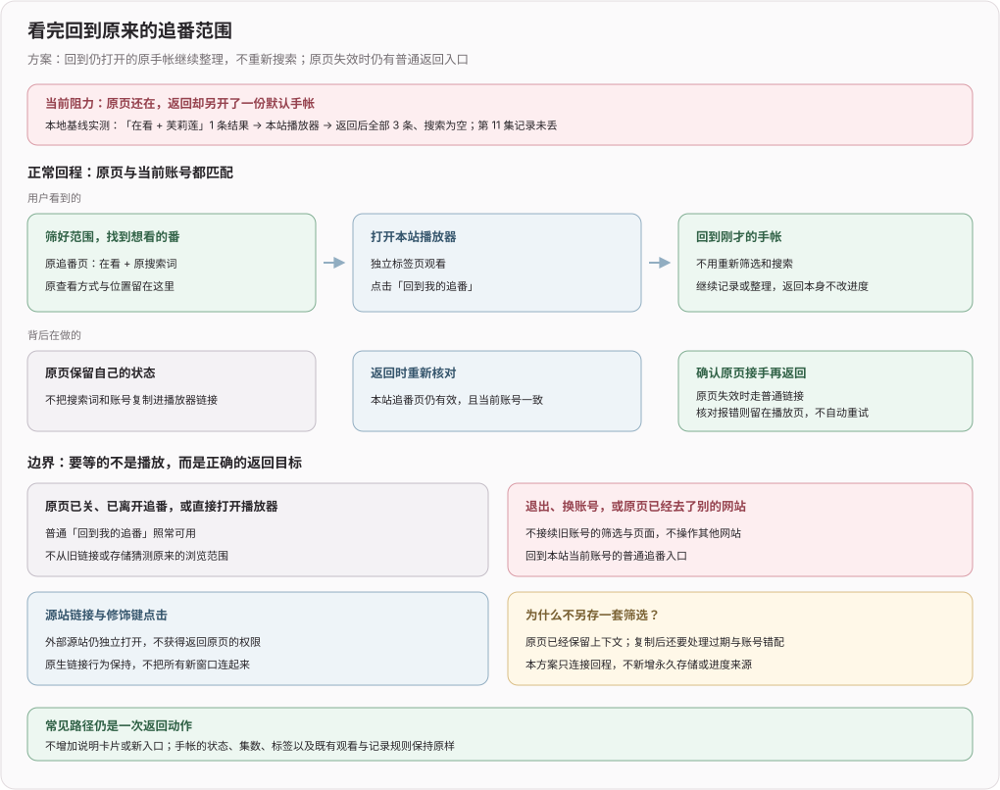
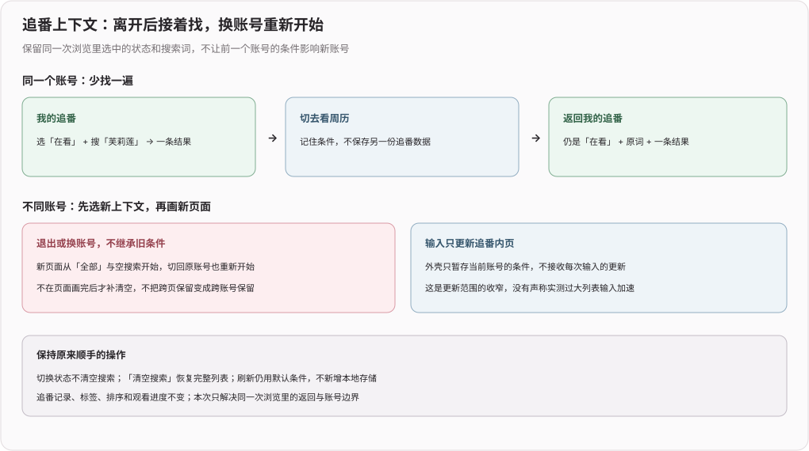

# 追番上下文（2026）

## 2026-11-17 feat(web): 看完返回原来的追番范围

**修改后效果**：从我的追番打开本站播放器后，点「回到我的追番」优先回到仍打开、账号一致的原追番页，继续原来的筛选、搜索和整理位置；原页已关闭或不再匹配时，普通返回链接仍可用

**关键决策**：只为追番进入明确本站播放器的路径保留受限同源返回关系，返回时实时核对账号及原页；源站链接继续独立打开，不放宽全部新窗口；复用原页已经持有的浏览状态，不新增存储、不将筛选或账号写入 URL，也不把播放器进度改写为手帐进度

**边界 / 风险**：原页关闭、离开追番、换账号、退出或直接打开播放器，均使用普通链接兜底；当前账号核对报错时留在播放器显示原因，不自动重试；修饰键点击保留原生行为；只补独立播放器的回程，不扩展刷新恢复、跨设备同步或追番状态

**验证记录**：基线 CUA 已确认「在看 + 芙莉莲」的 1 条结果返回后变为全部 3 条，原页和第 11 集记录仍在；19 项自动化浏览器回程、旧导航 4 项、观看入口、链接边界、类型检查和构建通过；相同输入基线失败，账号、来源路径和模式三项单守卫变异失败，恢复后转绿，返回未写入手帐；以上技术结果沿用 11 月 16 日记录，11 月 17 日核对业务代码与测试散列一致后接续，不重复记作新测试；发布前认证 fetch 确认远端 `main` 仍为开发基线 `5df695b`，没有漂移

**同目标 CUA**：11 月 17 日在新接通的 Chrome 中完成桌面卡片与窄屏列表回程，实际前台均切回原追番标签，播放器标签从列表消失；窄屏仍为「芙莉莲 / 在看 1 / EP 11 / 28」；视口设置 390 × 640、页面内容实测 386 × 640，完成后已恢复；仅打开本地生成片而未播放，真机、真实媒体与生产未验；补测以实际离开点为准，原页滚动 54 px → 返回后 54 px，搜索与原标签不变，仅代表这次窄屏样本

**方案与回滚**：[方案取舍及验收清单](../ideas/024-播放后返回追番范围.md)；撤销本次聚焦提交恢复普通链接回程，无需迁移或回写追番数据；原始散列、补丁及副本回滚记录留在仓库外

## 2026-11-09 refactor(web): 追番上下文改为显式写入并去掉源码正则断言

**修改后效果**
- 用户可见行为不变：返回追番仍保留状态筛选和搜索词，换账号、退出后清空
- 内页写入上下文改走 `rememberTracksNavigation`，不再直接改传进来的对象字段
- 回归脚本去掉两条用正则匹配 `App.tsx` 源码的断言，只留行为断言

**关键决策**
- 逐项拆掉防护看测试是否变红：忽略账号归属、不写搜索词、不恢复筛选、去掉页面 key，四种都在 `npm run test:tracks-navigation` 里明确失败
- 源码正则只管当前写法，换种写法就误报；去掉后「去掉页面 key」仍被跨标签切账号的浏览器用例拦住，所以没有损失这一条
- 去掉后不再有断言证明「输入只更新内页」，这一点现在靠代码结构保证，没有自动检查

**边界 / 风险**
- 合并到当时最新 `main` 的组合树上，类型检查和回归均通过；真实大列表输入耗时、真机未覆盖

## 2026-11-05 refactor(web): 追番搜索仅更新内页并隔离账号上下文

**效果**：返回追番仍保留原状态、搜索词与结果，输入和状态选择只更新追番内页，不再通知整个应用壳；退出或换账号在新页面渲染前选取空上下文，切回原账号也从默认条件开始，不继承旧条件

**审核回应**：落实 PR #4 的非阻塞建议，外壳仅保存带账号归属的内存对象，内页自行响应输入，账号变化同步更换对象并重新挂载内页；不新增浏览器存储、全局状态库或订阅层，筛选和搜索以外的状态不扩展保存范围

**验证**：原返回/清空/退出回归通过，不把代码审核当成大列表卡顿或可见旧账号帧的复现；增强后的 `npm run test:tracks-navigation` 在原实现的输入更新范围结构断言失败，故意移除账号判断时在同步归属断言失败，恢复后四项浏览器场景完整通过，包含跨页返回、清空、跨标签换账号往返与退出，模型与外部请求均为零；`npm run typecheck` 通过，浏览器断言均先等待可见结果，不靠点击后的瞬时读取

**实际路径与边界**：CUA 从首页进入我的追番，选在看并搜芙莉莲，去周历再回来仍是一条和第 7 集，不用重选或重输；切到全部后清空搜索恢复三条，退出回到访客首页；仅为本次浏览上下文，大列表输入耗时、真机和可见瞬态未实测，原数据、标签、排序与进度不改

**登记与回滚**：本 PR 的记录移到独立专题，避免与主分支在总日志顶部相邻追加冲突，旧脚本仅移动本 PR 的登记位置，不夹带新功能；撤销本次追加提交即可恢复原实现，原始文件、散列、patch、字面验证和副本逆向回滚保留在仓库外

## 2026-11-04 fix(web): 返回我的追番时保留搜索词

**效果**：在「我的追番」搜到一部番后，去周历再回来，搜索词和结果仍在原处，可以继续刚才的条目，不用再输一次番名；清空搜索仍能恢复完整列表

**关键决策**：沿用同一返回上下文事项里状态筛选的生命周期，只把搜索词一并留在应用壳的内存中；退出登录或账号变化时同步清空，不新增浏览器存储，不改标签、排序或查看方式

**回归**：`cd web && npm run test:tracks-navigation` 核对「在看 + 芙莉莲 → 周历 → 我的追番」保留一条结果和原词、切到全部仍按词检索、清空后恢复三条、退出后清掉前一账号的词；旧行为在返回搜索断言失败，移除退出清词保护时在退出断言失败

**边界**：刷新仍使用原有默认状态；这是原开放 Draft PR 的同一导航上下文补齐，保留已发布历史，不另开重复 PR，不合并或部署

## 2026-11-03 fix(web): 返回我的追番时保留状态筛选

**效果**：在「我的追番」选择在看、想看等状态后，切去周历等页面再回来，仍停在刚才选中的状态，不再重新展开全部条目；退出登录或切换账号时恢复为全部

**关键决策**：只把状态筛选留在不会随内页切换而卸载的应用壳中，追番数据仍按原流程重新读取；不保留搜索、标签或修改记录，也不新增浏览器存储

**回归**：`cd web && npm run test:tracks-navigation` 使用隔离账号和实际页面，核对「在看 → 周历 → 我的追番」后仍只显示 1 条在看记录，退出后恢复全部；基线会在返回筛选断言失败，修复后通过，移除账号重置后会在退出断言失败

**边界**：仅保持本次打开网页内的跨页选择，刷新后仍从全部开始；未替用户合并或部署，生产环境效果待对应版本上线后核验
