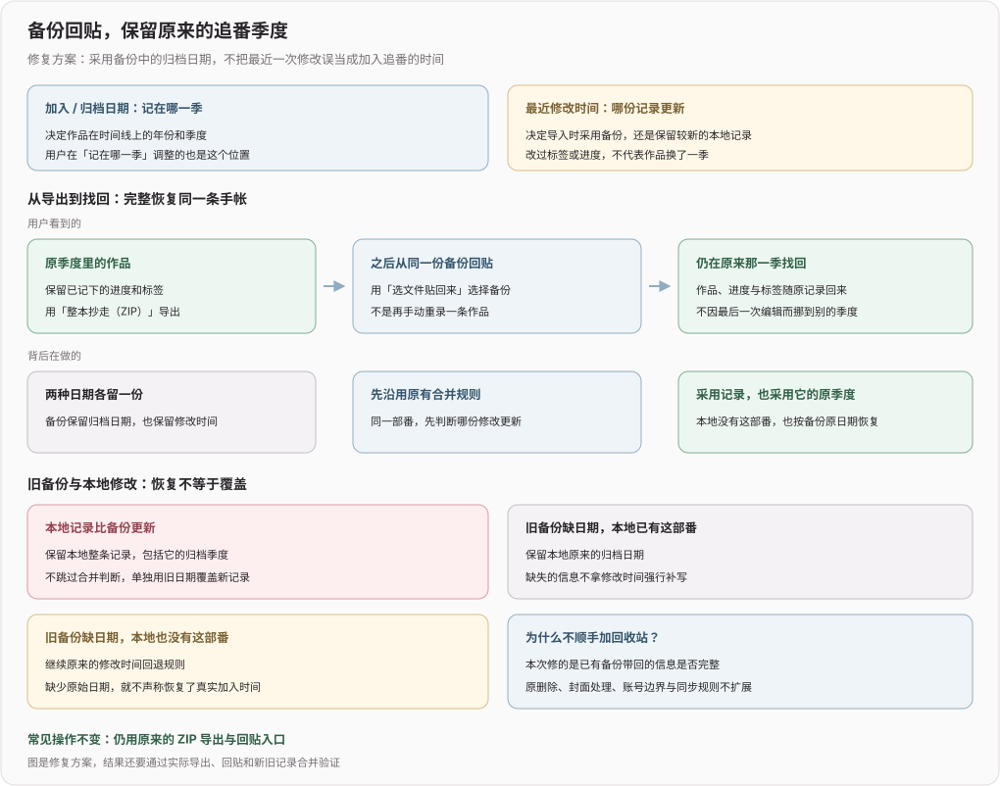

# 追番备份（2026）

## 2026-11-17 fix(web): 备份恢复保留追番归档季度

**修改后效果**：携带归档日期的追番备份贴回来后，作品仍归到原来的年份与季度，不把最近一次改进度或标签的时间当成加入时间；本地较新记录及旧备份缺日期时的兼容规则保持

**关键决策**：归档日期用于时间线位置，修改时间只参与现有合并胜负判断；采用备份记录时一并采用它的归档日期，旧副本不单独覆盖本地较新的季度；旧备份缺日期时，已有记录保留原日期，新记录沿用原回退

**边界 / 风险**：只修既有备份导入的日期完整性，不新增即时撤销、回收站或追番状态，不扩展删除、封面与跨端同步规则；历史上已恢复成错误季度的记录不自动追溯重写

**技术验证**：隔离脚本 `npm run test:backup-created-at` 在原基线明确得到 11 月时间值而非备份中的 7 月，退出 `1`；相同 ZIP 字节的修后 6 组通过，退出 `0`，覆盖新增 / 更新、较新或相同修改时间跳过、旧格式以及 16 类缺失 / 非法日期输入；新增与更新两项日期采用逻辑分别移除后断言变红，恢复转绿；进度、标签、extra 与 PNG 封面保持，外部请求和模型调用均为零；未运行未隔离的旧备份脚本

**同目标 CUA**：实际产品导出的 ZIP 落盘、内容与散列已确认，通过产品选文件入口导入同一文件后提示“新贴了 1 部，32 部手帐里的更新、没动”，33 → 32 → 33，四号仍为 1/12、周末再看与接着看，时间线选中 2026 年 7 月；下载事件超时仅影响回执，没有重复下载；API 测试 ZIP 与产品 UI ZIP 分开，PNG 封面只在技术用例验证，不宣称本轮 UI 自定义封面回贴通过

**方案与回滚**：[日期口径、旧备份兼容及验收清单](../ideas/025-备份恢复归档季度.md)；代码回滚恢复原导入逻辑，不改原备份、不重新删除已恢复的记录；原始散列、补丁与副本回滚验证随发布证据归档
