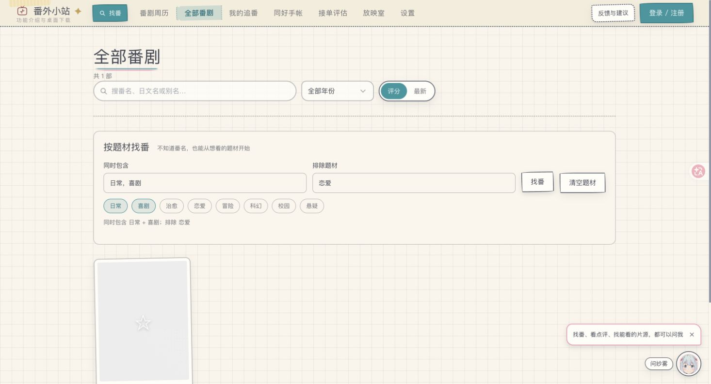
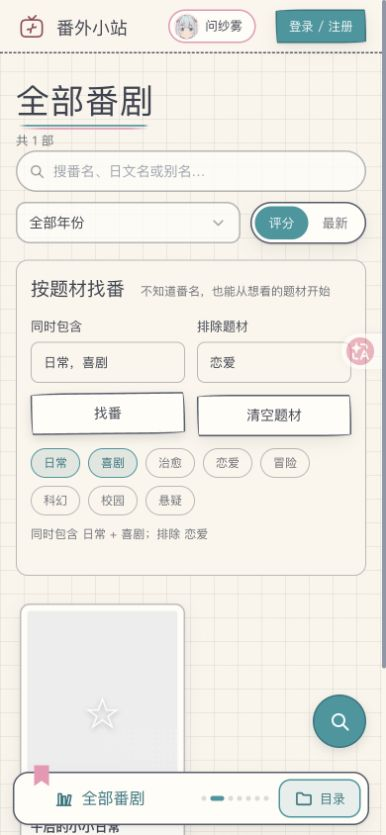

# 题材组合找番

## 用户目标与取舍

不知道番名，只知道今天想看日常喜剧、暂时不想看恋爱作品，也能直接缩小目录里的候选，再沿用现有追番与选源入口

参考：[用户提供的演示视频](https://www.bilibili.com/video/BV1A94z69E22/)在 03:40 左右展示题材包含与排除组合，01:20 展示明确偏好与推断画像分开；本次只借鉴用户主动表达条件的机制，不复制视觉、自动画像或整套推荐系统

当前本站 Agent 已有登录后的离线标签/相似检索，同好手帐也已有公开点评；目录目前只有番名、年份和排序，所以把能力补在现有目录，不另建同义推荐页，不引入付费模型调用

## 本轮完整范围

- 同时包含多个题材、排除任意指定题材，两组各最多 5 项
- 常用题材快捷选择，也可手动输入逗号分隔的精确标签
- 显式点击找番后应用，显示当前生效条件；冲突条件在表单中说明
- 与番名、年份、评分/最新排序和分页组合；清空题材不丢番名与年份
- 卡片显示已有标签，继续沿用追番、选源与管理员编辑能力
- 同次打开期间跨页返回保留筛选，不新增账号偏好、浏览器持久化或数据库结构

## 正确性边界

题材按精确标签匹配，不擅自把「日常系」当「日常」，也不承诺标签齐全或内容避雷保证。缺少标签的作品不会命中包含条件；排除只排除已有对应标签的作品

管理员覆盖的标签和索引标签只能有一个生效来源。两份数据位于不同数据库，筛选时一次读取覆盖表并顺序扫描可见索引，只保留匹配 ID，再交给原有搜索排序/分页。关键词候选上限之前先套题材条件，避免高分不匹配作品占满候选

不筛当前页面的 48 张卡，不在浏览时请求 Bangumi，不修改访客可见性。服务端仍独立验证参数；界面校验不是权限边界

## 验收与回滚

`npm run test:catalog-discovery` 覆盖包含交集、排除、精确标签、覆盖标签、访客隔离、年份和番名组合、分页总数、清空、错误参数以及 121 条不匹配搜索候选的反例；故意移除题材候选筛选后应在结果断言失败

界面按「日常 + 喜剧，排除恋爱 → 找番 → 跨页返回 → 无结果 → 清空题材」验收，并检查窄屏；技术检查和界面观察分别记录，真实推荐满意度、真实媒体、音频和真机不由本轮推断

回滚本功能提交即可，无数据迁移。大型索引下筛选会顺序扫描标签，不将小夹具耗时当生产性能结论

## 本地界面与数据验证

截图为隔离合成目录，5个访客可见候选缩小为1个；浏览器完成跨页返回、冲突提示、无结果与清空恢复。390px视口未观察横向溢出，不代表真机

额外插入30,000条合成索引记录后，3次本地HTTP筛选耗时42/37/37ms，分别取不同分页；此数值仅代表这台机器与合成标签分布，不外推生产耗时
