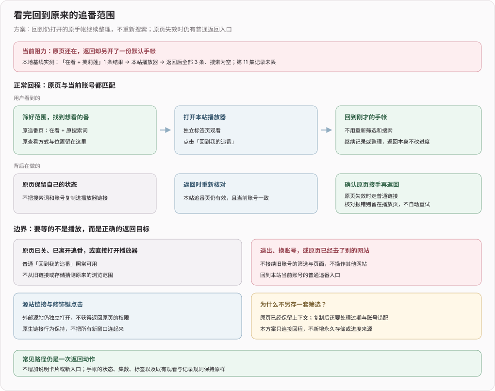

# 024 - 播放后返回追番范围

> 2026-11-17 · 方案随 Draft PR 审核，不授权合并或部署

## 用户目标与已确认阻力

用户在自己的追番里筛好范围、找到作品，打开本站播放器，再返回手帐继续记录或整理，不想重新筛选和搜索

2026-11-16 的 `main` 基线 `5df695b86fa0d25a9c5d84231508163b05443a36` 已通过隔离 CUA 复现：

| 步骤 | 实际看到的结果 |
| --- | --- |
| 我的追番选择「在看」，搜索「芙莉莲」 | 1 条结果，手帐进度为第 11 集 |
| 从已有绑定打开本站播放器 | 播放器在新标签页打开，原追番页仍在 |
| 点「回到我的追番」 | 播放器标签页重新打开手帐，搜索为空，显示全部 3 条 |
| 查看仍打开的原追番页 | 原筛选和搜索仍在，原进度未变 |

这是合成角色上的真实界面观察，不是真人需求投票，也不是数据丢失或播放失败；本次没有播放样片，既有续播验收不重复执行

## 选择的方案

**返回仍打开的原追番页，而不是在播放器里重建另一份手帐页面**

- 仅「我的追番 → 明确的本站播放器」保留受限的同源返回关系
- 点「回到我的追番」时检查原页仍有效、仍是本站追番页面，并实时核对当前账号；确认接手后再返回原页
- 原页保留自己的搜索、筛选、查看方式和滚动位置，不将这些条件复制到播放器
- 原页关闭、已经离开追番、退出或切换账号、直接打开播放器时，走现有普通返回链接
- 当前账号核对遇到网络、超时或 HTTP 错误时，留在播放器并显示原因，不自动重试或通过新开页面重复请求
- 从追番页发起的 Agent 内部观看同样按原页回程；Agent 播放回执和写入流程不变，其他发起页仍走原有返回入口
- 外部源站仍独立打开并保持 `noopener` / `noreferrer`，不因本站回程而放宽所有新窗口
- 修饰键点击等原生链接行为保持原样，普通链接本身始终可用

## 为什么不选另外两种做法

| 做法 | 不采用的原因 |
| --- | --- |
| 把搜索、筛选、账号和滚动位置放进播放器 URL | 复制了本来仍在原页里的状态，增加链接传播、过期恢复与账号错配风险 |
| 新增持久化浏览器存储，在任意手帐页面恢复 | 将一次观看的回程扩展为刷新和跨标签恢复，超出既有账号内存隔离的边界 |

已有 [PR #4](https://github.com/AlcMaple/tools/pull/4) 解决同一网页内跨页返回，本次补齐独立播放器文档的回程，不重做其内存上下文，不修改手帐进度语义，也不依赖待审 [PR #9](https://github.com/AlcMaple/tools/pull/9)

## 最小完整范围

包含卡片和列表中已有绑定、搜索并选择片源的本站观看入口，回程沿用同一个「回到我的追番」动作，不新建导航入口或说明卡片

不做：
- 不新增追番状态、跨端同步字段或桌面端逻辑
- 不把播放器正在播的集数自动写成手帐进度
- 不修改缓冲、预取、换线和媒体请求预算
- 不新增浏览器存储，不通过 URL 保存账号或筛选数据
- 不触及生产账号、真实媒体、付费 AI、合并或部署

## 验收清单

| 场景 | 需要观察的结果 |
| --- | --- |
| 在看 + 搜索词 → 本站播放器 → 返回 | 回到原追番页，原条件、结果与进度仍在 |
| 类型、查看方式、滚动位置已改变 | 返回原页，不重建默认页面；原页本来保存的状态仍在 |
| 卡片与列表；已有绑定与搜索选源 | 回程行为一致，不漏其中一条入口 |
| 播放器内换集或换源 | 回程关系仍有效，不改变手帐进度 |
| 原追番页关闭、离开本站或离开追番 | 使用普通返回链接，不操作不再匹配的页面 |
| 直接打开播放器、没有原页 | 使用普通返回链接 |
| 原页退出或切换账号 | 不返回旧账号的筛选范围，不显示或写入旧账号记录 |
| 外部源站与修饰键点击 | 保持原生独立打开，不获得本站返回权限 |
| 返回动作前后比较手帐 | 状态、集数、标签等字段没有因返回而写入 |
| 窄屏 | 同一回程目标可完成；不将窄视口等同真机 |

回归必须包含行为断言与守卫变异：去掉账号核对、来源限制或返回目标核对后，对应场景应明确失败；源码文字匹配不代替行为证据

## 验证与回滚记录

沿用 2026-11-16 已完成的 19 项自动化浏览器回程、旧导航 4 项、观看入口、链接边界、类型检查与构建；同输入基线失败，账号、来源路径和模式三项单守卫变异失败，恢复后转绿，手帐字段与记录数不变，追番写入、模型调用和外部请求均为零；2026-11-17 接续前核对业务代码及测试文件散列一致，没有将旧测试记成本次重跑

先前因内置浏览器连接故障而未完成的可见回程，2026-11-17 已在新接通的 Chrome 中复验：

| 本次 CUA 场景 | 实际结果 |
| --- | --- |
| 桌面卡片进入本站播放器后返回 | 前台选中原追番标签，播放器标签已从浏览器标签列表消失 |
| 窄屏列表进入本站播放器后返回 | 前台回到同一原追番标签，播放器标签消失，搜索「芙莉莲」、「在看 1」与 `EP 11 / 28` 保留 |
| 窄屏环境口径 | 设置为 390 × 640，页面实测内容视口为 386 × 640；完成后恢复视口设置，不等同手机真机 |

两条路径只打开本地生成片的播放器，不开始播放；既有真实媒体预算限制和暂停续播验收结论不变；窄屏补测按实际离开点对照：播放器已打开、尚未返回时原页滚动为 54 px，返回后仍为 54 px，搜索「芙莉莲」与原标签保持；这是本次样本结果，不外推为所有浏览器和页面长度的验证

未覆盖真实手机、真实媒体及生产环境，也没有把旧内置浏览器的连接故障记为已修复；发布前认证 fetch 已确认 `main` 与开发基线同为 `5df695b86fa0d25a9c5d84231508163b05443a36`，没有新增提交或路径漂移；方案图只说明路径，不替代 CUA

撤销本次聚焦提交即可恢复播放器里的普通链接回程；不涉及数据迁移，也不需要回写追番记录；原始文件散列、补丁、逐条命令输出与副本回滚验证留在仓库外的证据目录
