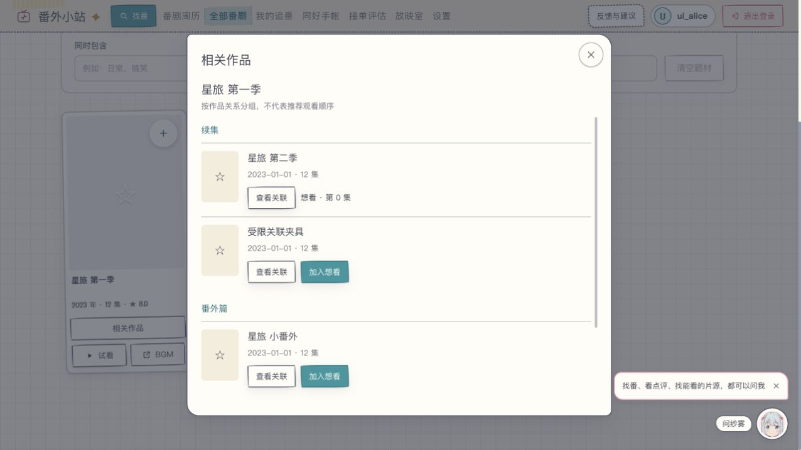
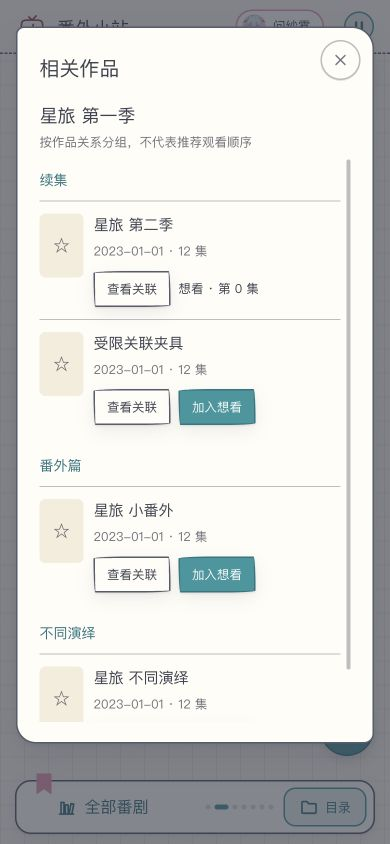

# 相关作品与想看衔接

## 用户目标

从一部番找到前传、续集和番外，辨清不同演绎，再把想看的作品接回现有手帐，不必反复猜番名或在外站来回搜索

在现有全部番剧卡片增加「相关作品」，不是另建推荐首页，也不生成所谓唯一正确的观看顺序。关联弹窗可以逐部查看和返回，关闭后保留原目录的搜索与筛选

## 来源与范围

用户给定的[演示视频](https://www.bilibili.com/video/BV1A94z69E22/)约 04:20 展示故事前后与番外分组，作为产品参考而非复制界面。数据字段依据 [Bangumi Archive](https://github.com/bangumi/Archive)，动画关系语义依据 [bangumi/common](https://github.com/bangumi/common/blob/master/subject_relations.yml)

只展示归档明确记录的直接关联动画，按关系类型分组；不凭名称相似推断，不自动补反向边，不递归抓取整套系列。相同世界观、总集篇、不同演绎各自保留标签，不都当作「下一部」

登录后明确点击「加入想看」才沿用原手帐写入，已收藏作品显示原状态和手帐集数，不改进度、不重复新增。这也遵守 PR9 最新审核意见：手帐是唯一进度来源

## 数据与兼容

关系和作品在同一份临时离线索引中构建，成功后整体原子替换。原有每周导入复用同一个归档，多读取一个成员，不为每次打开弹窗请求外站

支持现有本地作品文件增加 `--relation-file`，以及 `npm run sync:index -- --archive-file <归档路径>` 离线读取已有压缩包。输入归档保留；作品成员精确匹配，避免先找到关系文件就误当作品表。解压非零退出和关系解析失败会终止替换，旧索引保留

旧索引没有关系表时显示资料未就绪，有表但没有记录时显示暂无关联。界面不自动重试。查询端先核对起点和目标的可见性，再截取结果，缺失目标和自关联忽略；最多展示200条并明确标记截断

关联查询不访问外站；加入想看沿用现有新增条目流程，可能触发原有详情补全，本功能没有另外增加补全来源

## 验收

- `npm run test:related-index`：方向、去重、非动画/缺失端点、自关联、畸形行不替换旧库、旧结构兼容、归档成员顺序与输入文件保留
- `npm run test:related-anime`：旧库提示、前传/续集/番外/不同演绎、源与目标可见性、登录范围、无关联和非法编号
- 去掉关联查询可见性守卫后断言应失败，再恢复；技术通过不替代界面体验
- CUA：访客仅看到允许条目；登录合成角色将第二季加入想看；关联前后返回；空分支；关闭保留搜索；键盘焦点循环与390px窄屏

界面截图来自合成夹具，不表示线上已部署。真实归档全量耗时、生产索引重建与真机不由小夹具测试推断

## 发布与回滚

本次没有执行生产索引重建、部署或迁移。合并部署后，已有索引先按旧库兼容展示，管理员可按原流程重建索引或等待既有更新任务读取新代码

回滚代码后原有目录仍忽略新增关系表，不涉及用户手帐数据迁移；副本回滚验证见本轮证据。与 PR11 已合并的实时题材筛选和缓存共存，不覆盖用户后续优化

## 隔离夹具界面

