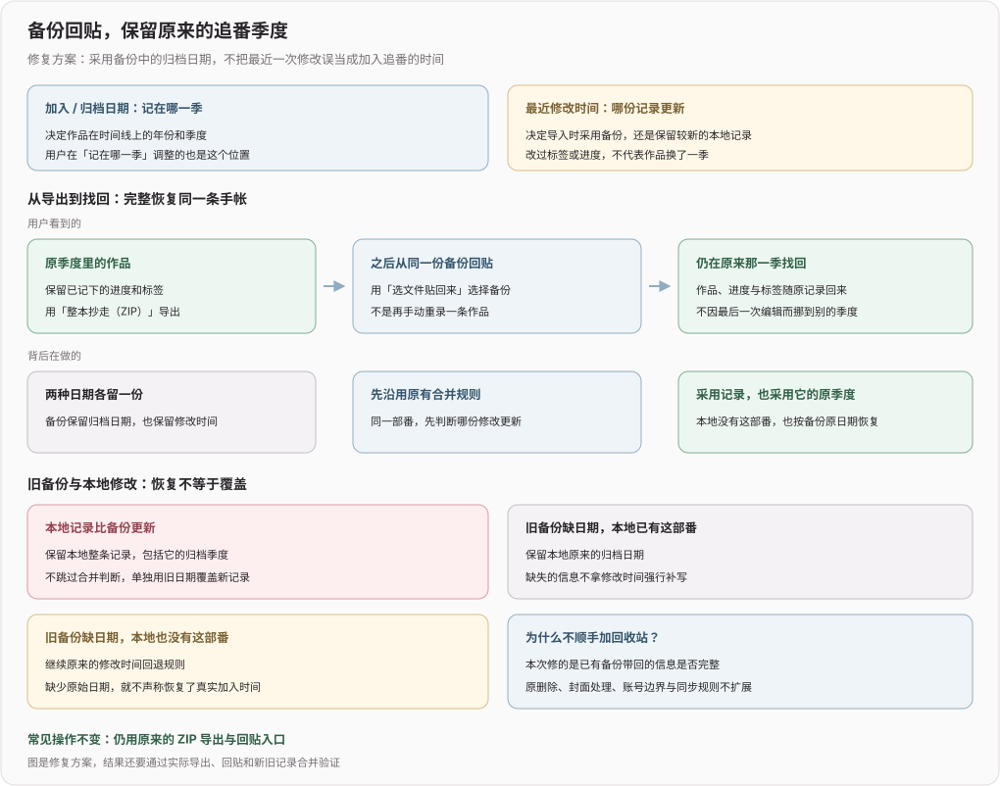

# 025 - 备份恢复归档季度

> 2026-11-17 · 聚焦既有备份的记录完整性，方案随 Draft PR 审核，不扩展删除模型

## 用户目标

把手帐导出再贴回来，作品仍落在自己记下的年份与季度，同时保留进度、标签以及回贴前已有的较新修改

归档日期回答“这部番记在哪一季”，修改时间回答“同一部番哪份记录更新”；两者不同，恢复时不应相互替代

## 当前证据分层

| 证据层级 | 实际结果 | 口径 |
| --- | --- | --- |
| 可见整理体验 | 四号通过现有编辑入口从 10 月归到 7 月，再归回 10 月，搜索、1/12 和双标签保留 | 已有时间线编辑正常，不重做时间线 |
| 同输入技术基线 | 原始导入恢复为 `1794744000000`（11 月），期望为备份中的 `1782907200000`（7 月），日期断言明确失败 | 使用真实导出、删除与导入路由，不只凭源码推断 |
| 修后技术验证 | 相同 ZIP 字节下 6 组通过，包含新增、更新、较新本地保护、旧格式和 16 类缺失 / 非法字段的新增与更新 | 独立移除新增与更新的日期采用逻辑，各自失败，恢复后转绿 |
| 产品 UI 回贴 | 产品实际下载的同一 ZIP 经选文件入口导入，33 → 32 → 33；四号回到 2026 年 7 月，1/12 和双标签保留 | UI ZIP 与 API 测试 ZIP 分开记录；本轮 UI 未单独验证自定义封面 |

原下载事件回执超时后，已通过实际落盘文件、内容与散列确认导出完成，并用同一文件完成产品导入，没有重复发起下载；API 生成的测试 ZIP 不代替产品 UI 下载证据

已确认的删除流程会指明作品名、标签数量和不可恢复提醒，取消保留记录，确认后移除；这不是本次要改的行为，也不将一次合成误删当作新增回收站需求

## 修复范围

仅修正既有备份导入中追番归档日期的恢复，沿用现有条目身份、更新时间合并及账号边界，不新增状态、接口或数据迁移

| 导入场景 | 预期行为 |
| --- | --- |
| 本地没有这部番，备份有合法归档日期 | 按备份中的原日期恢复到原季度，而不是按最近修改时间重新归档 |
| 本地已有这部番，现有合并规则决定采用备份 | 使用同一份备份记录的归档日期，与该记录的其余字段一起恢复 |
| 本地记录较新，旧备份没有赢得合并 | 保留本地记录，包括本地归档日期，不单独拿旧日期覆盖 |
| 旧备份缺少归档日期或日期非法，本地已有记录 | 保留已有归档日期 |
| 旧备份缺少归档日期或日期非法，本地没有记录 | 继续原有按修改时间回退的规则，不凭空推断过去的真实加入时间 |

历史时间线设计曾记录“旧备份缺少创建时间时按修改时间归档”；本次保留这一兼容边界，只处理已经携带归档日期的备份，不把旧格式缺失信息当成可还原的事实

## 为什么不借机重做恢复功能

- 当前缺口是现有备份承载的字段是否被完整采用，不是缺少一个新备份入口
- 即时撤销或回收站会引入留存期限、删除意图、跨端同步与清理规则，当前证据没有支持这些扩展
- 直接在时间线改季度的目标已经完成，不重新设计时间线、首页或笔记
- 封面字节与元数据、点评 / 推荐、跨账号导入、桌面同步以及删除本身沿用现有规则；回归关注它们未被本次日期改动带偏，不顺手扩大实现范围

## 最小完整验收

1. 在隔离副本中给四号设置明确的归档季度，记录作品身份、进度、标签和导出前条目数
2. 走现有产品 ZIP 导出，核对备份中的归档日期与修改时间分别有正确含义
3. 移除四号后导入同一 ZIP，核对它回到原季度，身份、进度、标签与条目数恢复到导出基线，不产生重复记录
4. 用旧备份与较新本地记录发生冲突，确认本地较新修改及其季度保留
5. 用缺少归档日期的旧格式分别验证“本地已有”和“本地没有”的兼容分支
6. 同输入在缺陷基线上明确失败、修后通过；独立移除新增与更新的日期采用逻辑，确认各自行为断言失败，再恢复
7. 技术验证之外完成同目标可见回贴；本地数据快照恢复、HTTP 成功和静态图都不代替产品 UI 验收

测试只使用隔离合成数据，保留角色原始快照；30 条初始种子的零时间不代表真实历史，不用它们推断用户跨季使用情况

## 验证与交付状态

在 `web` 目录运行隔离脚本 `npm run test:backup-created-at`，原基线退出 `1` 并命中 `CREATED_AT_INSERT_RESTORES_ARCHIVE_TIME`；修后退出 `0`，字面结果 `BACKUP_CREATED_AT_CASES=6`；两项独立变异分别命中新增 / 更新日期恢复断言并退出 `1`，恢复后退出 `0`

同一技术 ZIP 的 SHA-256 为 `d9463271b69ef4f31df42292fca671c1eacf5ddede0cc0cc828334633138ca7f`，基线、修后及变异均沿用该字节输入；测试同时核对进度、标签、extra 与 PNG 封面，外部请求与模型调用均为零；未运行未隔离的旧 `test:backup`

同目标 CUA 使用产品导出实际落盘的 ZIP，而非上述 API 样本；通过「选文件贴回来」导入后显示“追番：新贴了 1 部，32 部手帐里的更新、没动”，列表恢复 33 条、在看 1 条，四号保持 1/12、周末再看与接着看，时间线选中 2026 年 7 月；测试副本与 canonical 角色数据分离，不影响原 34 条

技术命令、字面输出、退出状态、两个 ZIP 的来源与散列、可见回贴证据留在仓库外；真实账号、生产导入和本轮 UI 自定义封面回贴不在已验范围，技术封面断言不冒充 UI 封面实测；发布前另核对 main 漂移及归档，不在此声明已创建 PR、合并或部署

## 回滚边界

代码回滚恢复原导入日期选择逻辑，不修改原 ZIP 或重新删除已经恢复的记录；修复前已按错误季度导入的条目不自动追溯重写，仍遵守现有新旧记录合并规则，必要时使用现有季度编辑操作调整

不增加生产迁移，不替用户判断应该保留哪一季；补丁、原始散列及副本回滚结果随发布证据归档
