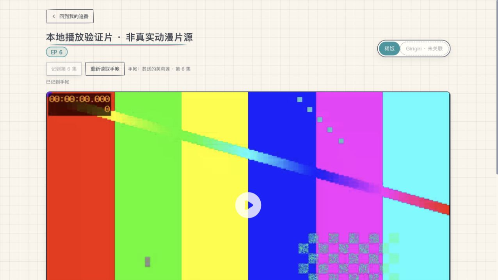
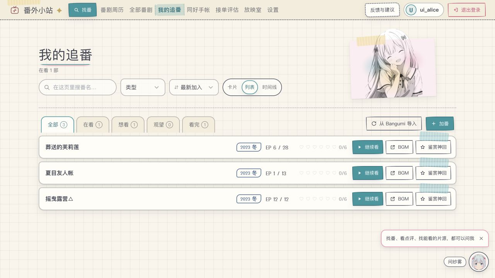

# 播放页明确记进度

## 回应 PR9 方向审核

原方案用本机最近播放集数覆盖「继续看」入口，把误点末集、回看与正常追番混在一起，也形成了与手帐不同的第二份进度

本次移除最近播放集数的记录、读取与入口替代。卡片、列表和继续看仍取原手帐集数；原有每一集的秒点续播保持不变

播放页提供明确的「记到第 N 集」操作，用户自己决定是否记录，不用开始播放或时长阈值判断看完，也不自动记下一集。只向前推进，回看低于手帐集数时按钮禁用；需要往回改仍在原手帐中操作

## 一份进度与并发边界

先读取当前账号拥有的手帐记录和版本，再通过原追番写入接口保存，数据及同步版本在同一事务中更新。不创建缺失条目，不触发元数据回填，不另建进度表或浏览器集数存储

页面账号变化、记录被删除、其他页面已修改手帐时，原确认失效并显示具体原因；用户重新读取后再次决定。只在显式保存时将想看/观望转为在看，不自动标记整部看完

保存成功才显示「已记到手帐」。超时或结果不明不自动重发 PUT，禁用保存并提示重新读取；读写均有10秒截止，离开页面中止本页请求。错误回传既有服务端日志入口，不只留在网页控制台

## 验收

- 固定本地片：原手帐5，打开并播放第28集后返回，手帐和继续看仍是5
- 选择第6集、明确保存后，卡片显示6，列表显示6，继续看提示6
- API：账号归属、版本冲突、总集数上限、已删除不重建、回看不回退、读取不写入
- 故意移除版本守卫后，陈旧写入断言失败，再恢复
- 本次保留原PR历史，以合并最新main的方式修订，不强推、不新建同功能PR

真实片源、真机、音频及真实跨设备操作未验；固定片不是实际动漫观看。首次UI轮触发既有70%预取时，被夹具外部请求守卫拦截；已为生成片补上预取响应夹具，未改变生产预取策略

## 回滚

无数据库结构迁移。回滚到当前main的功能状态即可，已由用户明确保存的手帐记录继续保留；不要为了回滚代码删除用户进度

