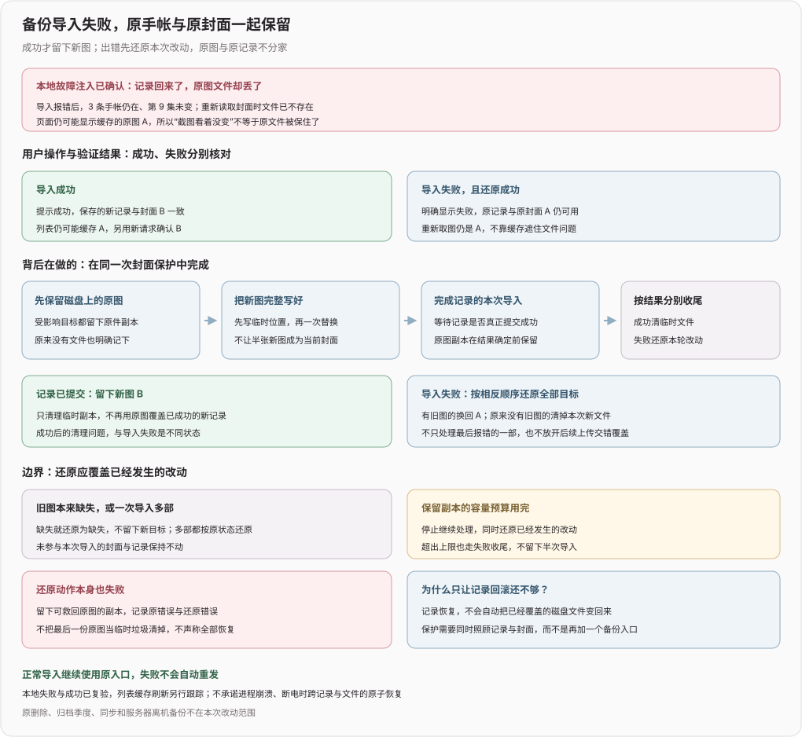

# 026 - 备份导入失败保护

> 2026-11-17 · 只保护导入失败时原记录与原封面的一致性，不扩展备份或删除体系

## 用户目标

把备份贴回手帐时，如果导入报错，原来的进度、标签和自己上传的封面仍可继续使用；导入成功时，则正常采用备份里的新记录与新封面

这里的“采用”指记录与封面字节保存成功；普通列表仍可能显示已有缓存，本次不把文件保护与缓存刷新混成一个修复

这不是新增回收站，也不依赖归档季度修复；本项从新鲜 main 独立验证，不带入未合并的其他备份改动

## 已冻结的基线事实

基线为 `3a5a5ef1368b3e4e462dc39cf3fb6b970008604a`，使用隔离副本中的 3 条手帐、第 9 集和两张可区分的合成封面 A / B，故障只在本地注入，不是生产事故

| 观察点 | 实际结果 |
| --- | --- |
| 导入前 | 原记录和橙色封面 A 可见，第 9 集 |
| 数据库预定故障发生时 | 目标文件已写成新封面 B，字节散列匹配 B |
| 导入结果 | 产品显示服务端内部错误，只提交了一次导入，没有自动重试 |
| 记录回读 | 数据库整行保持原值，3 条手帐与第 9 集不变 |
| 文件及封面接口回读 | 原封面文件缺失，实际封面读取返回 404 |
| 返回页面并刷新 | 页面仍可显示缓存 A，仅凭截图不足以认定原文件保住了 |

已经确认的是“导入失败后记录回滚，原封面字节却丢失”，不是“用户一刷新就必然看到裂图”；可见缓存与持久文件要分别验

## 修复合同

### 正常处理

1. 在现有同一封面锁内处理受影响文件，修改前先在磁盘保留原文件副本，不把整批旧图堆进内存
2. 新图先完整写入临时文件，写完后才原子替换目标，不把半写入文件暴露为当前封面
3. 记录事务成功后保留新记录和新图，只清理本次临时文件；不因成功后的清理问题重新换回旧图
4. 导入过程失败时，按处理的相反顺序恢复所有受影响目标；有旧图的换回旧图，原本没有旧图的清掉本轮新增目标

### 失败边界

| 边界 | 必须保持的行为 |
| --- | --- |
| 多条封面已处理，后面才失败 | 前面处理过的目标也恢复，不只收尾最后报错的条目 |
| 原文件本来就不存在 | 恢复到原来的缺失状态，不留下本轮新图，也不凭空制造原封面 |
| 已处理部分目标后达到快照预算 | 停止后仍补偿已经发生的改动，不把超限当作无需回滚的提前退出 |
| 还原旧图本身失败 | 保留可用于恢复的磁盘副本，同时记录原导入错误和恢复错误，不清掉最后一份原图证据 |
| 记录已经提交成功 | 只清理临时资源，不再执行导入失败时的逆向恢复 |

快照容量继续受现有 200 MiB 上限约束，这是配置预算，不是本轮实测用量；不新增无限留存

## 为什么这样做

- 数据库回滚只保护记录字段，磁盘上的旧封面不随事务自动回来，单纯删除刚写的新文件会把原目标也一起删掉
- 原图与新图使用同一个固定目标时，先保留原文件，再完整写新图并替换，才能区分“原来就没有”与“原图被覆盖”
- 只在统一锁外保存或恢复文件，会与后续上传、删除交错；保护必须覆盖整个保存、替换与收尾过程
- 失败恢复也可能失败，保留副本比无条件清理更重要；日志需要同时留下最初失败原因与恢复失败原因，不要只剩一个笼统错误
- 成功后的清理与事务失败是两种状态，不把已经成功的导入再做一遍逆向覆盖

## 最小完整验收

- 原图 A → 备份 B，在文件已替换而记录尚未成功提交时故障：记录保持原值，封面接口重新读取为 A，MIME 与字节散列一致
- 原来没有旧文件，导入新封面后故障：恢复原状态，没有新增目标或半成品残留
- 多条目标处理中较晚失败：所有受影响旧图恢复，未触及的记录与封面不变
- 对新图部分写入、容量预算及恢复动作等已选边界分别注入失败，确认已发生改动得到对应补偿；不宣称已穷举所有文件系统错误
- 恢复动作自身失败：记录两层原因，并验证可救回原图的副本仍在，不声称已经完整恢复
- 相同输入不注入故障：新图 B 和导入后的记录正常采用，临时文件正常清理
- 基线与修后使用同一受控输入；独立去掉关键保护时行为断言变红，再恢复，不靠源码字符串匹配证明覆盖
- 同目标 CUA 观察失败提示、返回原手帐和封面可用性；另做文件与封面接口回读，避免浏览器缓存掩盖持久数据问题

## 不做项

- 不新增即时撤销、回收站、同步墓碑或自动重试
- 不改变归档日期、更新时间合并规则或账号数据边界
- 不修改服务器离机备份脚本、部署流程和备份快照
- 不触及真实账号、生产封面、真实媒体或付费 AI
- 不将异常补偿描述为跨数据库与文件系统的崩溃原子提交；进程崩溃、断电或硬件故障仍不在本次保证范围

## 验证与交付状态

### 同一故障的前后对照

产品文件选择入口上传相同冻结 ZIP，在相同预定数据库故障位置触发一次失败；原基线数据库整行回滚但封面接口为 404，修后数据库仍保持原行、3 条手帐和第 9 集，原图 A 的磁盘字节与新 HTTP 读取散列均一致，封面接口为 200；解除故障开关没有修复数据，原图恢复来自产品补偿逻辑

之后另做无故障的成功对照，UI 显示“追番：改了 1 部，2 部手帐里的更新、没动”和“封面：贴了 1 张”，磁盘及新 HTTP 请求均为 B；这证明正常导入没有被保护逻辑一并阻断

### 技术矩阵与保护变异

在 `web` 目录执行 `npm run test:backup-cover-rollback`：

| 输入 | 退出状态 | 字面结果 |
| --- | --- | --- |
| 原业务基线 | `1` | `BACKUP_ROLLBACK_RESTORES_ORIGINAL_COVER_FILES` |
| 修后冻结代码 | `0` | `BACKUP_COVER_ROLLBACK_CASES=11` |
| 六项保护分别变异 | 各 `1` | 对应原图恢复、新图清理、封面锁、救援副本保留、预算叠加恢复错误、提交后清理状态的行为断言失败 |
| 恢复全部保护 | `0` | `BACKUP_COVER_ROLLBACK_CASES=11` |

11 项覆盖旧图恢复、新条目无孤儿文件、多条晚失败、旧 / 新目标部分写入失败、无故障成功、并发上传与账号隔离、快照预算、恢复失败保留救援副本、提交后清理失败及预算错误叠加恢复失败；并发上传 C 在回滚结束后执行，最终保留 C 与第 9 集，另一账号独立

核心固定 ZIP 的 SHA-256 为 `0975c0c8bb6aefee6e79ccd9de9c080d5562176044f32b88e8a0f157f700a60a`；多条、容量等场景另有冻结夹具，各场景字节在对应前后验证与变异中保持一致；外部请求和模型调用均为零，变异结束后代码散列恢复

### 可见验收与缓存边界

失败提示、返回原手帐、原记录及封面 A 已通过实际产品 UI 复验，持久文件另用磁盘与封面接口证明；成功后普通列表刷新仍显示缓存 A，既有封面地址固定且响应采用私有缓存，本次未改该链路

开发复验使用独立的新请求确认 B，并直接打开带缓存区分参数的已知封面地址看见 B；这不是“普通列表立即换成 B”的证据，成功后的缓存刷新问题另行记录，不混入本项代码或交付结论

本轮是隔离合成故障注入，不是生产事故；真实账号、生产文件系统及崩溃 / 断电恢复未验；前后命令、输入、散列、退出状态、故障位置与补偿证据留在仓库外，发布前另核对 main 与最终归档，不在此声明 PR 已发布

## 回滚

代码回滚恢复原导入文件处理逻辑，不操作用户原 ZIP，不主动删除已经成功导入的封面；发生恢复异常时保留下来的原图副本属于救援证据，不应随普通临时文件清理一并删除

本地原始散列、补丁与副本回滚演练在发布前归档；不自动对历史失败导入作追溯修改，也不以此授权生产恢复或部署
